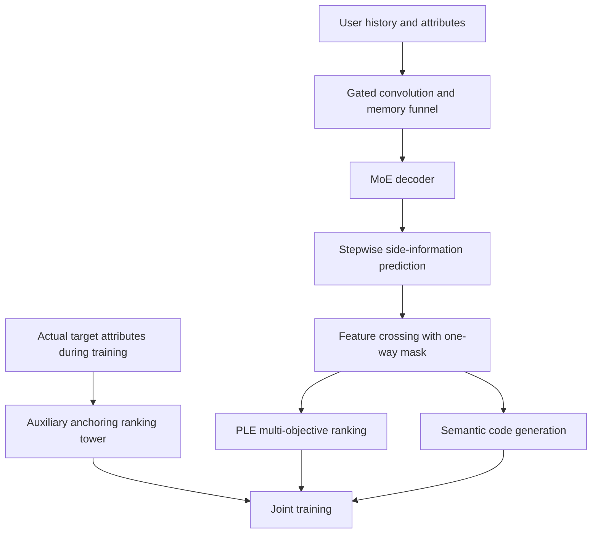
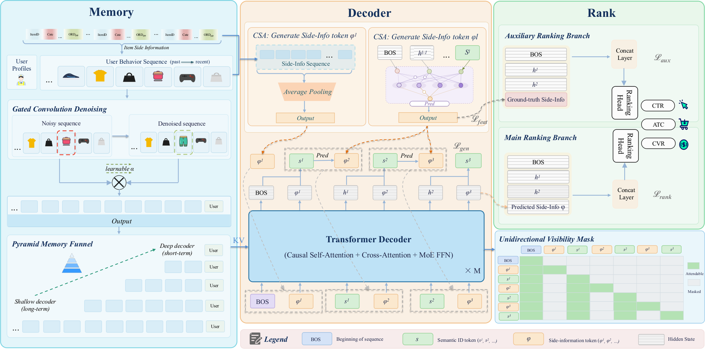

<!-- source-sha256: b059085567b3c0031c44f47853b82ad7403a4196dfd5b577a035b265814f341b -->

[简体中文](README.md) · English

# UniSGR-V2: Stepwise Target-Side Feature Anticipation and Crossing for Generative Recommendation

> **Too costly to reproduce for now; acceptance pending (research material only).** Full-text review and deferral are complete. No downloads, training, executable adapter or Evolve integration. Paper figures below are not local results.

## Paper information

| Field | Details |
| --- | --- |
| Paper | [arXiv 2610.16132](https://arxiv.org/abs/2610.16132); [pinned v1 full text](https://arxiv.org/html/2610.16132v1) |
| Institutions | Alibaba International Digital Commerce Group / Lazada |
| First author affiliation | Alibaba International Digital Commerce Group |
| First public release | 2026-10-12 (arXiv v1) |
| Original source code | Not found. Pinned v1 did not link official code for this method when checked on 2026-10-14; not a claim that none exists anywhere. |
| Adapter | `unisgr-v2` (planned key; not implemented or registered) |
| Local reproduction code | **No algorithm implementation.** [`src/auto_research/reproductions/unisgr_v2/deferred-spec.json`](https://github.com/daiwk/auto-research/blob/main/src/auto_research/reproductions/unisgr_v2/deferred-spec.json) is a deferred-work specification, not runnable code. |
| Acceptance status | Not implemented or GPU-accepted; neither a capability comparison nor an executable Evolve operator. |

## Original paper summary

### Background and main changes

A generative recommender cannot look up a target item's side information before it generates the item, leaving both stepwise generation and final ranking without item attributes. TacGR predicts continuous side features before each semantic code and crosses them inside the decoder. An auxiliary ranking tower prevents collapse of the regression target, and a one-way mask isolates prediction noise.

### Architecture and data flow

Local redraw; see original [Figure 1](https://arxiv.org/html/2610.16132v1#S3.F1). This is not a local implementation diagram.

<!-- paper-figure:start -->
### Key figure from the paper

Figure 1: The left encodes user history and uses gated convolutions and a memory funnel to control noise and long-sequence costs. The middle predicts continuous item-side features step by step. The right shows main ranking, auxiliary anchoring using actual attributes and the one-way visibility mask. These are paper modules, not an implemented local network.

Source: [Pinned v1 Figure 1, `S3.F1`](https://arxiv.org/html/2610.16132v1#S3.F1). See [figure-source.json](figure-source.json) for hashes, dimensions and conversion details for the source asset and local PNG.

> **Figure 1 from the paper:** From the [paper](https://arxiv.org/html/2610.16132v1#S3.F1); copyright belongs to the authors. Click the image for the pinned original asset. The local version is a proportional PNG conversion, not a placeholder, AI redraw or measurement.
<!-- paper-figure:end -->

### Core equations

In Sections 3.3–3.5, crossed predictions serve both generation and ranking:

$$
P(s^l\mid\cdot)=\operatorname{softmax}\!\left(W_l[h^{l-1};\widetilde\phi^{(l)}]\right),\qquad
\mathcal L_{\rm feat}=\sum_{l=2}^L\|\widehat\phi^{(l)}-\phi_\theta(v)\|_2^2.
$$

The auxiliary training tower predicts business labels from actual attributes, anchoring the learnable regression target semantically. Attention visibility is $j=\mathrm{BOS}\lor j=i\lor(j<i\land j\in\mathcal S)$: semantic tokens cannot read prediction tokens, while prediction tokens can read past semantic tokens. This is not equivalent to disabling predicted features, which still condition the generation outputs.

### Offline and online results

Table 1 reports click HR@100 of 0.3148 and payment HR@100 of 0.3857, with click/payment AUC of 0.6786/0.8505. [Section 4.5](https://arxiv.org/html/2610.16132v1#S4.SS5) used 10% of Lazada homepage traffic for 40 days, replacing only UniSGR with TacGR; IPV, orders and GMV increased by 0.79%, 5.55% and 3.09% relative, respectively, with $p<0.05$. These are private author experiments, not local measurements.

## Local reproduction

### Resource cost and deferral

Section 4.1 uses 2.42 billion private examples, 6.46 million users and 7.53 million items; the decoder uses 8 layers, width 512, GQA and SwiGLU-MoE with 64 experts and top-2 routing, and sequence length 1024. The data is unavailable, and full-scale training exceeds one A100/A30 or a Mac. No local runtime was measured and no costly probe was used to estimate it.

Resource estimates assume one A100 **or** A30, or a local Mac, not concurrent multi-machine use. They derive from paper budgets and dependencies, not local measurements. A smaller run is not automatically approved. Reopening requires explicit user direction after costs are clear, with pinned public data and checkpoint revisions.

### Data protocol, code, and results

No algorithm run, local metrics, model download, or passing GPU receipt exists for this batch. The deferred specification records core components and future acceptance requirements, but there is no `paper.yaml`, `adapter.py` or executable entry point. Paper tables, zero-training fixtures and empty registrations cannot be presented as local reproduction.

A future run must isolate train, validation and test and select only on validation. Actual training or inference, cost accounting, multiple seeds, and equal-budget controls must all run. Any advertised CUDA path still needs a sanitized A100/A30 receipt, not this page.

### Scope and conditions for reopening

Status remains **too costly to reproduce for now; acceptance pending**, without blocking other papers or the review. Reopening requires reassessing budget, obtaining resources, and preserving all defining mechanisms. Heuristics and gold-answer access are not cost shortcuts. The [pinned source](https://arxiv.org/html/2610.16132v1) and specification document the review, not completion of an implementation.
