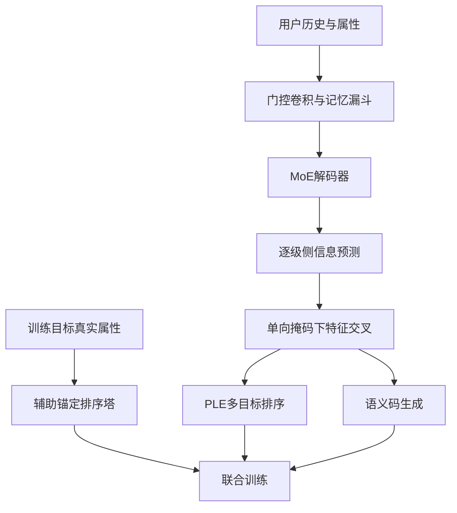
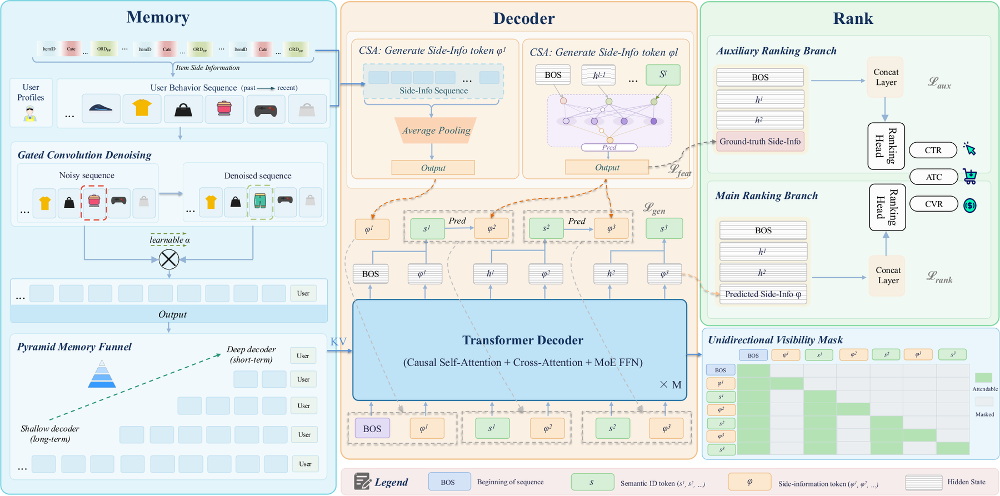

# UniSGR-V2: Stepwise Target-Side Feature Anticipation and Crossing for Generative Recommendation

> **成本过高，暂不复现；待验收（仅研究资料）。** 本轮完成全文审查与延期登记，不下载模型或数据，不训练、不注册可执行Adapter、不接入evolve。下文论文数值不是本地实验结果。

## 论文信息

| 字段 | 内容 |
| --- | --- |
| 论文链接 | [arXiv 2610.16132](https://arxiv.org/abs/2610.16132)；[固定v1全文](https://arxiv.org/html/2610.16132v1) |
| 公司/机构 | Alibaba International Digital Commerce Group / Lazada |
| 一作所属机构 | Alibaba International Digital Commerce Group |
| 首次公开日期 | 2026-10-12（arXiv v1） |
| 原文开源代码 | 未发现：固定v1原文未链接本方法官方源码（2026-10-14核验；不宣称全网不存在） |
| Adapter | `unisgr-v2`（计划键；未实现、未注册） |
| 本地复现代码 | **尚无算法实现**；[`src/auto_research/reproductions/unisgr_v2/deferred-spec.json`](https://github.com/daiwk/auto-research/blob/main/src/auto_research/reproductions/unisgr_v2/deferred-spec.json)仅为延期计划规格，不是运行代码 |
| 当前验收状态 | 未实施；GPU未验收；非能力比较、非可执行evolve算子 |

## 原始论文总结

### 背景与主要改动

生成式推荐尚未生成目标商品时无法读取其侧信息，导致逐级生成与最终排序同时缺少商品属性。TacGR在每级语义码之前预测连续侧信息并做解码器内交叉，同时用辅助排序塔防止回归目标坍塌、单向掩码隔离预测噪声。

### 架构与数据流

本地重绘；原论文结构见[Figure 1](https://arxiv.org/html/2610.16132v1#S3.F1)，不是本地实现图。

<!-- paper-figure:start -->
### 原论文关键图

中文图注（原论文 Figure 1）：左侧编码用户历史并以门控卷积、记忆漏斗控制噪声与长序列成本；中间逐级预测连续商品侧信息；右侧展示主排序、真实属性辅助锚定及单向可见掩码。图中模块是原论文方法，不是本地已实现网络。

来源：[固定v1 Figure 1，`S3.F1`](https://arxiv.org/html/2610.16132v1#S3.F1)；资源与本地PNG的SHA-256、尺寸和处理记录见[figure-source.json](figure-source.json)。

> **原论文 Figure 1（关键图）**：图片来自[原论文](https://arxiv.org/html/2610.16132v1#S3.F1)，版权归原作者所有；点击图片查看固定原始资源。本地仅做保持比例的PNG展示转换，不是占位图、AI重绘或本地测量。
<!-- paper-figure:end -->

### 核心公式

由原文§3.3–3.5，交叉后的预测特征同时服务生成和排序：

$$
P(s^l\mid\cdot)=\operatorname{softmax}\!\left(W_l[h^{l-1};\widetilde\phi^{(l)}]\right),\qquad
\mathcal L_{\rm feat}=\sum_{l=2}^L\|\widehat\phi^{(l)}-\phi_\theta(v)\|_2^2.
$$

训练辅助塔以真实属性预测业务标签，为可学习回归目标提供语义锚定。注意力可见条件为
$j=\mathrm{BOS}\lor j=i\lor(j<i\land j\in\mathcal S)$：语义token不读取预测token，预测token仍可读取历史语义token。不能把“禁用预测特征”当成该掩码；预测特征仍通过输出条件进入生成。

### 论文离线与线上效果

原文Table 1：点击HR@100为0.3148、支付HR@100为0.3857；点击/支付AUC为0.6786/0.8505。[§4.5](https://arxiv.org/html/2610.16132v1#S4.SS5)在Lazada首页10%流量运行40天，仅替换UniSGR为TacGR，IPV、订单、GMV分别相对提升0.79%、5.55%、3.09%，$p<0.05$。这些是作者私有实验，不是本地测量。

## 本地复现

### 资源成本与延期依据

原文§4.1：24.2亿私有样本、646万用户、753万商品；8层512维GQA/SwiGLU-MoE解码器，64专家top-2、序列长度1024。数据不可用，原规模训练超出单卡A100/A30或Mac预算；没有实测本地耗时，不用昂贵试跑估算。

可用资源按一张A100**或**A30、或本地Mac评估，不假设多机同时可用。结论是基于论文预算与资源依赖的估计，不是本轮实测。缩小规模不是自动批准启动；如以后要恢复，须在明确成本后获得用户指定，再固定公开数据和checkpoint版本。

### 数据协议、代码位置与结果

本轮没有运行算法，没有本地指标、模型下载或GPU通过回执。延期规格保留核心组件与未来验收要求，但没有`paper.yaml`、`adapter.py`或可执行入口。不得以论文表格、零训练fixture或空注册伪装本地复现。

未来执行须隔离train/validation/test，选择只看validation；真实训练/推理路径、成本账、多seed与同预算对照均需实际完成。有CUDA宣传路径时仍须A100/A30脱敏回执，不能用本页文档替代。

### 边界与后续触发条件

维持“成本过高，暂不复现；待验收”，不阻塞其他论文交付或审查闭环。重新执行须重新评估预算、取得必要资源，保留全部定义性机制；不能用启发式或gold读取降成本。上述[固定版本来源](https://arxiv.org/html/2610.16132v1)及规格是审查依据，不声明实现完成。
