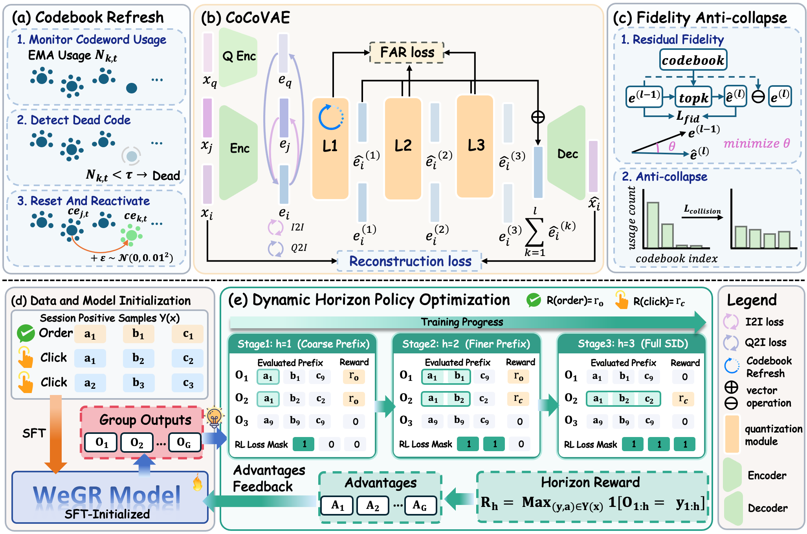
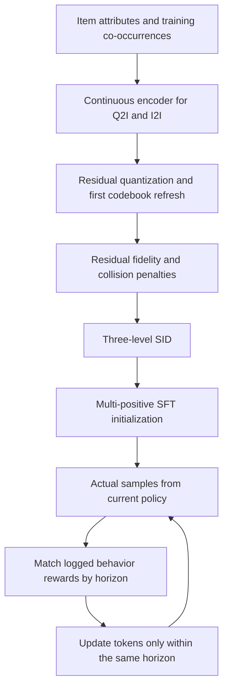

<!-- source-sha256: f8c5d8e9ee1c664597e122a5e7755065082ae8f2d56a094cf576fa43cdebec48 -->

[简体中文](README.md) · English

# WeGR: Collaborative semantic IDs and dynamic-prefix preference optimization for WeChat Search

## Paper information

| Field | Details |
| --- | --- |
| Paper | [arXiv 2610.16979](https://arxiv.org/abs/2610.16979) |
| Institution | WeChat E-commerce Search team |
| First public release | 2026-10-12 (arXiv v1) |
| Original source code | No public author implementation found in the pinned v1 or associated primary sources checked on 2026-10-14. |
| Adapter | `wegr` |
| Local reproduction code | [`src/auto_research/reproductions/wegr/`](https://github.com/daiwk/auto-research/tree/main/src/auto_research/reproductions/wegr/) |
| Evidence level | `core_mechanism`; bounded L2 public-data mechanism diagnostic, not original-scale production reproduction. |

## Original paper summary

### Background and main changes

WeGR jointly optimizes collaborative semantic encoding and preferences in generative retrieval. CoCo-VAE learns continuous representations from query–item and item–item co-occurrence, refreshes underused codes, and uses residual fidelity and cross-example collision losses to improve codebook utilization. DHPO grows short SID prefixes toward complete SIDs, expanding reward matching and policy gradients in tandem; multi-positive SFT stabilizes training under sparse rewards.

### Architecture and data flow

<!-- paper-figure:start -->
### Key figure from the paper



Figure 2 from the v1 [paper](https://arxiv.org/html/2610.16979v1#S3.F2); copyright belongs to the authors. The original shows the production system. The redraw below covers only locally retained mechanisms, not production scale or data.
<!-- paper-figure:end -->

Local redraw, not an original paper figure:



### Core equations

Set $h(n)=\min(1+\lfloor n/\eta\rfloor,L)$. The prefix reward is

$$
R_h(\hat y,x)=\max_j r(a_j)\,\mathbf 1[\hat y_{1:h}=y^j_{1:h}].
$$

Within-group reward normalization gives $A_i$, and $\rho_{i,t}$ is the new-to-old probability ratio per token. Optimization uses the same horizon as the reward:

$$
\mathcal L_{DHPO}=-\frac1{Gh}\sum_i\sum_{t=1}^h
\min(\rho_{i,t}A_i,\operatorname{clip}(\rho_{i,t},1-\epsilon,1+\epsilon)A_i).
$$

CoCo-VAE approximates each residual with cosine-weighted top-k codewords. The collision term is a mean inner product between different samples' soft assignments, not single-example entropy. A codeword-hit EMA determines first-layer refresh, with no refresh for deeper layers. The total objective includes reconstruction, FAR, Q2I and I2I. The policy also adds session-averaged multi-positive NLL. See [Section 3](https://arxiv.org/html/2610.16979v1#S3).

### Offline and online results

In WeChat production, v1.2 shows relative changes of +2.539% orders, +1.508% CTR and +1.381% CVR. This replaces multiple retrieval channels and cannot isolate the effect of a single loss. CPU/GPU resource use decreases by 25.5%/26.1%. These are [Section 4.4](https://arxiv.org/html/2610.16979v1#S4.SS4) reports, not local results.

## Local reproduction

> **Comparison protocol:** SFT and full-SID GRPO+MSFT are compared with dynamic-horizon DHPO+MSFT. The arms share CoCo-VAE and SFT initialization. Three seeds support a bounded mechanism diagnostic, not a stable relative improvement claim.

### Data and cost protocol

Use verified MovieLens-100K, reserving each user's last two positive interactions chronologically for validation and test. Each training session's next three items come from train, with the preceding 24 as observable history. Training does not access validation/test targets. The tokenizer is fitted only on training items. Public full-catalog attributes are available, but full-catalog interactions are not used to fit. Public ratings 4/5 map to rewards 1/2, not actual clicks or orders.

Inputs are public genre and character-level title features. The decoder is a randomly initialized two-layer causal Transformer, with no GPT-2 download. Models, reconstruction, InfoNCE, residual quantization, FAR, sampling, group advantages and gradients actually execute. This retains the mechanism, not production backbone or feature scale. SID collisions remain and ties use fixed item IDs, not gold disambiguation.

The budget is 64 users, 24 tokenizer updates, 32 SFT updates, 6 updates per stage across 3 stages, group=4 and batch=16. The runner rejects unreviewed larger budgets. The first Mac CPU run took about 41 seconds; three-seed CUDA acceptance has a separate source-bound receipt. There is no hours-long extension.

### Running

```bash
PYTHONPATH=src python scripts/run_wegr.py --dataset-dir data --device cpu \
  --seed 42 --output runs/wegr-42
# Use --device cuda in an installed CUDA environment; use a new non-overwritable output directory.
```

The batch entry point is `auto-research reproduce --paper wegr --dataset-dir data --seeds 42,43,44`.

### Results and scope

The [public CUDA mechanism diagnostic](metrics/public-a100-seeds42-44.json) retains all three seeds, failures and negative results. The [GPU receipt](../../gpu-validations/wegr-a100-20261014.json) binds results to the executed code. These tiny-model results cannot establish that DHPO reliably beats SFT or GRPO and are not automatically promoted by Evolve.

| Arm | Test MRR (mean ± sample SD) | Mean test HR@10 |
| --- | ---: | ---: |
| SFT | 0.003976 ± 0.000078 | 0.005291 |
| Full-SID GRPO + MSFT | 0.003956 ± 0.000281 | 0 |
| DHPO + MSFT | 0.003451 ± 0.000475 | 0 |

Each seed has 63 public held-out targets. All three runs took about 16.7 seconds in total. Gradients and the dynamic horizon ran, but scores were low and DHPO did not beat the controls. No failed seeds were dropped and the budget was not expanded to chase a positive result. The unified CLI also ran on the same A100 with seed 42, correctly routing to CUDA and matching the standalone script. Its command is in the receipt.

### Code map

- `model.py`: CoCo-VAE, FAR, first-layer refresh, causal SID policy, horizons/rewards/gradients, and MSFT.
- `experiment.py`: training data construction, actual optimization, matched controls, validation selection, and isolated test reporting.
- `scripts/run_wegr.py`: non-overwritable budget-limited runs.

The paper's private queries, multimodal semantic encoding, daily production data and serving are outside local acceptance. Public-rating retrieval MRR and online order lift are not interchangeable measures.
