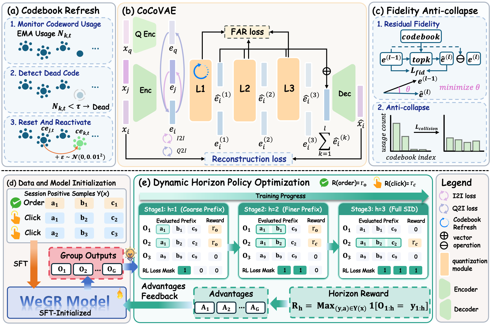
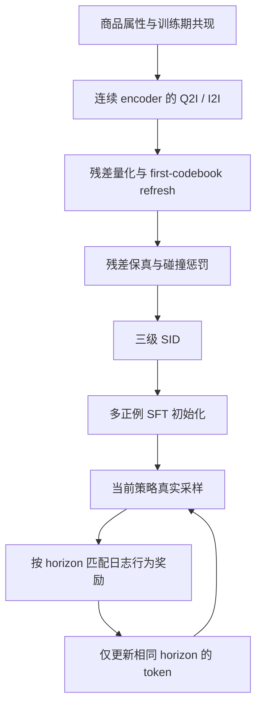

# WeGR：微信搜索的协同语义 ID 与动态前缀偏好优化

## 论文信息

| 项目 | 内容 |
| --- | --- |
| 论文链接 | [arXiv 2610.16979](https://arxiv.org/abs/2610.16979) |
| 公司/机构 | WeChat E-commerce Search team |
| 首次公开日期 | 2026-10-12（arXiv v1） |
| 原文开源代码 | 否：未找到原作者公开实现（固定 v1 与关联原始来源，2026-10-14 核验） |
| Adapter | `wegr` |
| 本地复现代码 | [`src/auto_research/reproductions/wegr/`](https://github.com/daiwk/auto-research/tree/main/src/auto_research/reproductions/wegr/) |
| 实现/评测层级 | `core_mechanism`，L2 公开数据有界机制诊断；不是原规模生产复现 |

## 原始论文总结

### 背景与主要改动

WeGR 联合优化协同语义编码和生成检索偏好：CoCo-VAE 让连续表示学习查询—商品与商品—商品共现，刷新低使用率码字，并用残差保真和跨样本碰撞损失改善码本利用率。DHPO 从短 SID 前缀逐步扩展到完整 SID，同时扩展奖励匹配和策略梯度范围，以多正例 SFT 稳定稀疏奖励下的训练。

### 架构与数据流

<!-- paper-figure:start -->
### 原论文关键图



图片来自[原论文](https://arxiv.org/html/2610.16979v1#S3.F2) v1 图 2，版权归原作者所有。原图描述生产系统；下面重绘仅展示本地保留的算法链路，二者规模与数据不可混同。
<!-- paper-figure:end -->

以下是本地重绘，不是论文原图。



### 核心公式

令 $h(n)=\min(1+\lfloor n/\eta\rfloor,L)$。前缀奖励为

$$
R_h(\hat y,x)=\max_j r(a_j)\,\mathbf 1[\hat y_{1:h}=y^j_{1:h}].
$$

组内奖励标准化得到优势 $A_i$，每 token 的新旧概率比为 $\rho_{i,t}$。优化范围与奖励一致：

$$
\mathcal L_{DHPO}=-\frac1{Gh}\sum_i\sum_{t=1}^h
\min(\rho_{i,t}A_i,\operatorname{clip}(\rho_{i,t},1-\epsilon,1+\epsilon)A_i).
$$

CoCo-VAE 用 top-k 余弦加权码字逼近每级残差；碰撞项为不同样本 soft assignment 内积的均值，而非单个样本熵。首层使用码字命中 EMA 判断刷新，深层不刷新。总目标包含重建、FAR、Q2I 和 I2I；策略另加逐 session 平均的多正例 NLL。公式和顺序依据[原文 §3](https://arxiv.org/html/2610.16979v1#S3)。

### 论文离线与线上效果

微信生产对照中，v1.2 的订单、CTR、CVR 相对变化分别为 +2.539%、+1.508%、+1.381%；对应多检索通道替换方案，不能解释成某个 loss 单独带来的收益。CPU/GPU 资源使用分别下降 25.5%/26.1%。这些是[原文 §4.4](https://arxiv.org/html/2610.16979v1#S4.SS4)报告，不是本地实验。

## 本地复现

> **本地对照口径**：基线为 SFT 和完整 SID GRPO+MSFT，实验组为动态 horizon DHPO+MSFT；共用同一 CoCo-VAE 和 SFT 初始化。三种子只是有界机制诊断，稳定相对提升不适用。

### 数据与成本协议

使用固定校验的 MovieLens-100K，按用户正反馈时间留最后两项为 validation/test。每个训练 session 的未来三项都来自 train，其之前 24 项构成可观测历史；训练代码不接触当前 validation/test 目标。只对训练项拟合 tokenizer；全库公开属性可用，但不把全库交互用于拟合。公开评分 4/5 映射为奖励 1/2，不能称作真实点击/订单。

输入是公开类别和标题字符特征，解码器为随机初始化的两层 causal Transformer，不下载 GPT-2 权重。所有模型、重建、InfoNCE、残差量化、FAR、采样、组优势和梯度都实际运行；这保留算法链路，但不保留原生产 backbone/特征规模。SID 碰撞仍存在，按固定 item-ID 打破同分，不用 gold 消歧。

预算为 64 用户、24 tokenizer 更新、32 SFT 更新、每阶段 6 次更新（3 阶段）、group=4、batch=16。入口拒绝未经审查的大预算。首个 Mac CPU 运行约 41 秒；CUDA 三种子验收由绑定源码的独立回执记录。不扩展为小时级实验。

### 运行方式

```bash
PYTHONPATH=src python scripts/run_wegr.py --dataset-dir data --device cpu \
  --seed 42 --output runs/wegr-42
# 已安装 CUDA 环境可用 --device cuda；每次使用新的不可覆盖输出目录。
```

批量入口为 `auto-research reproduce --paper wegr --dataset-dir data --seeds 42,43,44`。

### 结果与边界

实际三种子结果与失败/负结果保存在 [公开 CUDA 机制诊断](metrics/public-a100-seeds42-44.json)，[GPU 回执](../../gpu-validations/wegr-a100-20261014.json)绑定执行代码。当前小模型结果不能证明 DHPO 稳定优于 SFT/GRPO；不自动接入 evolve 晋级。

| 对照 | Test MRR（均值 ± 样本标准差） | Test HR@10（均值） |
| --- | ---: | ---: |
| SFT | 0.003976 ± 0.000078 | 0.005291 |
| 完整 SID GRPO + MSFT | 0.003956 ± 0.000281 | 0 |
| DHPO + MSFT | 0.003451 ± 0.000475 | 0 |

每种子 63 个公开留出目标，三次运行合计约 16.7 秒。梯度和动态 horizon 确实执行，但效果偏低且 DHPO 未优于对照；不丢弃失败种子，不增加预算去追正结果。统一 CLI 另在同一 A100、seed 42 实跑，显式 CUDA 设备路由正确，与独立脚本结果一致，命令保存在回执中。

### 代码映射

- `model.py`：CoCo-VAE、FAR、首层 refresh、causal SID policy、horizon/reward/梯度与 MSFT。
- `experiment.py`：训练期数据构造、真实优化、配对对照、validation 选择和隔离 test 报告。
- `scripts/run_wegr.py`：不可覆盖的预算受限运行。

原论文私有查询、多模态语义编码、每日生产数据和 serving 不在本地验收范围。不能把公开评分检索 MRR 与线上订单提升混为同一种“提升”。
