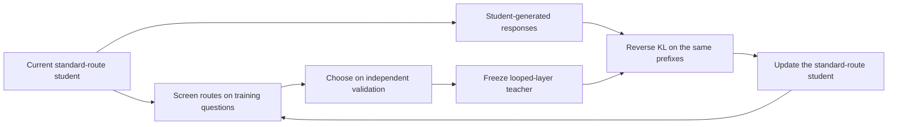
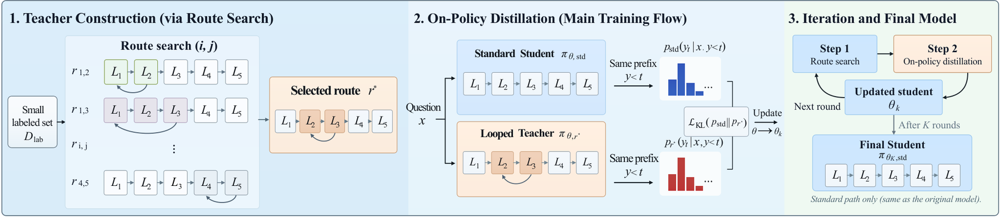

<!-- source-sha256: a486a09457247840bf39f700246432d5ff5d873fe8ffa5177de9d483cfec03a5 -->

[简体中文](README.md) · English

# LoOPSD: On-Policy Self-Distillation with Looped Teachers

> **Too costly to reproduce for now; acceptance pending (research material only).** Full-text review and deferral recording are complete. No model or dataset was downloaded, no training was performed, no executable adapter was registered, and Evolve is not integrated. Paper figures below are not local results.

## Paper information

| Field | Details |
| --- | --- |
| Paper | [arXiv 2610.18162](https://arxiv.org/abs/2610.18162); [pinned v1 full text](https://arxiv.org/html/2610.18162v1) |
| Institutions | Anhui Province Key Laboratory of Digital Security / Token Foundry, Alibaba Group / Independent Researcher |
| First author affiliation | Anhui Province Key Laboratory of Digital Security (PDF first-page affiliation 1; work done during an Alibaba internship) |
| First public release | 2026-10-13 (arXiv v1) |
| Original source code | Not found. The pinned v1 did not link official code for this method when checked on 2026-10-14; this is not a claim that no code exists anywhere. |
| Adapter | `loopsd` (planned key; not implemented or registered) |
| Local reproduction code | **No algorithm implementation.** [`src/auto_research/reproductions/loopsd/deferred-spec.json`](https://github.com/daiwk/auto-research/blob/main/src/auto_research/reproductions/loopsd/deferred-spec.json) is a deferred-work specification, not runnable code. |
| Acceptance status | Not implemented or GPU-accepted; not a capability comparison or executable Evolve operator. |

## Original paper summary

### Background and main changes

On-policy self-distillation needs a more useful teacher than the student, but that does not have to be a bigger external model or additional answer context. LoOPSD searches for contiguous blocks of layers to repeat without changing the weights, uses that route as the teacher for student-generated prefixes, and searches for a new teacher after the student update.

### Architecture and data flow

Local redraw; see original [Figure 2](https://arxiv.org/html/2610.18162v1#S3.F2).

<!-- paper-figure:start -->
### Key figure from the paper

Figure 2: Search on labeled training questions for a contiguous repeated block, freeze the resulting teacher and score the student's own prefixes, then alternate search and distillation. The final student still follows the standard layer order. The figure depicts the paper's algorithm; those training stages were not run here.

Source: [Pinned v1 Figure 2, `S3.F2`](https://arxiv.org/html/2610.18162v1#S3.F2). See [figure-source.json](figure-source.json) for hashes, dimensions, and conversion details for the source asset and local PNG.

> **Figure 2 from the paper:** From the [paper](https://arxiv.org/html/2610.18162v1#S3.F2); copyright belongs to the authors. Click the image for the pinned original asset. The local version is a proportional conversion to PNG, not a placeholder, AI redraw, or local measurement.
<!-- paper-figure:end -->

### Core equations

Section 3 repeats the contiguous interval $i..j$:

$$
r_{i,j}=(1,\ldots,i-1,i,\ldots,j,i,\ldots,j,j+1,\ldots,L).
$$

This adds $j-i+1$ layer executions per token. Teacher $q_k$ fixes the route and weights. The objective is reverse KL on student-generated prefixes:

$$
\mathcal L(\theta)=\mathbb E_{x,y\sim p_{\rm old}}\left[T^{-1}\sum_t
D_{\rm KL}\!\left(p_{\theta,\rm std}(\cdot\mid x,y_{<t})\,\|\,q_k(\cdot\mid x,y_{<t})\right)\right].
$$

Routes are selected on independent validation and used only if better than the standard path. Search may use training references, but distillation does not pass reference answers to the student. Test is not used for route or checkpoint selection.

### Paper results

Table 1 reports GSM8K accuracy for Qwen3-1.7B of 42.30% before training, 78.09% after the first round, and 79.61% at the end, with a fixed budget of 400 thinking and 128 answer tokens under greedy decoding. Different prompt extensions are not the base LoOPSD configuration. The authors do not report a production A/B test; shorter responses do not imply cheaper teacher search or lower total training cost.

## Local reproduction

### Resource cost and deferral

Appendix A screens all contiguous intervals on 128 questions, tests 24 routes on 872 more, and compares the top 5 with the standard route on 100 independent questions. Each round has 200 updates × 12 questions × 4 responses, at most 1024 tokens per response, and at most 10 rounds. Route search and OPD across Qwen3-1.7B/4B/8B with repeated teacher computation are substantial. These are estimates from the configuration and caps, not observed runtimes; no expensive probe was attempted.

The resource estimate assumes one A100 **or** A30, or a local Mac, not concurrent use of multiple machines. It is based on paper budgets and dependencies, not local measurements. A smaller scale is not automatically approved; restarting would require explicit user direction after cost clarification, with pinned public data and checkpoints.

### Data protocol, code, and results

No algorithm run, local metrics, model download, or passing GPU receipt exists for this batch. The deferred specification records the key components and future acceptance criteria, but there is no `paper.yaml`, `adapter.py`, or executable entry point. Paper tables, zero-training fixtures, and empty registration cannot be passed off as a local reproduction.

A future run must isolate train, validation and test, with selection only on validation. Actual training/inference, cost accounting, multiple seeds, and equal-budget controls all need execution. An advertised CUDA path still requires a sanitized A100/A30 receipt, not this page.

### Scope and conditions for reopening

Status remains **too costly to reproduce for now; acceptance pending**. It does not block other paper deliveries or the review. Reopening requires a new budget assessment and the necessary resources while retaining all defining mechanisms. Heuristics or gold-answer access are not cost-saving substitutes. The [pinned source](https://arxiv.org/html/2610.18162v1) and deferred specification support the review decision, not an implementation claim.
