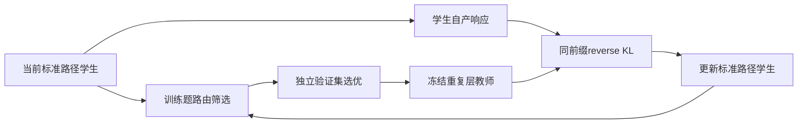
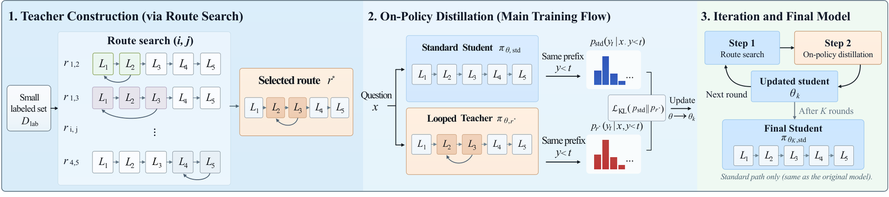

# LoOPSD: On-Policy Self-Distillation with Looped Teachers

> **成本过高，暂不复现；待验收（仅研究资料）。** 本轮完成全文审查与延期登记，不下载模型或数据，不训练、不注册可执行Adapter、不接入evolve。下文论文数值不是本地实验结果。

## 论文信息

| 字段 | 内容 |
| --- | --- |
| 论文链接 | [arXiv 2610.18162](https://arxiv.org/abs/2610.18162)；[固定v1全文](https://arxiv.org/html/2610.18162v1) |
| 公司/机构 | Anhui Province Key Laboratory of Digital Security / Token Foundry, Alibaba Group / Independent Researcher |
| 一作所属机构 | Anhui Province Key Laboratory of Digital Security（PDF首页作者标记1；研究在阿里实习期间完成） |
| 首次公开日期 | 2026-10-13（arXiv v1） |
| 原文开源代码 | 未发现：固定v1原文未链接本方法官方源码（2026-10-14核验；不宣称全网不存在） |
| Adapter | `loopsd`（计划键；未实现、未注册） |
| 本地复现代码 | **尚无算法实现**；[`src/auto_research/reproductions/loopsd/deferred-spec.json`](https://github.com/daiwk/auto-research/blob/main/src/auto_research/reproductions/loopsd/deferred-spec.json)仅为延期计划规格，不是运行代码 |
| 当前验收状态 | 未实施；GPU未验收；非能力比较、非可执行evolve算子 |

## 原始论文总结

### 背景与主要改动

在线自蒸馏需要比学生更有用的教师，但更大外部模型或额外答案上下文并非唯一来源。LoOPSD在不改权重时搜索重复层区间来构造教师，用学生自产前缀进行蒸馏，再从更新后的学生重新搜索下一轮教师。

### 架构与数据流

本地重绘；原图见[Figure 2](https://arxiv.org/html/2610.18162v1#S3.F2)。

<!-- paper-figure:start -->
### 原论文关键图

中文图注（原论文 Figure 2）：先在带标签的训练题上搜索重复层区间，再冻结该教师并评分学生自产的同一前缀，最后交替搜索与蒸馏；最终学生仍走标准层序。图展示原论文算法，本轮没有执行这些训练阶段。

来源：[固定v1 Figure 2，`S3.F2`](https://arxiv.org/html/2610.18162v1#S3.F2)；资源与本地PNG的SHA-256、尺寸和处理记录见[figure-source.json](figure-source.json)。

> **原论文 Figure 2（关键图）**：图片来自[原论文](https://arxiv.org/html/2610.18162v1#S3.F2)，版权归原作者所有；点击图片查看固定原始资源。本地仅做保持比例的PNG展示转换，不是占位图、AI重绘或本地测量。
<!-- paper-figure:end -->

### 核心公式

原文§3，重复连续区间$i..j$构造路由：

$$
r_{i,j}=(1,\ldots,i-1,i,\ldots,j,i,\ldots,j,j+1,\ldots,L).
$$

每token额外执行$j-i+1$层。教师$q_k$固定路由与权重，目标为学生自产前缀上的反向KL：

$$
\mathcal L(\theta)=\mathbb E_{x,y\sim p_{\rm old}}\left[T^{-1}\sum_t
D_{\rm KL}\!\left(p_{\theta,\rm std}(\cdot\mid x,y_{<t})\,\|\,q_k(\cdot\mid x,y_{<t})\right)\right].
$$

路由按独立validation选；只有优于标准路径才继续。搜索可用训练参考答案，蒸馏不给学生参考答案；test不用于选路由或checkpoint。

### 论文离线与线上效果

原文Table 1，Qwen3-1.7B的GSM8K准确率：原模型42.30%，第一轮78.09%，最终79.61%；固定400 thinking加128 answer tokens、greedy。不同提示扩展不是基础LoOPSD同一配置。未报告生产线上A/B；响应变短不等于教师搜索或总训练成本下降。

## 本地复现

### 资源成本与延期依据

原文Appendix A：全部连续层区间先筛128题，24条候选再评872题，前5与标准路径评独立100题；每轮200updates×12题×4responses、每响应上限1024tokens，最多10轮。以Qwen3-1.7B/4B/8B等重复教师计算，完整路线搜索和OPD总预算明显较高；这是上限/配置推断而非实测时长，不做昂贵探针。

可用资源按一张A100**或**A30、或本地Mac评估，不假设多机同时可用。结论是基于论文预算与资源依赖的估计，不是本轮实测。缩小规模不是自动批准启动；如以后要恢复，须在明确成本后获得用户指定，再固定公开数据和checkpoint版本。

### 数据协议、代码位置与结果

本轮没有运行算法，没有本地指标、模型下载或GPU通过回执。延期规格保留核心组件与未来验收要求，但没有`paper.yaml`、`adapter.py`或可执行入口。不得以论文表格、零训练fixture或空注册伪装本地复现。

未来执行须隔离train/validation/test，选择只看validation；真实训练/推理路径、成本账、多seed与同预算对照均需实际完成。有CUDA宣传路径时仍须A100/A30脱敏回执，不能用本页文档替代。

### 边界与后续触发条件

维持“成本过高，暂不复现；待验收”，不阻塞其他论文交付或审查闭环。重新执行须重新评估预算、取得必要资源，保留全部定义性机制；不能用启发式或gold读取降成本。上述[固定版本来源](https://arxiv.org/html/2610.18162v1)及规格是审查依据，不声明实现完成。
