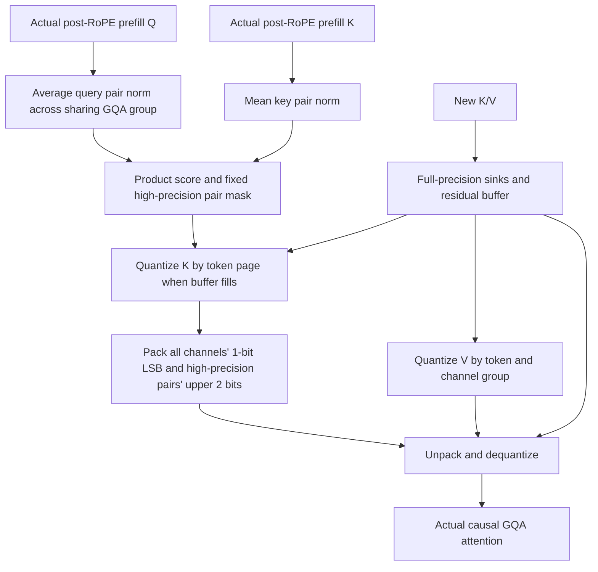
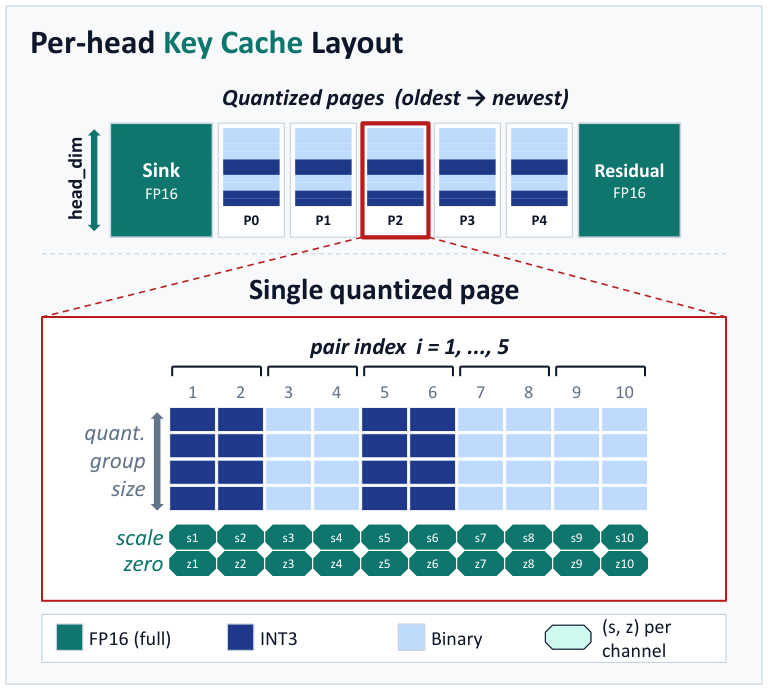

# PN-Mix: Key-Cache Precision Allocation from RoPE Channel-Pair Norms

<!-- source-sha256: 18809a7ee99ac871bd4b7ed25c33bd1075827987b592b616041f4249b7beb18a -->

[简体中文](README.md) · English

> **Executable L1 component diagnostic, not a reproduction of the full paper results.** Implements prefill query–key pair scoring, actual H3/L1 packing, 1-bit midpoint correction, sink and residual caches, and post-quantization attention. The full 8B–32B, 32K-output, multi-task throughput study exceeds the cost budget and was not reproduced (review complete). Not eligible for automatic Evolve promotion.

## Paper information

| Field | Details |
| --- | --- |
| Paper | [arXiv 2610.19605](https://arxiv.org/abs/2610.19605) |
| Affiliation | Seoul National University |
| First public release | 2026-10-14 (arXiv v1) |
| Authors' open-source code | No author PN-Mix code found as of 2026-10-15. Kitty, linked in the paper, is a comparison baseline, not PN-Mix code. |
| Adapter | `pn-mix` |
| Local implementation | [`src/auto_research/reproductions/pn_mix/`](https://github.com/daiwk/auto-research/tree/main/src/auto_research/reproductions/pn_mix/) |

## Original paper summary

### Background and main changes

KV cache grows with token count during long-output decoding. Uniformly lowering K bit width can amplify attention-logit error. PN-Mix does not allocate precision by K magnitude alone. It observes prefill Q and K, groups channels that actually share a RoPE rotation plane, and uses the product of their mean norms as importance. Each KV head selects its high-precision pairs once. Later quantization pages reuse the choice without looking at future decoding states.

The local implementation distinguishes adjacent channel pairs in the paper's formulas and split-half pairs in Hugging Face Llama/SmolLM2. They describe the same kind of rotation plane. Adjacent stored dimensions must not be mistaken for Llama RoPE pairs.



<!-- paper-figure:start -->
### Key figure from the paper

[](https://arxiv.org/html/2610.19605v1/pnmix_top_final.png)

> **Figure 1 from the paper:** Overall method design and key components. The figure comes from the [original paper](https://arxiv.org/abs/2610.19605), © the original authors. Select the image to see the source.
<!-- paper-figure:end -->

### Core equations

For query heads sharing KV head $h$, prefill scoring follows Eq. 6:

$$
\sigma_{h,i}=\frac{1}{|g^{-1}(h)|}\sum_{h'\in g^{-1}(h)}
\mathbb E_t\|q_{h',t,i}\|_2\;\mathbb E_s\|k_{h,s,i}\|_2.
$$

Select $\lfloor r d/2\rfloor$ complete pairs, using higher precision for both dimensions. Ordinary $b$-bit groups use asymmetric min–max quantization from Eq. 2:

$$
s=\frac{x_{\max}-x_{\min}}{2^b-1},\quad z=x_{\min},\quad
q=\operatorname{clip}\left(\operatorname{round}\frac{x-z}{s},0,2^b-1\right),\quad \hat x=sq+z.
$$

For 1-bit groups, Eq. 7 moves the two reconstruction values to the bin midpoints:

$$
s=\frac{x_{\max}-x_{\min}}{2},\qquad z=\frac{3x_{\min}+x_{\max}}4.
$$

The **1-bit correction does not store another residual code**. It differs from the **FP16 residual buffer** of unquantized tokens. Constant groups explicitly store zero scale and the original offset to avoid division by zero. K groups each channel along the token axis; V groups channels within each token. They are not interchangeable.

H3/L1 packing follows Appendix G. Every K channel stores its LSB at 8 tokens per byte; high-precision channels store the upper 2 bits separately at 4 tokens per byte. The pair mask is packed into bits and stored once, not repeated as a byte index per page. `storage()` counts short-sequence, sink/residual, scale/offset, and byte-alignment overhead. A short local sequence cannot be described as using “2.26 bits” without qualification.

### Reported offline and online results

Table 2 reports Qwen3-8B mean task scores of 77.85 for FP16 and 77.21 for PN-Mix(1); Llama3.1-8B scores are 54.04 and 53.08. These are author means over five reasoning/code runs, not local results or gains on every task. The main configuration is $b_H=3,b_L=1,r=0.5,G=N=128,N_s=32$. The theoretical mean K storage of approximately 2.26 bits at 32K quantized tokens excludes the residual buffer.

Efficiency runs fit larger batches on one A100-40GB. Appendix E explicitly says **FP16 is faster at the same batch size when FP16 fits**. The 2.37× number compares maximum throughput at each method's maximum feasible batch under memory limits, not a same-batch speedup. The local work did not reproduce this throughput result. No industrial online A/B test was reported.

Algorithm sources: [§5](https://arxiv.org/html/2610.19605v1#S5), [Appendix G](https://arxiv.org/html/2610.19605v1#A7), and [Appendix H](https://arxiv.org/html/2610.19605v1#A8).

## Local reproduction

> **Local comparison:** Same Q/K/V, causal positions, and input network. The baseline retains the full original-precision cache and the experimental arm runs the packed PN-Mix cache. Compare attention KL, output MSE/cosine, persistent cache bytes, and sink error. This tests component fidelity and perturbation, not task improvement or a comparison with DIN or full language tasks.

```bash
# No download or training: fixed public Hamlet text and a random one-layer RoPE/GQA network.
PYTHONPATH=src python scripts/run_pn_mix.py --device cpu --seed 42 \
  --output runs/pn-mix/cpu-seed42.json

# Real NVIDIA GPU path: FP16 inputs, metadata, sink, and residual.
PYTHONPATH=src python scripts/run_pn_mix.py --device cuda --seed 42 \
  --output runs/pn-mix/cuda-seed42.json

# Cached public Llama/SmolLM2 checkpoint; offline directory only, no download.
PYTHONPATH=src python scripts/run_pn_mix.py --device cuda --pair-layout split \
  --checkpoint /path/to/existing-public-checkpoint \
  --checkpoint-id HuggingFaceTB/SmolLM2-135M-Instruct \
  --checkpoint-revision <40-hex-public-revision> \
  --output runs/pn-mix/checkpoint-component.json
```

`run_diagnostic()` defaults to 384 prefill + 64 decode with 66 actual attention calls. Total component input is limited to 2048 tokens. Unavailable CUDA errors rather than falling back to CPU. Random initialization explicitly bounds the input network; **no pretrained large model is loaded** on this path. The optional offline checkpoint path extracts actual first-layer input normalization, Q/K/V projections, and model-native RoPE. It conservatively estimates model size from config before loading and rejects more than 500M parameters. The caller declares the pinned public revision, which is recorded; an offline run does not verify revision/weight identity online. This is not a full generation benchmark.

`auto-research reproduce --paper pn-mix --device ...` follows runtime device settings. `auto` uses CUDA when available and otherwise CPU; it does not auto-select unsupported MPS on Mac. Explicit MPS requests are rejected early. The standalone runner rejects existing output before starting, and preserves history through an exclusive writer lock and exclusive file creation.

### Measured local results

CPU seed 42 results are in [`metrics/component-cpu-seed42.json`](metrics/component-cpu-seed42.json):

| Metric | Measured |
| --- | ---: |
| Quantized tokens | 384 |
| Attention KL | 0.01147833 |
| Attention output MSE | 0.00401362 |
| Attention output cosine | 0.95004052 |
| Maximum sink-key error | 0 |
| Saliency calculations | 1 |
| Pair mask unchanged after decoding | Yes |
| Total persistent K/V cache bytes | 52740 |

These are actual quantization perturbations, not task accuracy. The CPU run uses float32 inputs and metadata, not the paper's FP16 storage. As residual tokens are quantized later, early online attention and replay from the final cache can differ. That difference is not assumed to be zero.

A100 runs with FP16 inputs/metadata completed seeds 42/43/44. Each of the three initializations made 66 actual cache attention calls. KL was 0.0114783 / 0.0103835 / 0.0104913, and output MSE was 0.0042563 / 0.0031485 / 0.0042349. All maximum sink errors were 0, with the pair mask calculated once at prefill. Actual component time was about 0.7–0.9 seconds per run, excluding startup.

See the [three-seed A100 results](metrics/component-a100-seeds42-44.json) and [sanitized source-bound receipt](../../gpu-validations/pn-mix-a100-20261015.json). The unified CUDA CLI also ran seed 42 and matched the standalone script numerically. The seeds represent three random initializations of quantization inputs, **not a pretrained LLM language-task comparison**. The 32,516 persistent bytes exclude temporary dense dequantization and do not establish end-to-end memory gains.

No reusable pretrained checkpoint was available. The GPU receipt covers only the default network and cache component. The optional `--checkpoint` extraction interface **was not accepted end to end on real weights** and does not validate full Llama/SmolLM2 integration. Before using it, independently check the installed Transformers version and the actual model's RoPE layout.

### API and code mapping

| Entry point | Actual role |
| --- | --- |
| `pair_norm_scores(Q, K, pair_layout=...)` | Eq. 6 prefill/GQA/query–key scoring |
| `PNMixCache.from_prefill(Q, K, V, config)` | Select and pack mask once and populate real cache |
| `cache.append(K_new, V_new)` | Sinks, residual, and online page quantization; no decoding-Q reselection |
| `cache.attention(Q_new)` | Actual dequantized cache consumed by causal GQA attention |
| `cache.storage()` | Actual persistent byte count, excluding temporary dequantized cache |
| `experiment.checkpoint_states(...)` | Extract actual first-layer post-RoPE inputs from cached Llama/SmolLM2 |

To connect a different model, supply actual **post-RoPE** Q/K with shape `[batch, heads, tokens, head_dim]`, with query heads ordered by model GQA sharing groups. A cache corresponds to one layer. The caller handles padding and batch semantics separately; padding tokens are not valid prefill.

## Reproduction limits and cost conclusion

- Precision allocation, bit packing, cache partitioning, and attention consumption actually execute. Reconstruction-error labels do not replace attention.
- The PyTorch reference creates a dense dequantization buffer before attention. It does not implement the paper's in-register fused Triton kernel. Persistent cache compression does not establish end-to-end peak-memory or throughput gains.
- The default input network is untrained and supports no language-capability claim. A single-seed component result is not stable-improvement evidence.
- Full 8B–32B multi-task experiments, repeated responses up to 32K output, and serving-batch sweeps **exceed the budget and were not reproduced (review complete)**. No large weights, full study, or automatic retries; review progress is not blocked.
- `evolve_operators=[]`. The controller does not treat this diagnostic as automatic capability-improvement evidence.
