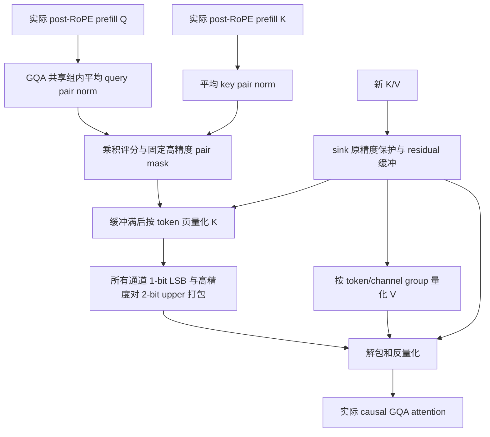
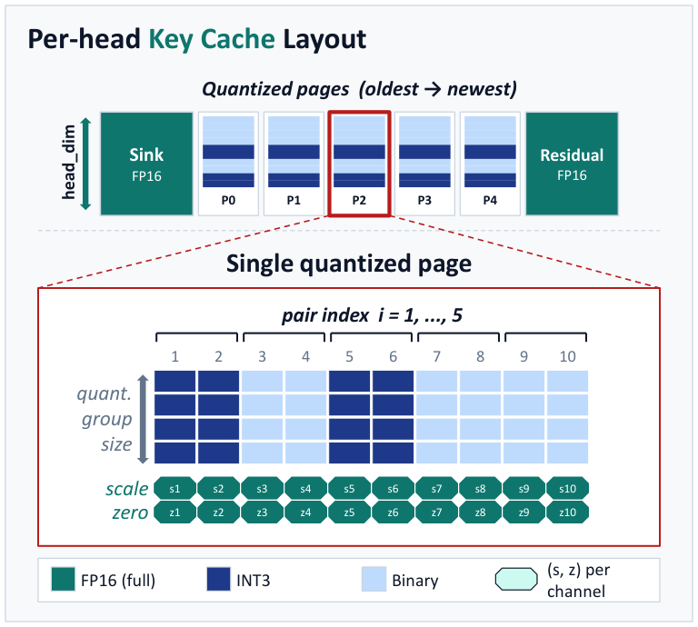

# PN-Mix：由 RoPE 通道对范数分配精度的 Key Cache

> **本地是 L1 可执行组件诊断，不是完整论文效果复现。** 已实现 prefill 的 query–key 通道对评分、H3/L1 真正打包、1-bit 中点校正、sink/residual 缓存与量化后 attention 消费。完整 8B–32B、32K 输出、多任务与吞吐研究为**成本过高，不复现（审查 DONE）**；不进入自动 Evolve 晋级。

## 论文信息

| 项目 | 内容 |
| --- | --- |
| 论文链接 | [arXiv 2610.19605](https://arxiv.org/abs/2610.19605) |
| 公司/机构 | Seoul National University |
| 首次公开日期 | 2026-10-14（arXiv v1） |
| 原文开源代码 | 否：截至 2026-10-15 未发现 PN-Mix 原作者公开代码；正文链接的 Kitty 是对照基线，不是 PN-Mix 代码 |
| Adapter | `pn-mix` |
| 本地复现代码 | [`src/auto_research/reproductions/pn_mix/`](https://github.com/daiwk/auto-research/tree/main/src/auto_research/reproductions/pn_mix/) |

## 原始论文总结

### 背景与主要改动

长输出解码的 KV cache 随 token 数增长；一律把 K 降到低位宽，会放大 attention logit 的偏差。PN-Mix 的精度分配不是仅按 K 的幅度排序：它同时观察 prefill 的 Q 和 K，把实际 RoPE 旋转耦合的两个通道作为整体，以两侧平均范数乘积预测重要性。每个 KV head 选择一次高精度通道对，后续所有量化页复用这份选择，不读取未来解码状态重选。

本地实现区分两种实际布局：论文公式的相邻通道对，以及 Hugging Face Llama/SmolLM2 的前后半维配对。它们是同一种旋转平面，不应把存储中相邻的两维错误地当成 Llama 的 RoPE pair。



<!-- paper-figure:start -->
### 原论文关键图

[](https://arxiv.org/html/2610.19605v1/pnmix_top_final.png)

> **原论文 Figure 1（关键图）**：展示原论文方法的总体设计和关键组成。图片来自[原论文](https://arxiv.org/abs/2610.19605)，版权归原作者所有；点击图片可查看来源。
<!-- paper-figure:end -->

### 核心公式

对共享 KV head $h$ 的 query heads，prefill 评分对应原文 Eq.6：

$$
\sigma_{h,i}=\frac{1}{|g^{-1}(h)|}\sum_{h'\in g^{-1}(h)}
\mathbb E_t\|q_{h',t,i}\|_2\;\mathbb E_s\|k_{h,s,i}\|_2.
$$

以 $\lfloor r d/2\rfloor$ 选择完整通道对，两维共同使用高位宽。对普通 $b$-bit 分组使用原文 Eq.2 的 asymmetric min–max 量化：

$$
s=\frac{x_{\max}-x_{\min}}{2^b-1},\quad z=x_{\min},\quad
q=\operatorname{clip}\left(\operatorname{round}\frac{x-z}{s},0,2^b-1\right),\quad \hat x=sq+z.
$$

对于 1-bit 组，Eq.7 把两个重构值移向 bin 中点：

$$
s=\frac{x_{\max}-x_{\min}}{2},\qquad z=\frac{3x_{\min}+x_{\max}}4.
$$

这里的 **1-bit correction 不是另存一份残差码**。它与保留未量化 token 的 **FP16 residual buffer** 是两件事。常数组明确使用零 scale、原值 offset，避免除零。K 按 token 方向的每通道分组，V 按每 token 的通道组分组，二者不可互换。

H3/L1 的打包对应附录 G：每个 K 通道保存 LSB（8 个 token/byte），仅高精度通道额外保存高 2 bit（4 个 token/byte）。pair mask 只存一次且真正打成位，不是每页重复一个字节索引。短序列、sink/residual、scale/offset、字节对齐的真实开销均由 `storage()` 计入；不能把本地短序列笼统写成“2.26 bit”。

### 论文离线与线上效果

原文 Table 2 的 Qwen3-8B 平均任务分数，FP16 为 77.85，PN-Mix(1) 为 77.21；Llama3.1-8B 为 54.04 与 53.08。这是作者五次运行的 reasoning/code 任务均值，不是本地结果，也不表示所有任务都提升。主配置为 $b_H=3,b_L=1,r=0.5,G=N=128,N_s=32$；32K 量化 token 的理论平均 K 存储约 2.26 bit，排除了 residual buffer。

效率实验在一张 A100-40GB 上扩大可容纳的 batch。原文附录 E 同时明确：**相同 batch 且 FP16 能放下时，FP16 更快**；2.37 倍是显存限制下各自最大可行 batch 的最大吞吐比较，不是同 batch 加速。本地未重现该吞吐结论。论文未报告工业线上 A/B。

算法来源：[§5](https://arxiv.org/html/2610.19605v1#S5)、[附录 G](https://arxiv.org/html/2610.19605v1#A7)、[附录 H](https://arxiv.org/html/2610.19605v1#A8)。

## 本地复现

> **本地对照口径**：基线与实验组使用同一 Q/K/V、因果位置与输入网络；基线保留原精度完整缓存，实验组运行 PN-Mix 打包缓存，比较 attention KL、output MSE/cosine、持久缓存字节和 sink 误差。此处是组件保真与误差诊断，相对任务提升百分比不适用，不与 DIN 或完整语言任务成绩混比。

```bash
# 无下载、无训练；固定公开 Hamlet 文本，随机初始化单层 RoPE/GQA 网络
PYTHONPATH=src python scripts/run_pn_mix.py --device cpu --seed 42 \
  --output runs/pn-mix/cpu-seed42.json

# 真实 NVIDIA GPU 路径：输入/metadata/sink/residual 为 FP16
PYTHONPATH=src python scripts/run_pn_mix.py --device cuda --seed 42 \
  --output runs/pn-mix/cuda-seed42.json

# 使用已缓存的公开 Llama/SmolLM2 checkpoint；只接受离线目录，不下载
PYTHONPATH=src python scripts/run_pn_mix.py --device cuda --pair-layout split \
  --checkpoint /path/to/existing-public-checkpoint \
  --checkpoint-id HuggingFaceTB/SmolLM2-135M-Instruct \
  --checkpoint-revision <40-hex-public-revision> \
  --output runs/pn-mix/checkpoint-component.json
```

`run_diagnostic()` 默认 384 prefill + 64 decode，实际 66 次 attention 调用；代码限制整个组件输入不超过 2048 token，CUDA 不可用时拒绝执行而不是静默回落 CPU。随机初始化路径是明确的网络输入边界，**不是加载了预训练大模型**。可选离线 checkpoint 提取实际第一层 input norm→Q/K/V projection→模型自身 RoPE；在加载权重前先按 config 保守估算，超过 500M 参数即拒绝。固定公开 revision 由调用方声明并记录，离线运行不冒充已联网验证 revision/权重对应关系。它也不是完整生成基准。

统一 `auto-research reproduce --paper pn-mix --device ...` 路径遵守运行时设备设置：`auto` 在 CUDA 可用时用 CUDA，其余用 CPU（Mac 不自动选择不支持的 MPS）；显式请求 MPS 会提前拒绝。独立脚本的已有输出会在实验运行前拒绝覆盖，并通过独占 writer lock 和排他创建保留历史证据。

### 本地已测结果

CPU seed42 的实际结果保存在 [`metrics/component-cpu-seed42.json`](metrics/component-cpu-seed42.json)：

| 指标 | 实测 |
| --- | ---: |
| quantized tokens | 384 |
| attention KL | 0.01147833 |
| attention output MSE | 0.00401362 |
| attention output cosine | 0.95004052 |
| sink key 最大误差 | 0 |
| saliency 计算次数 | 1 |
| decode 后 pair mask 不变 | 是 |
| 持久 K/V 缓存总字节 | 52740 |

这些数值表示量化产生的实际扰动，不是模型任务准确率。CPU 此次使用 float32 输入/metadata，不能冒充论文 FP16 存储结果。随着 residual 在后续步骤被量化，早期在线 attention 与最终缓存重新回放可以不同，不能把该差异错误断言为零。

A100 的 FP16 输入/metadata 已完成 seed 42/43/44，三个网络初始化各实际执行 66 次缓存 attention：KL 为 0.0114783 / 0.0103835 / 0.0104913，output MSE 为 0.0042563 / 0.0031485 / 0.0042349；sink 最大误差均为 0，pair mask 始终只在 prefill 计算一次。每次实际组件约 0.7–0.9 秒，不含进程启动。

完整记录见 [A100 三种子组件结果](metrics/component-a100-seeds42-44.json)及[绑定源码的脱敏回执](../../gpu-validations/pn-mix-a100-20261015.json)。统一 `auto-research reproduce` 的 CUDA 入口也实际运行 seed42，数值与独立脚本一致。这里三 seed 只是三个随机初始化的量化输入，**不是预训练 LLM 的语言任务比较**。持久缓存 32,516 字节不包含 dense 反量化临时空间，不能据此宣称端到端显存收益。

本轮没有可复用的预训练权重缓存，故 GPU 回执仅覆盖默认网络与缓存组件；可选 `--checkpoint` 提取接口**未做真实权重端到端验收**，不在本轮通过范围内，也不代表已验证完整 Llama/SmolLM2 适配。使用该实验性接口前仍需单独核对所安装 Transformers 版本和实际模型的 RoPE 布局。

### API 与代码映射

| 入口 | 实际职责 |
| --- | --- |
| `pair_norm_scores(Q, K, pair_layout=...)` | 原文 Eq.6，prefill/GQA/query–key 评分 |
| `PNMixCache.from_prefill(Q, K, V, config)` | 选择一次并打包 mask，灌入真实缓存 |
| `cache.append(K_new, V_new)` | sink、residual 与在线页量化，不读取解码 Q 重选 |
| `cache.attention(Q_new)` | 实际反量化缓存进入 causal GQA attention |
| `cache.storage()` | 实际持久字节计数，不包含反量化临时缓存 |
| `experiment.checkpoint_states(...)` | 已缓存 Llama/SmolLM2 第一层真实 post-RoPE 输入提取 |

直接接其他模型时必须提供实际 **post-RoPE** Q/K，形状 `[batch, heads, tokens, head_dim]`；query heads 必须按模型 GQA 共享组顺序排列。一个 cache 对象只对应一层，padding/batch 的语义由调用方分开处理，不能把补齐 token 当成有效 prefill。

## 复现边界与成本结论

- 算法分配、bit packing、缓存分区与 attention 消费真实执行；不使用重构误差标签代替 attention。
- 当前是 PyTorch 参考路径，会在 attention 前建立 dense 反量化临时缓存；未实现原文寄存器内融合 Triton kernel。因此持久 cache 的压缩不等于端到端峰值显存或吞吐改善。
- 默认输入网络未预训练，没有语言任务能力声明；单 seed 组件结果也不构成稳定提升证据。
- 完整 8B–32B、多任务、多次响应、最长 32K 输出、服务 batch sweep 明确**成本过高，不复现（审查 DONE）**。不下载大权重、不运行完整研究、不自动重试，不阻塞审查水位。
- `evolve_operators=[]`，此诊断不被控制器自动当作能力提升证据。
