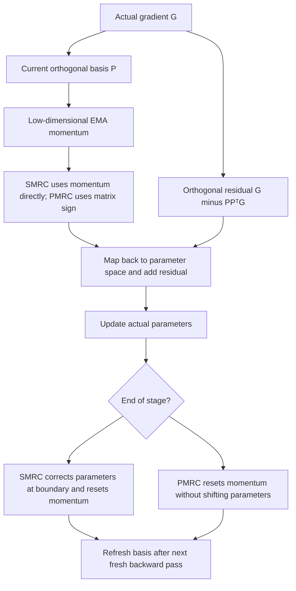
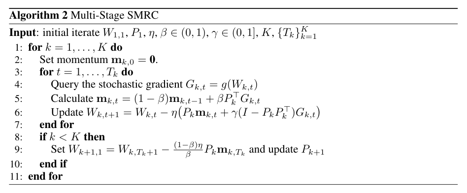

# SMRC / PMRC: Low-Memory Optimizers That Retain Out-of-Subspace Gradients

<!-- source-sha256: 024202e423dbb45b46db139f52a5b695a110cacd44832d485a961b77622d8800 -->

[简体中文](README.md) · English

> **Fidelity: core mechanism; L1 component diagnostic.** This delivers PyTorch optimizers that update actual parameters and a bounded validation entry point. It does not reproduce full LLM pretraining, SFT, or the paper's large-scale effects. **The full experiments exceed the cost budget and were not reproduced (review complete).**

## Paper information

| Field | Details |
| --- | --- |
| Paper | [arXiv 2610.19844](https://arxiv.org/abs/2610.19844) |
| Affiliations | Nanjing University / Alibaba Token Hub |
| First public release | 2026-10-14 (arXiv v1) |
| Authors' open-source code | No dedicated author repository for SMRC/PMRC was found. Dependencies such as Minimalist_LLM_Pretraining do not establish a code release for the new method (v1 checked 2026-10-15). |
| Adapter | `smrc-pmrc` |
| Local implementation | [`src/auto_research/reproductions/smrc_pmrc/`](https://github.com/daiwk/auto-research/tree/main/src/auto_research/reproductions/smrc_pmrc/) |

The pinned source is the [v1 main text and appendices](https://arxiv.org/html/2610.19844v1). The authors use [Minimalist_LLM_Pretraining](https://github.com/OptimAI-Lab/Minimalist_LLM_Pretraining) as a base for their experiments. The local code implements the equations independently; it does not copy or stand in for the unavailable dedicated implementation.

## Original paper summary

### Background and main changes

Low-rank optimizers save persistent state by retaining only projected momentum. But noise can dominate a gradient's leading singular directions, and discarding everything outside the subspace can lose useful descent directions. The paper uses low-rank momentum for in-subspace updates and the original gradient's orthogonal residual for the remaining directions, without storing a full-size residual state. SMRC uses EMA momentum; PMRC takes the matrix sign of low-dimensional momentum. They are not interchangeable instances of projected SGD.



<!-- paper-figure:start -->
### Key figure from the paper

[](https://arxiv.org/pdf/2610.19844v1#page=5)

> **Algorithm 2 from the paper:** Overall method design and key components. The figure comes from the [original paper](https://arxiv.org/abs/2610.19844), © the original authors. Select the image to see the source.
<!-- paper-figure:end -->

### Core equations

For left projection, $P^\top P=I$. The local implementation automatically transposes matrices with more rows than columns to perform the equivalent right projection.

$$
H_t=P^\top G_t,\quad R_t=G_t-PH_t,\quad
M_t=(1-\beta)M_{t-1}+\beta H_t.
$$

Local `beta` is the **new gradient coefficient**, not the usual API coefficient on old momentum. The updates are:

$$
W_{t+1}^{\mathrm{SMRC}}=W_t-\eta(PM_t+\gamma R_t),
\qquad
W_{t+1}^{\mathrm{PMRC}}=W_t-\eta(P\operatorname{msign}(M_t)+\gamma R_t).
$$

The exact matrix sign of a rectangular matrix comes from the SVD polar decomposition, with zero in zero-singular-value directions. At a basis-change boundary, SMRC also performs:

$$
W_{k+1,1}=W_{k,T_k+1}
-\eta\frac{1-\beta}{\beta}P_kM_{k,T_k},\qquad M_{k+1,0}=0.
$$

PMRC's Algorithm 4 **does not apply this parameter shift**. It only refreshes the basis and resets momentum. Practical PMRC in Appendix E.2.1 also caps the residual and scales by matrix shape:

$$
\widehat\gamma=\min\left(\gamma,
\rho\sqrt{\frac{\lVert PZ\rVert_F^2}{\max(\lVert R\rVert_F^2,10^{-30})}}\right),
\quad
W^+=(1-\eta\lambda)W
-0.2\sqrt{\max(m,n)}\,\eta(PZ+\widehat\gamma R).
$$

Later basis changes in practical mode use $P^+=\operatorname{QR}(G f_{\mathrm{RN}}(P^\top G)^\top)$. The local code uses stable `torch.linalg.qr` and **does not reproduce the authors' SCQR performance kernel**, so it makes no claim to their projection latency. Nesterov is enabled by default in practical mode with the explicit direction $\beta H_t+(1-\beta)M_t$. It is off by default in theoretical mode.

The paper's theorem has assumptions on step size, stochastic gradients, and a predictable orthogonal basis. The default automatic SVD refresh reuses the current gradient to choose the basis. Additional weight decay and arbitrary learning rates also do not follow unconditionally from the theorem. The numerical diagnostic does not treat these practical options as convergence guarantees.

### Reported offline and online results

The paper reports PMRC outperforming several memory-constrained comparators on C4 pretraining and IFEval/GSM8K fine-tuning. Those are not local measurements. This is optimizer research, and **no real online A/B test was reported**. The local runs do not reproduce the full table or use the number of state elements in a few matrices as evidence of LLM peak-memory or throughput gains.

## Local reproduction

> **Local comparison:** Full-space EMA-SGD, exact-matrix-sign Muon, and AdamW are baselines; the experimental arms are SMRC, theoretical PMRC, and practical PMRC. They share initialization, gradient noise/inputs, and update counts. This fixed small budget is only for mechanism diagnostics, so relative downstream gains across algorithms are not applicable.

### Implemented components

- `SMRC` and `PMRC` are actual `torch.optim.Optimizer` classes supporting CPU/CUDA, left/right projection, zero gradients, full-rank reduction, and save/restore.
- Only the basis and low-dimensional momentum are persistent matrix state. The residual is computed from the real gradient each step; it is neither discarded nor stored as a second full-matrix momentum.
- At the end of a stage, SMRC **first corrects the actual parameters and clears momentum**. The next forward/backward uses corrected parameters. Only that fresh gradient can refresh the basis, avoiding stale pre-correction gradients.
- Stopping exactly at the boundary returns **the starting point of the next stage**, including the SMRC correction. Set `refresh_interval=None` for one stage.
- Theoretical PMRC uses the exact SVD matrix sign. `variant="practical"` enables the cap, shape scaling, five Newton–Schulz steps, Nesterov, and warm-start RN+QR. This is an approximate polar decomposition and does not require all singular values to equal one exactly.
- Vectors and embedding/head groups explicitly marked `use_subspace=False` use real AdamW. The optimizer does not infer whether a 2D matrix is an embedding from dimensionality.
- FP16/BF16 parameters accumulate basis/momentum in FP32. Restore recovers FP32 directly from the saved state, without a lossy BF16 round trip. AMP scalers and distributed compilation are not validated.

```python
from auto_research.reproductions.smrc_pmrc import PMRC

optimizer = PMRC([
    {"params": hidden_matrix_parameters},
    {"params": embedding_bias_norm_head_parameters, "use_subspace": False},
], lr=0.002, beta=0.05, gamma=1.0, rank=8,
   refresh_interval=20, variant="practical")
# beta=0.05 means an old-momentum coefficient of 0.95. Component example, not paper hyperparameters.
optimizer.zero_grad()
loss.backward()
optimizer.step()
```

### Data protocol and bounded execution

Part one constructs the paper's public $30\times8$ random quadratic problem from Appendix E.1.1 equation by equation, including orthogonal signal/noise subspaces and shared Rademacher noise. No model or data download. It uses 80 fixed updates, **not the paper's 400-update multi-hyperparameter grid search**. Part two applies real autograd updates to an 808-parameter MLP, with fixed generated data split into 96 training and 32 validation examples. No test access or hyperparameter selection.

Independent CPU double-precision analytic and SVD references verify full-rank updates, different SMRC/PMRC basis-change behavior, and `state_dict` restore. The CPU oracle's SVD and the public quadratic protocol's complete-QR construction use NumPy so GPU-specific PyTorch builds without CPU LAPACK do not block validation. The tested optimizer still runs real `torch.linalg` CUDA SVD/QR; no approximation or loosened tolerance. Protocol fingerprints include actual constructed matrices and noise sequences. The same CPU/CUDA script also runs six genuine updates each for FP16/BF16 SMRC and practical PMRC. Absolute tolerances to the FP32 parameter trajectory are `2e-4` / `2e-3`, respectively; FP32 basis/momentum restore and same-dtype continuation must match exactly. All results are `diagnostic_only=true` and `evolve_eligible=false`. Mechanism success alone does not qualify as Evolve capability-improvement evidence.

```bash
PYTHONPATH=src python scripts/run_smrc_pmrc.py \
  --device cpu --seed 42 --steps 80 --max-seconds 120 \
  --output runs/smrc-pmrc/cpu-seed42

# Run only on a real A100/A30; no silent CPU fallback.
PYTHONPATH=src python scripts/run_smrc_pmrc.py \
  --device cuda --seed 42 --steps 80 --max-seconds 120 \
  --output runs/smrc-pmrc/cuda-seed42

auto-research reproduce --paper smrc-pmrc --dataset-dir data --seed 42
```

Each run requires a fresh output directory. The script allows at most 400 steps and 180 seconds. The default budget for an entire single-seed diagnostic is 120 seconds; exceeding it fails rather than expanding to hours. The unified CLI adapter accepts `--device cpu`, `--device cuda`, and `--device cuda:<index>`. `auto` prefers CUDA and otherwise CPU; it does not select MPS on Mac. Unavailable CUDA or a nonexistent index errors without silent fallback. The standalone script also supports explicit CUDA indices. Real GPU validation has a separate sanitized receipt.

### Measured results

See [`metrics/cpu-seed42.json`](metrics/cpu-seed42.json) for CPU seed 42 with 80 steps per arm. SMRC's true quadratic gradient norm fell from `7.61577` to `0.47756`, but full-space EMA-SGD reached `0.22104`, so SMRC **did not win**. On the small MLP, PMRC validation MSE was `0.05343` and full-space Muon `0.01644`; the negative result is retained. Maximum exact-update/boundary/restore error was `1.39e-16`. One seed does not establish a stable ranking.

A real A100 ran seeds 42/43/44, each with six arms × 80 steps for the quadratic problem, six arms × 80 steps for the MLP, and actual FP16/BF16 updates and resume. Maximum FP64 update/boundary/restore error was `2.22e-16`. Low-precision state restore error was 0, and FP16/BF16 errors against FP32 trajectories stayed within the declared tolerances. Actual component time was about 2.4–2.6 seconds per seed, excluding process startup.

The [three-seed A100 results](metrics/component-a100-seeds42-44.json) retain all comparators and negatives. The [sanitized GPU receipt](../../gpu-validations/smrc-pmrc-a100-20261015.json) binds the source commit and actual input fingerprints. The unified CUDA CLI also ran seed 42 and matched the standalone analytic controls and small-MLP results. The first run failed because the independent CPU PyTorch oracle lacked LAPACK; that failure remains recorded. The fix changed only the NumPy reference construction, not CUDA optimizers or error thresholds. All conclusions remain L1, not LLM quality or training-efficiency gains.

### Code mapping

| File | Role |
| --- | --- |
| `optim.py` | Actual optimizers, matrix sign, basis refresh, residual, stage transitions, and AdamW fallback |
| `experiment.py` | Analytic controls, public quadratic protocol, real small MLP, strong baselines, and negatives |
| `scripts/run_smrc_pmrc.py` | Bounded CPU/CUDA entry point and non-overwritable artifacts |
| `tests/reproductions/test_smrc_pmrc.py` | Equations, boundaries, basis changes, save/restore, precision, and real backward passes |

## Reproduction limits and cost decision

This round implements core mechanisms, not full pretraining. The paper uses 60M–1.3B LLaMA-style models, 1.162B–26.84B C4 tokens, 2–8 GPUs for pretraining, and long-sequence SFT/evaluation of 7B–8B models. Relative to one A100/A30 this is substantial. **The full experiments were not reproduced (review complete)**. No weights or full data were downloaded, no training probe was run, and there is no automatic retry queue.

The implementation lacks distributed state, the authors' SCQR kernel, and the full paper grid search. AdamW groups for vectors and embedding/head parameters, the practical Nesterov direction, and immediate stage-end correction are defined above. No L1 numerical success supports empirical claims about the paper's convergence rate, full pretraining quality, or throughput.
