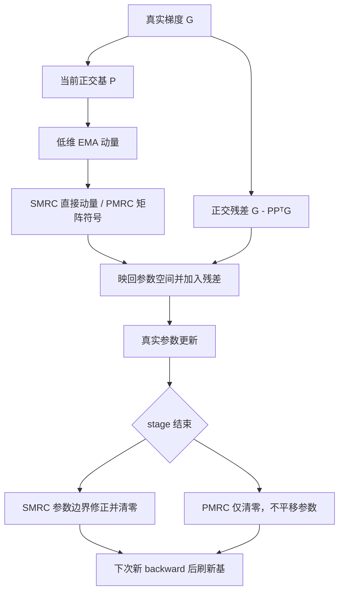
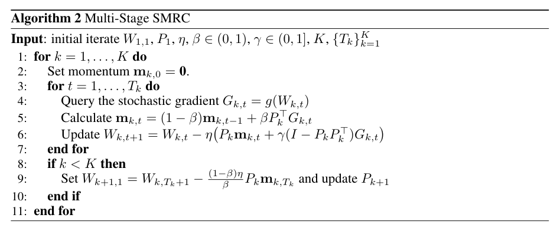

# SMRC / PMRC：保留子空间外梯度的低内存优化器

> **Fidelity: 核心机制复现；L1 组件诊断。** 这里交付可直接更新真实参数的 PyTorch 优化器和有界验证入口，不代表完整 LLM 预训练、SFT 或论文大规模效果已复现。完整实验：**成本过高，不复现（审查 DONE）**。

## 论文信息

| 项目 | 内容 |
| --- | --- |
| 论文链接 | [arXiv 2610.19844](https://arxiv.org/abs/2610.19844) |
| 公司/机构 | Nanjing University / Alibaba Token Hub |
| 首次公开日期 | 2026-10-14（arXiv v1） |
| 原文开源代码 | 否：未找到原作者 SMRC/PMRC 专用公开仓库；论文引用 Minimalist_LLM_Pretraining 等基础实现，不等于新方法已开源（v1，2026-10-15 核验） |
| Adapter | `smrc-pmrc` |
| 本地复现代码 | [`src/auto_research/reproductions/smrc_pmrc/`](https://github.com/daiwk/auto-research/tree/main/src/auto_research/reproductions/smrc_pmrc/) |

固定阅读版本是 [v1 正文与附录](https://arxiv.org/html/2610.19844v1)。作者用作实验基础的代码是 [Minimalist_LLM_Pretraining](https://github.com/OptimAI-Lab/Minimalist_LLM_Pretraining)，这里独立实现公式，不复制或冒充尚未找到的作者专用实现。

## 原始论文总结

### 背景与主要改动

低秩优化器只存投影后的动量，能减少持久状态；但梯度主奇异方向可能被噪声占据，直接丢掉子空间外分量会遗漏有效下降方向。本文让低秩动量负责投影内更新，原始梯度的正交残差负责其余方向，不额外保存一个全尺寸残差状态。SMRC 使用 EMA 动量，PMRC 对低维动量取矩阵符号；二者不能简单替换成同一个“投影 SGD”。



<!-- paper-figure:start -->
### 原论文关键图

[](https://arxiv.org/pdf/2610.19844v1#page=5)

> **原论文 Algorithm 2（关键图）**：展示原论文方法的总体设计和关键组成。图片来自[原论文](https://arxiv.org/abs/2610.19844)，版权归原作者所有；点击图片可查看来源。
<!-- paper-figure:end -->

### 核心公式

以下写左投影，$P^\top P=I$。对行数大于列数的矩阵，本地自动转置为等价右投影。

$$
H_t=P^\top G_t,\quad R_t=G_t-PH_t,\quad
M_t=(1-\beta)M_{t-1}+\beta H_t.
$$

注意本地 `beta` 是**新梯度系数**，不是常见 API 中旧动量的系数。SMRC 和 PMRC 的更新分别是：

$$
W_{t+1}^{\mathrm{SMRC}}=W_t-\eta(PM_t+\gamma R_t),
\qquad
W_{t+1}^{\mathrm{PMRC}}=W_t-\eta(P\operatorname{msign}(M_t)+\gamma R_t).
$$

其中矩形矩阵的精确矩阵符号由 SVD 的极分解给出，零奇异值方向取零。SMRC 的换基边界还须执行：

$$
W_{k+1,1}=W_{k,T_k+1}
-\eta\frac{1-\beta}{\beta}P_kM_{k,T_k},\qquad M_{k+1,0}=0.
$$

PMRC 的 Algorithm 4 **没有这一参数平移**，只刷新基并重置动量。附录 E.2.1 的实用 PMRC 另有残差 cap 与按形状缩放：

$$
\widehat\gamma=\min\left(\gamma,
\rho\sqrt{\frac{\lVert PZ\rVert_F^2}{\max(\lVert R\rVert_F^2,10^{-30})}}\right),
\quad
W^+=(1-\eta\lambda)W
-0.2\sqrt{\max(m,n)}\,\eta(PZ+\widehat\gamma R).
$$

实用模式的后续换基计算为 $P^+=\operatorname{QR}(G f_{\mathrm{RN}}(P^\top G)^\top)$。本地用稳定的 `torch.linalg.qr`，**没有复刻作者 SCQR 性能 kernel**，所以不声称达到其投影延迟。Nesterov 默认用于实用模式，采用显式的 $\beta H_t+(1-\beta)M_t$ 方向；理论模式默认不启用它。

论文定理还包含步长、随机梯度和可预测正交基等假设。默认自动 SVD 刷新会复用当前梯度作选基，额外 weight decay、任意学习率配置也不是定理的无条件结论；本地数值诊断不将这些实用选项当作收敛保证。

### 论文离线与线上效果

原文报告在 C4 预训练和 IFEval/GSM8K 微调比较中，PMRC 优于多种内存受限对照；这不是本地测量。本文属于优化器研究，**未报告真实线上 A/B**。本地不复跑完整结果表，也不把几个矩阵的状态元素数说成 LLM 峰值显存或吞吐收益。

## 本地复现

> **本地对照口径**：基线为全空间 EMA-SGD、精确矩阵符号 Muon 和 AdamW，实验组为 SMRC、理论 PMRC、实用 PMRC；参数初始化、梯度噪声/输入与更新次数一致；固定小预算，仅作机制诊断，跨算法下游效果相对提升不适用。

### 已实现的组件

- `SMRC` / `PMRC` 都是真实 `torch.optim.Optimizer`，支持 CPU/CUDA、左右投影、零梯度、满秩退化与可保存恢复的状态。
- 只有基和低维动量作为矩阵持久状态，残差每步由真实梯度计算，不丢掉，也不在缓存里存一份全矩阵动量。
- SMRC 在 stage 末**先修正真实参数、清空动量**，下次 forward/backward 使用修正后的参数；下次新梯度才用于刷新基，避免偷用修正前的陈旧梯度。
- 若恰好在 stage 边界停止，结果是**下一 stage 的初始点**，已经包含 SMRC 边界修正；单 stage 设 `refresh_interval=None`。
- PMRC 理论模式使用精确 SVD 矩阵符号；`variant="practical"` 开启 cap、形状缩放、五步 Newton–Schulz、Nesterov 和 warm-start RN+QR。后者是近似极分解，不要求所有奇异值精确为一。
- 向量和显式 `use_subspace=False` 的 embedding/head 参数组使用真实 AdamW；不靠张量维数猜测某个二维矩阵是不是 embedding。
- FP16/BF16 参数的基/动量累积在 FP32，恢复时从原始保存状态恢复 FP32，不经过 BF16 有损中转；不声称 AMP scaler 或分布式编译路径已验收。

```python
from auto_research.reproductions.smrc_pmrc import PMRC

optimizer = PMRC([
    {"params": hidden_matrix_parameters},
    {"params": embedding_bias_norm_head_parameters, "use_subspace": False},
], lr=0.002, beta=0.05, gamma=1.0, rank=8,
   refresh_interval=20, variant="practical")
# beta=0.05 表示旧动量系数 0.95；上述仅展示组件配置，不是论文训练超参。
optimizer.zero_grad()
loss.backward()
optimizer.step()
```

### 数据协议与有界运行

第一部分逐式构造论文 Appendix E.1.1 的公开 $30\times8$ 随机二次问题，包含正交信号/噪声子空间及共享的 Rademacher 噪声；不下载模型或数据。这里缩小为固定 80 次更新，**不执行论文 400 次更新的多超参网格搜索**。第二部分是 808 参数 MLP 的真实 autograd 更新，固定生成数据分成 96 条训练和 32 条 validation；不读取 test，不调参选优。

另有独立 CPU 双精度解析/SVD 对照，逐项检验满秩更新、SMRC/PMRC 不同换基行为和 `state_dict` 恢复。CPU oracle 的 SVD 与公开二次协议的 complete-QR 构造使用 NumPy，避免 GPU 专用 PyTorch 构建没有 CPU LAPACK 时阻断验证；被测优化器仍执行真实 `torch.linalg` CUDA SVD/QR，没有改成近似或降低数值容差。协议指纹包含实际构造矩阵和噪声序列。同一个 CPU/CUDA 脚本还分别对 FP16/BF16 的 SMRC 与实用 PMRC 执行六次真实更新：与 FP32 参数轨迹的绝对容差分别是 `2e-4` / `2e-3`，FP32 基/动量恢复与同 dtype 断点续跑则必须精确一致。所有结果是 `diagnostic_only=true`、`evolve_eligible=false`，不会仅凭机制成功进入 Evolve 作为能力提升证据。

```bash
PYTHONPATH=src python scripts/run_smrc_pmrc.py \
  --device cpu --seed 42 --steps 80 --max-seconds 120 \
  --output runs/smrc-pmrc/cpu-seed42

# 仅在真实 A100/A30 上执行；不可静默回退 CPU。
PYTHONPATH=src python scripts/run_smrc_pmrc.py \
  --device cuda --seed 42 --steps 80 --max-seconds 120 \
  --output runs/smrc-pmrc/cuda-seed42

auto-research reproduce --paper smrc-pmrc --dataset-dir data --seed 42
```

每次必须使用新输出目录。脚本最多允许 400 步、180 秒；默认整个单 seed 诊断 120 秒预算，超出直接失败，不自动扩成小时级实验。统一 CLI 的 adapter 遵循 `--device cpu` / `--device cuda` / `--device cuda:<index>`；`auto` 优先 CUDA，否则 CPU，Mac 上不自动选 MPS。指定 CUDA 不可用或 index 不存在会报错，不能静默回退。独立脚本也支持同样的显式 CUDA index；真实 GPU 验证保存独立脱敏回执。

### 当前实测结果

CPU seed 42、每臂 80 步的结果摘录见 [`metrics/cpu-seed42.json`](metrics/cpu-seed42.json)。这次 SMRC 的二次问题真梯度范数从 `7.61577` 降到 `0.47756`，但全空间 EMA-SGD 到 `0.22104`，SMRC **没有胜出**；小 MLP 上 PMRC validation MSE `0.05343`，全空间 Muon `0.01644`，同样保留负结果。精确更新/边界/恢复误差最大 `1.39e-16`。单 seed 不是稳定排名。

A100 已真实执行 seed42/43/44，各包含六臂×80步二次问题、六臂×80步小 MLP，以及 FP16/BF16 的真实更新和断点恢复。FP64 更新/边界/恢复最大误差为 `2.22e-16`；低精度状态恢复误差均为 0，FP16/BF16 到 FP32 轨迹的误差未超预先声明容差。每个 seed 实际组件约 2.4–2.6 秒，不含进程启动。

[A100 三种子结果](metrics/component-a100-seeds42-44.json)保留所有对照与负结果；[GPU 脱敏回执](../../gpu-validations/smrc-pmrc-a100-20261015.json)绑定源码提交与实际输入指纹。统一 CLI 的 CUDA seed42 也实跑，与独立脚本的解析控制、小 MLP 结果一致。首轮因独立 CPU Torch oracle 缺 LAPACK 失败，已保留失败记录；修复只改 NumPy 参考构造，CUDA 优化器和误差门槛不变。所有结论仍限 L1，不能解释为 LLM 质量或训练效率提升。

### 代码映射

| 文件 | 实际作用 |
| --- | --- |
| `optim.py` | 真优化器、矩阵符号、基刷新、残差、stage 转换、AdamW fallback |
| `experiment.py` | 解析对照、公开二次协议、真实小 MLP、强基线与负结果 |
| `scripts/run_smrc_pmrc.py` | 有界 CPU/CUDA 入口和不可覆盖产物 |
| `tests/reproductions/test_smrc_pmrc.py` | 公式、边界、换基、保存恢复、精度与真实 backward |

## 复现边界与成本决定

本轮组件是核心机制，不是完整预训练：原文包含 60M–1.3B LLaMA-style 模型、C4 的 1.162B–26.84B tokens、2–8 卡预训练，以及 7B–8B 模型的长序列 SFT/评测。相对现有单张 A100/A30 预算，完整研究开销显著；本轮**成本过高，不复现（审查 DONE）**，不下载这些权重/全量数据，不执行训练探针，也不进入自动重试队列。

实现没有分布式状态、作者 SCQR kernel 或完整论文网格搜索。向量与 embedding/head 的 AdamW 分组、实用模式 Nesterov 方向和 stage 末即时修正均在上文明确；任一 L1 数值成功都不能支持论文收敛速率的经验验证、完整预训练效果或吞吐提升。
