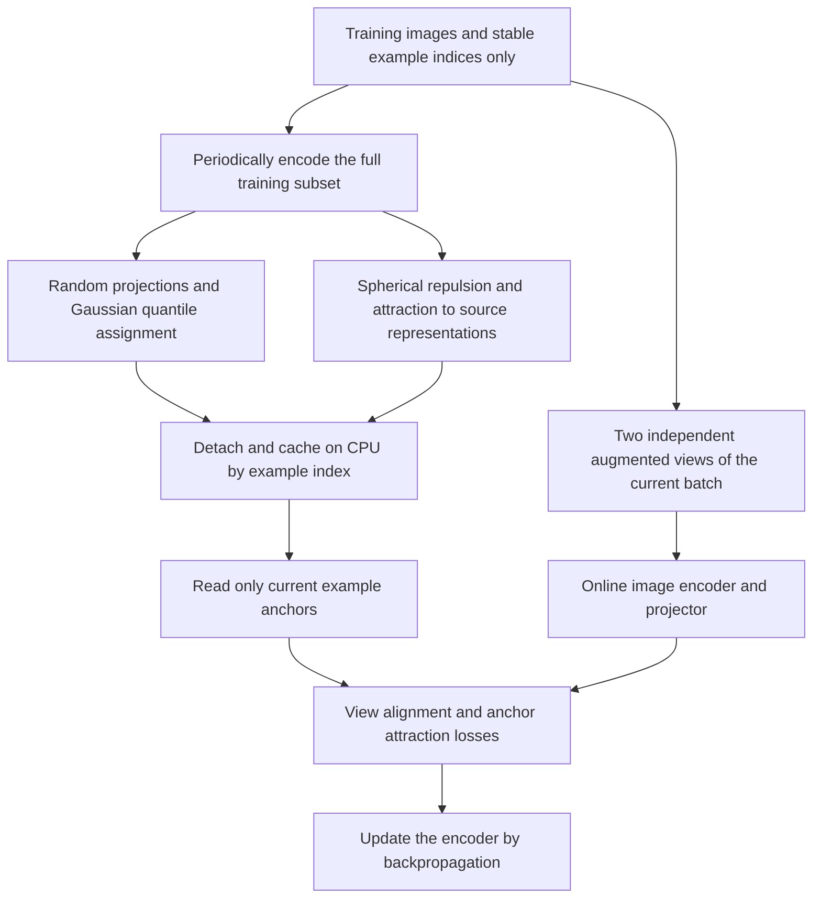
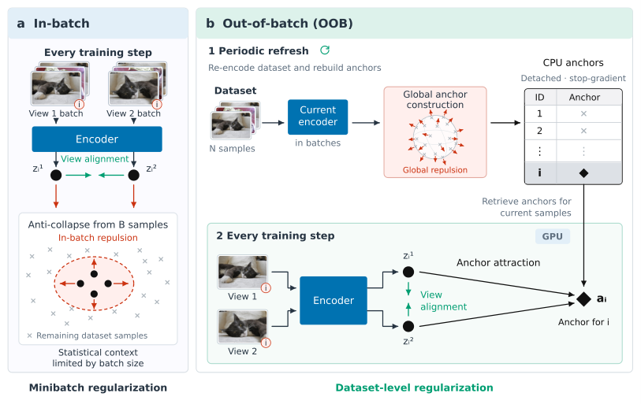

<!-- source-sha256: 1cff866ccbf41250cba1aa8ff9b346f8e7bb8c4a41254d143ea768ef089fb6ff -->

[简体中文](README.md) · English

# OOB Regularization: Dataset-wide anti-collapse regularization for small batches

> The local implementation trains two actual anchor algorithms with controls on a limited subset of official CIFAR images. It does not reproduce the paper's complete 100-epoch, multi-dataset study. Negative short-budget results are retained and do not qualify for automatic Evolve promotion. The full study is **too costly to reproduce (review DONE)**.

## Paper information

| Field | Details |
| --- | --- |
| Paper | [arXiv 2610.20158](https://arxiv.org/abs/2610.20158) |
| Institution | European Molecular Biology Laboratory (EMBL, Heidelberg, Germany) |
| First public release | 2026-10-14 (arXiv v1) |
| Original source code | No release found. The reproducibility statement only says code is planned; referenced SimCLR and SIGReg repositories are not the authors' implementation for this paper. |
| Adapter | `oob-regularization` |
| Local reproduction code | [`src/auto_research/reproductions/oob_regularization/`](https://github.com/daiwk/auto-research/tree/main/src/auto_research/reproductions/oob_regularization/) |

The exact arXiv v1 submission time is 2026-10-14 13:13:48 UTC.

## Original paper summary

### Background and main changes

Joint-embedding self-supervised learning pulls augmented views of the same image together and uses anti-collapse regularization to keep the representations diverse. A small batch can give a poor estimate of the representation distribution, but increasing the GPU batch costs memory. OOB decouples the statistics from the current optimization batch: periodically encode the training set, build fixed per-example targets using the full dataset distribution, and store them on CPU. Online updates only read anchors for the current examples instead of recalculating the regularizer over the whole dataset.

The Gaussian variant projects onto random unit directions, sorts the examples along each direction, and matches standard-normal quantiles. The contrastive variant optimizes uniformity on the unit sphere while preserving the correspondence with each current representation. Neither substitutes an ordinary variance or covariance loss for the paper's algorithm.



<!-- paper-figure:start -->
### Key figure from the paper

[](https://arxiv.org/html/2610.20158v1/oob_overview.png)

> **Figure 1 from the paper:** Periodic dataset-wide anchor construction versus online small-batch optimization. From the [paper](https://arxiv.org/html/2610.20158v1#S1.F1); copyright belongs to the authors.
<!-- paper-figure:end -->

### Core equations

For $N$ training representations $z_i$ and unit projection directions $v_m$, Gaussian anchors are assigned by

$$
s_{im}=v_m^\top z_i,\qquad q_{im}=\Phi^{-1}\!\left(\frac{\operatorname{rank}_m(i)+1/2}{N}\right).
$$

Ranks are zero-based. Directions and anchors stay fixed after refresh; the online loss is

$$
\mathcal L_{\mathrm{ac}}^{\mathrm{SIGReg-OOB}}=
\frac1{BVM}\sum_{i\in\mathcal B,v,m}(v_m^\top z_i^{(v)}-q_{im})^2.
$$

This implements Eqs. 6–7, **not the original Epps–Pulley statistic**. The paper's own in-batch comparator also uses a sorted-quantile objective, which the local comparison matches.

Spherical anchors $a_i$ optimize Eqs. 8–9:

$$
\log\frac{\sum_{i\ne j}\exp(-\tau_u\|a_i-a_j\|_2^2)}{N(N-1)}
+\frac{\lambda_f}{N}\sum_i(1-a_i^\top\bar z_i),\qquad \|a_i\|_2=1.
$$

Locally, the anchor optimizer takes the paper's 20 Adam steps, with at most 256 sampled anchors, $\tau_u=2$, and $\lambda_f=0.1$. Later refreshes initialize with a 0.5/0.5 mix of the current representations and previous anchors. The online objective is $1-\cos(z_i,a_i)$ and does not backpropagate into the refresh.

### Paper results

The authors compare frozen kNN, linear probing, retrieval, and continued DINOv2 pretraining on natural images and 2D/3D biomedical images. In Table 2, Gaussian OOB improves natural-image 5-NN / linear-probe results by an average of 14.17 / 12.89 percentage points over the in-batch comparator. This is an author-reported aggregate across small-batch settings, **not the local CIFAR improvement**. The paper does not report a production A/B test.

From-scratch training uses ViT-S/16 or 3D ResNet-18 for 100 epochs with three seeds. The study also includes continued DINOv2 pretraining up to 1.1B parameters and many hyperparameter and dataset combinations. Appendix G's single-L40S resource experiment does not make the complete study inexpensive to rerun.

## Local reproduction

> **Comparison protocol:** In-batch Gaussian with matching projections and quantiles, and SimCLR, are paired against Gaussian OOB and spherical OOB, respectively. The primary metric is validation kNN5 accuracy; this experiment cannot establish a stable gain. Arms share initialization, online batch indices, augmentation random streams, update counts and image splits. They train independently, use no validation labels to build anchors, and do not read the official test set. A gain is not a prerequisite: negative differences are valid results.

### Data and budget

- Read only a pre-existing official CIFAR `data_batch_1`. Verify MD5 `c99cafc152244af753f735de768cd75f` before loading the official pickle; reject arbitrary unverified pickles.
- Select 512 training and 128 validation images from that official training batch with fixed split seed `20261016`, independent of the training seed. Do not read test data or select parameters on validation.
- Use a small image CNN with a 64-dimensional hidden projector layer and 32-dimensional output, not the paper's ViT. The Gaussian variant uses 32 projections rather than 256.
- Each arm runs for 40 steps with batch size 16. Re-encode the entire training subset and refresh CPU anchors every 10 steps. Use two views instead of the paper's four; class labels do not replace representations.
- Each seed defaults to a 120-second limit with a hard parameter cap of 180 seconds. No images, models or large archives are downloaded. Timeouts and failures are written to JSON rather than silently shrinking the algorithm.

```bash
PYTHONPATH=src python scripts/run_oob_regularization.py \
  --dataset-dir data/cifar10 --device cpu --seed 42 \
  --output runs/oob/cpu-seed42.json

# Run on a real NVIDIA GPU with the official training batch already available; output is not overwritten.
PYTHONPATH=src python scripts/run_oob_regularization.py \
  --dataset-dir /path/to/cifar10 --device cuda --seed 42 \
  --output runs/oob/cuda-seed42.json

# Unified adapter runs the same training code; the offline directory must already exist.
auto-research reproduce --paper oob-regularization --dataset-dir data/cifar10 \
  --seeds 42,43,44 --device cpu
```

### Local results

The CPU run on official images with seed 42 completed 40 parameter updates per arm. Both OOB arms refreshed four times, keeping anchors detached on CPU. Training took about 5 seconds on the measured machine, not a device-independent estimate. Fixed-validation kNN5:

| Trained arm | Validation kNN5 accuracy |
| --- | ---: |
| In-batch Gaussian | 0.1953125 |
| Gaussian OOB | 0.1562500 |
| SimCLR | 0.2500000 |
| Contrastive OOB | 0.2031250 |

The paired differences were **−0.0390625 / −0.046875**. Parameters were not retuned to remove negative results. One seed, few updates, a small encoder, and kNN over self-supervised features cannot verify the paper's multi-dataset conclusion or support claims about large models or production. See the [CPU results](metrics/component-cpu-seed42.json). CUDA acceptance comes from the separately source-bound A100/A30 receipt and three-seed results, not these CPU values.

A real A100 run subsequently completed seeds 42/43/44 and a same-seed recheck through the unified CLI. The four validation means in order were 0.20573 / 0.22656 / 0.21354 / 0.23438. Both paired mean differences were +0.02083, but the Gaussian difference had a standard deviation of 0.05083, so this is not a stable improvement claim. Negative CPU results remain in the record. See the [full three-seed artifact](metrics/component-seeds42-44.json) and the [sanitized CUDA receipt](../../gpu-validations/oob-regularization-a100-20261016.json). Hardware acceptance caught a unified-entry device argument mismatch; after the fix, the unified command was verified to use CUDA. The receipt retains the failure and the source commit.

### Code map

| Code | Responsibility |
| --- | --- |
| `algorithm.GaussianAnchors` | Dataset-wide rank/quantile cache and lookup by index |
| `algorithm.SphericalAnchors` | Actual spherical anchor optimization and online attraction, Eqs. 8–10 |
| `algorithm.in_batch_gaussian_loss / simclr_loss` | Matched baselines |
| `experiment.load_public_images` | Verify the official training file and enforce fixed isolated splits |
| `experiment.run_comparison` | Four training arms, refresh auditing, and frozen kNN |
| `scripts/run_oob_regularization.py` | CPU/CUDA, time limits, retained failures, and immutable output |

## Scope and cost

Both core objectives, per-example CPU caching, periodic refresh, real backpropagation and matched controls execute; no mean or variance loss replaces the method. The public-image run is a limited L2 data experiment, still marked `diagnostic_only=true / promotion_eligible=false`, and does not enter automatic Evolve capability promotion.

The full multi-dataset study, 100 epochs, three seeds and batch sweeps, and continued DINOv2-L/G pretraining are **too costly to reproduce (review DONE)**. No author code was found, so this is an independent implementation of the equations, not an exact rerun of their environment. Negative results remain visible, and three seeds are not a guarantee of algorithmic improvement.
