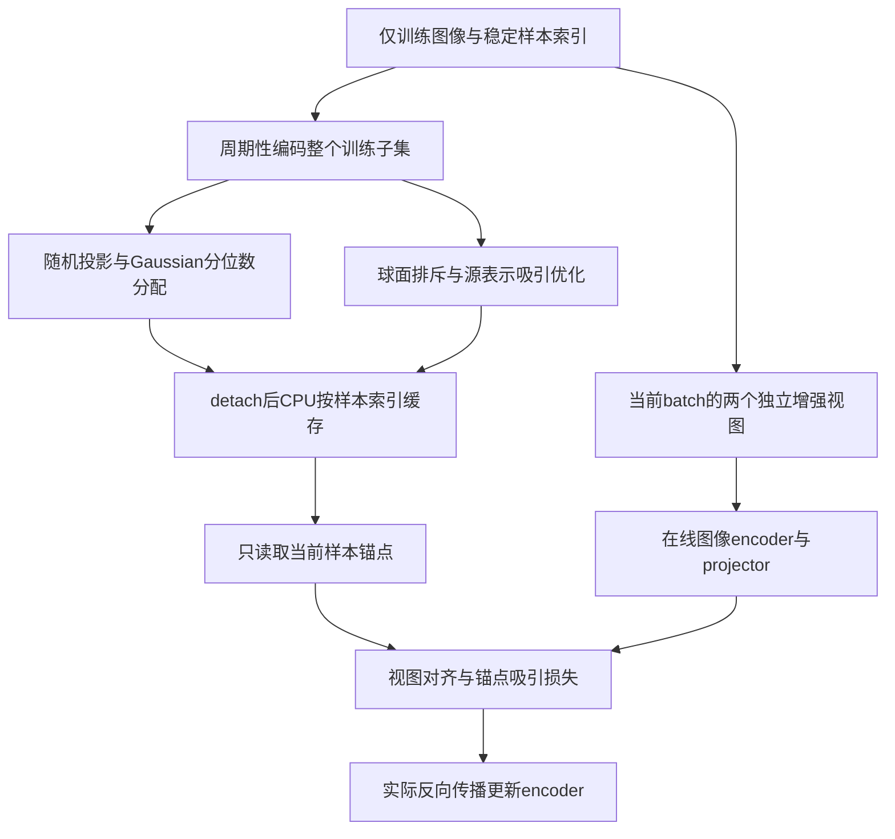
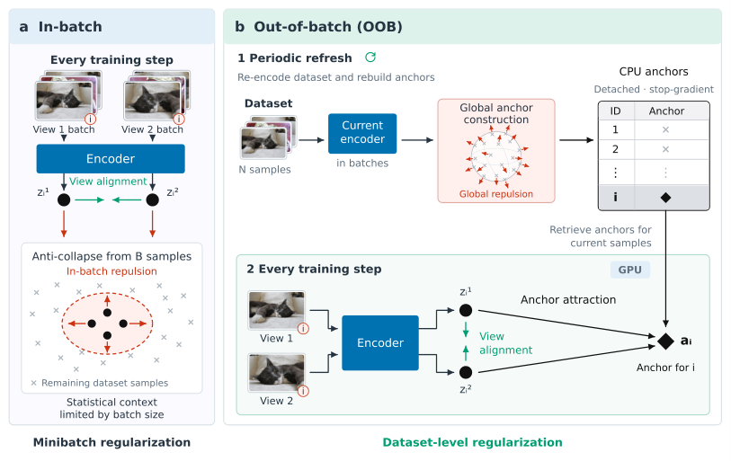

# OOB Regularization：小 batch 也能利用全数据的抗坍塌正则

> 本地实现两种真实锚点算法，并在有限的官方 CIFAR 图像上执行有对照的训练。它不是原论文多数据集、100 epochs 的完整研究；短预算的负结果照实保留，不进入 Evolve 自动晋级。完整原研究为**成本过高，不复现（审查 DONE）**。

## 论文信息

| 项目 | 内容 |
| --- | --- |
| 论文链接 | [arXiv 2610.20158](https://arxiv.org/abs/2610.20158) |
| 公司/机构 | European Molecular Biology Laboratory（EMBL，德国海德堡） |
| 首次公开日期 | 2026-10-14（arXiv v1） |
| 原文开源代码 | 否：原文 Reproducibility statement 仅说明计划发布，尚未找到原作者代码；不把引用的 SimCLR / SIGReg 仓库当成本论文代码 |
| Adapter | `oob-regularization` |
| 本地复现代码 | [`src/auto_research/reproductions/oob_regularization/`](https://github.com/daiwk/auto-research/tree/main/src/auto_research/reproductions/oob_regularization/) |

arXiv v1 精确提交时间为2026-10-14 13:13:48 UTC。

## 原始论文总结

### 背景与主要改动

联合嵌入自监督学习一方面拉近同一图像的不同增强视图，另一方面用抗坍塌正则保持表示多样性。小 batch 对整个表示分布的估计可能很差；单纯增大 GPU batch 又受显存限制。OOB 把“统计范围”与“本次优化 batch”解耦：定期编码整个训练集，按全数据分布构建每个样本的固定目标，再存入 CPU。在线训练只读取当前样本对应的锚点，不在每一步重新估计全数据正则。

Gaussian 变体沿随机单位方向投影，把每列样本排序后匹配标准正态分位数；Contrastive 变体在单位球面优化全局均匀性，同时保留与当前样本表示的对应关系。二者不是用普通方差 / 协方差损失代替原算法。



<!-- paper-figure:start -->
### 原论文关键图

[](https://arxiv.org/html/2610.20158v1/oob_overview.png)

> **原论文 Figure 1**：周期性全数据锚点构建与在线小 batch 优化的区别。图片来自[原论文](https://arxiv.org/html/2610.20158v1#S1.F1)，版权归原作者所有。
<!-- paper-figure:end -->

### 核心公式

对 $N$ 个训练表示 $z_i$ 和单位投影方向 $v_m$，Gaussian 锚点为

$$
s_{im}=v_m^\top z_i,\qquad q_{im}=\Phi^{-1}\!\left(\frac{\operatorname{rank}_m(i)+1/2}{N}\right).
$$

rank 从 0 开始，刷新后固定方向和锚点，在线损失为

$$
\mathcal L_{\mathrm{ac}}^{\mathrm{SIGReg-OOB}}=
\frac1{BVM}\sum_{i\in\mathcal B,v,m}(v_m^\top z_i^{(v)}-q_{im})^2.
$$

这对应原文 Eq.6–7；**不是 Epps–Pulley 原始统计量**。论文自己的对应 in-batch 基线也使用同一种 sorted-quantile 目标，因此本地按这一口径配对。

球面锚点 $a_i$ 则优化 Eq.8–9：

$$
\log\frac{\sum_{i\ne j}\exp(-\tau_u\|a_i-a_j\|_2^2)}{N(N-1)}
+\frac{\lambda_f}{N}\sum_i(1-a_i^\top\bar z_i),\qquad \|a_i\|_2=1.
$$

本地使用论文的 20 次 Adam 锚点更新、最多 256 个抽样锚点、$\tau_u=2$、$\lambda_f=0.1$；后续刷新以当前表示和上次锚点各 0.5 混合初始化。在线用 $1-\cos(z_i,a_i)$，不通过锚点向刷新阶段反传。

### 论文离线与线上效果

原文在自然图像、2D / 3D 生物医学图像上比较 frozen kNN、linear probe、检索与 DINOv2 continued pretraining。Table 2 中，自然图像的 Gaussian OOB 相对 in-batch 5-NN / linear probe 平均增加 14.17 /12.89 个百分点；这是作者跨小 batch 设置的原研究汇总，**不是本地 CIFAR 的提升**。论文未报告工业线上 A/B。

原文从头训练使用 ViT-S/16 或 3D ResNet-18、100 epochs、三种子；还有最大 1.1B DINOv2 继续预训练和大批超参数 / 数据集组合。附录 G 的单卡 L40S 资源实验不意味着把整个研究全部重跑成本很低。

## 本地复现

> **本地对照口径**：基线为同投影 / 分位数口径的 in-batch Gaussian 及 SimCLR；实验组分别为 Gaussian OOB 及球面 OOB，主指标为validation kNN5 accuracy，稳定提升结论不适用。每臂使用同初始化、相同在线 batch 索引及增强随机流、同更新步数与图像划分；独立真实训练，不读取验证标签构建锚点、不读取官方test。相对任务提升没有预设目标，负差值是有效结果。

### 数据与预算

- 仅读取已有官方 CIFAR `data_batch_1`；先核验 MD5 `c99cafc152244af753f735de768cd75f`，再解析官方 pickle，拒绝任意未验证 pickle。
- 固定 split seed `20261016`，从该官方训练 batch 选 512 张训练、128 张 validation，不随训练 seed 改变；test 完全不读，也不以 validation 选参数。
- 模型是小型真实图像 CNN、64 维隐藏层 projector、32 维输出；不是论文的 ViT。Gaussian 使用 32 个投影而非完整实验的 256 个。
- 每臂 40 步，batch16；每10步重新编码整个训练子集、刷新一次 CPU 锚点。与论文的四视图相比，本地为两视图；算法不以类标签代替表示。
- 单 seed 默认120秒上限，硬参数上限180秒；不下载图像、模型或大归档。超时 / 失败会留下失败 JSON，而不是静默缩小算法。

```bash
PYTHONPATH=src python scripts/run_oob_regularization.py \
  --dataset-dir data/cifar10 --device cpu --seed 42 \
  --output runs/oob/cpu-seed42.json

# 在已准备官方training batch的真实NVIDIA GPU上执行；输出不可覆盖
PYTHONPATH=src python scripts/run_oob_regularization.py \
  --dataset-dir /path/to/cifar10 --device cuda --seed 42 \
  --output runs/oob/cuda-seed42.json

# 统一adapter入口，实际使用同一训练代码；离线目录必须已存在
auto-research reproduce --paper oob-regularization --dataset-dir data/cifar10 \
  --seeds 42,43,44 --device cpu
```

### 本地结果

已完成真实官方图像的 CPU seed42，四臂各40次参数更新，两个 OOB 臂均4次刷新，锚点始终 CPU / detached；约5秒的训练是本机测量，不代表别的设备。固定 validation 的 kNN5：

| 实际训练臂 | Validation kNN5 accuracy |
| --- | ---: |
| in-batch Gaussian | 0.1953125 |
| Gaussian OOB | 0.1562500 |
| SimCLR | 0.2500000 |
| Contrastive OOB | 0.2031250 |

对应差值为 **-0.0390625 / -0.046875**，没有调参把负结果改成正数。单 seed、短更新、小 encoder 和自监督特征的 kNN 不是原论文多数据集结论的验证，更不代表大模型或生产收益。稳定标量见[CPU 结果](metrics/component-cpu-seed42.json)。CUDA 验收另由绑定源码的 A100/A30 回执及三 seed 结果确定，不能由这些 CPU 值替代。

随后已在真实 A100 完成seed42/43/44及统一CLI同seed复验。四臂validation均值依次为0.20573 /0.22656 /0.21354 /0.23438，
两组配对差均为+0.02083，但Gaussian差值标准差0.05083，不能据此宣称稳定提升；CPU负结果保留。
见[三seed完整产物](metrics/component-seeds42-44.json)和[脱敏CUDA回执](../../gpu-validations/oob-regularization-a100-20261016.json)。
真实验收曾发现统一入口设备参数不匹配，修复后已确认统一命令实际使用CUDA；失败原因和源码commit也保留在回执。

### 代码映射

| 代码 | 职责 |
| --- | --- |
| `algorithm.GaussianAnchors` | 全数据 rank / quantile 缓存与索引读取 |
| `algorithm.SphericalAnchors` | Eq.8–10 实际球面锚点优化和在线吸引 |
| `algorithm.in_batch_gaussian_loss / simclr_loss` | 配对的真实基线 |
| `experiment.load_public_images` | 校验官方训练文件、固定隔离划分 |
| `experiment.run_comparison` | 四臂实际训练、refresh 审计与冻结 kNN |
| `scripts/run_oob_regularization.py` | CPU/CUDA、时间预算、失败保留和不可变输出 |

## 复现边界与成本结论

核心两种目标、样本级 CPU 缓存、周期性刷新、真实反传及 matched controls 均执行；不是用均值 / 方差正则替代论文。公开图像小训练是有限 L2 数据实验，但仍明确 `diagnostic_only=true / promotion_eligible=false`，不进入 Evolve 自动能力晋级。

完整多数据集、100 epochs、三种子 / batch sweep，以及 DINOv2-L/G 的继续预训练为**成本过高，不复现（审查 DONE）**。当前没有作者代码，所以本地是按原公式独立实现，而非原作者环境的逐字复跑。没有删除负结果，也没有把三种子当作算法必然提升的保证。
