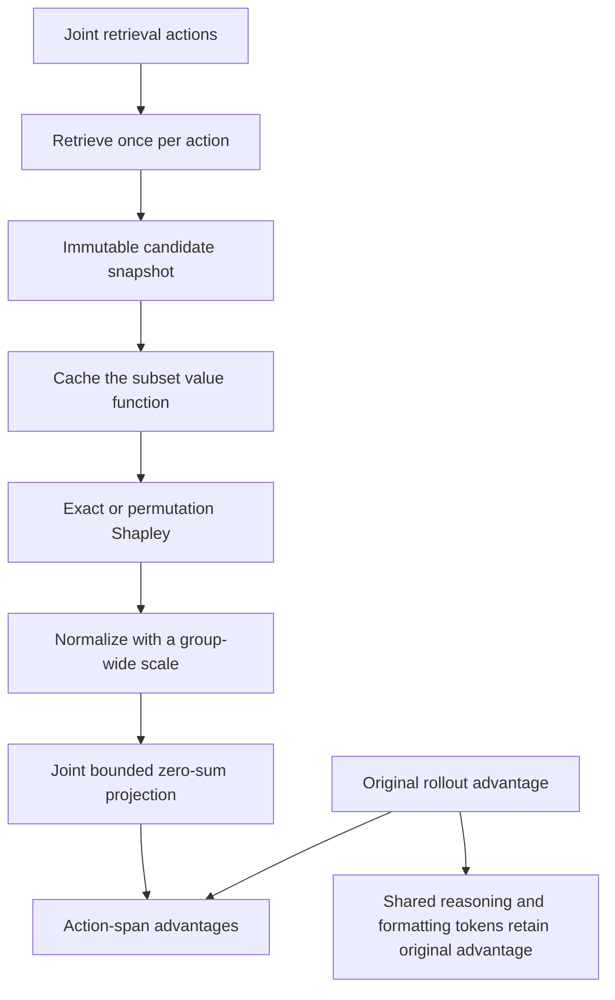
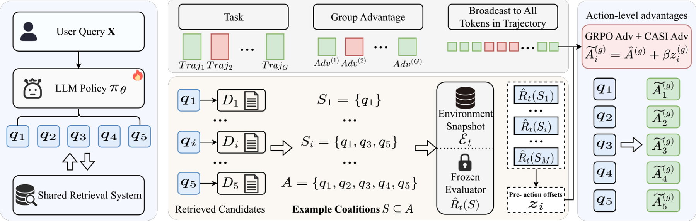

<!-- source-sha256: c2b57ed9ccdf956e91778bff0550035e32203f23cd7157311a8cc18227b11cc6 -->

[简体中文](README.md) · English

# CASI: Set interventions and credit assignment with frozen retrieval snapshots

## Paper information

| Field | Details |
| --- | --- |
| Paper | [arXiv 2610.20293](https://arxiv.org/abs/2610.20293) |
| Institution | Xiaohongshu |
| First public release | 2026-10-14 (arXiv v1) |
| Original source code | No public author implementation found in the official v1 and associated sources checked on 2026-10-15. |
| Adapter | `casi` |
| Local reproduction code | [`src/auto_research/reproductions/casi/`](https://github.com/daiwk/auto-research/tree/main/src/auto_research/reproductions/casi/) |
| Evidence level | `core_mechanism` / L1: CPU credit assignment and advantage shaping, without LLM policy training. |

## Original paper summary

### Background and main changes

One retrieval request can jointly produce several rewriting actions, while production gives a reward for only the whole result set. Rather than split that reward evenly, CASI retrieves once per action, freezes candidate snapshots, and recombines subsets to measure complementarity and substitution. Shapley marginal contributions assign credit. Shared-scale normalization and bounded zero-sum projection then convert set credit into action and token advantages.

Broadcasting set reward can still provide a valid score-function estimator of the original set objective. CASI's internal shaping does not additionally claim to preserve that unbiased gradient. The paper notes that additive sets need no extra intervention and CASI did not beat Singleton on the sensitivity backend; negative results matter too.

### Architecture and data flow

This diagram redraws the local component, not the production architecture.



<!-- paper-figure:start -->
### Key figure from the paper

[](https://arxiv.org/html/2610.20293v1/framework.png)

> **Figure 1 from the paper:** Training workflow and key optimization steps. From the [paper](https://arxiv.org/abs/2610.20293v1); copyright belongs to the authors. Click the image for the source.
<!-- paper-figure:end -->

### Core equations

Set $v(\varnothing)=0$. With $m$ actions, credit on the fixed snapshot is

$$
c_i=\sum_{S\subseteq [m]\setminus\{i\}}
\frac{v(S\cup\{i\})-v(S)}{m\binom{m-1}{|S|}}.
$$

Exact credit for five actions needs just 31 nonempty subset evaluations. The empty set returns zero without calling the external evaluator. Permutation estimates share the snapshot and cache repeated prefixes. Singleton observes only individual endpoints; LOO observes endpoints that remove one action from the full set. When $m\ge4$, these endpoints do not determine Shapley credit in general.

Within each rollout, center $d_i^g=c_i^g-\bar c^g$ and scale by the standard deviation shared by all centered actions in the group. Locally this is the population standard deviation (`ddof=0`). Then solve

$$
z^g=\arg\min_{\sum_i z_i=0,\ |z_i|\le\kappa}\|z-u^g\|_2^2,
\qquad A_i^g=A^g+\beta z_i^g.
$$

The implementation solves the monotone root for $z_i=\operatorname{clip}(u_i-\lambda,-\kappa,\kappa)$, not independent clipping. This keeps the arithmetic mean across actions equal to the original rollout advantage, not necessarily the token-length-weighted mean. Shared tokens are not assigned redistributed credit. See [Section 3](https://arxiv.org/html/2610.20293v1#S3).

### Offline and online results

The authors report offline auction replay from five independent policy runs and a randomized production A/B test with 10% traffic for seven days. Advertiser value (Advv), the primary metric, increases 3.51% over production control. These are private production results from [Section 4.5](https://arxiv.org/html/2610.20293v1#S4.SS5), not an effect of the component below.

## Local reproduction

> **Comparison protocol:** Singleton and LOO use the same frozen set function as the exact/permutation Shapley and zero-sum advantage components. There is no policy training, so relative capability improvement is not applicable.

### Data, execution, and budget

The default explicitly controlled five-action snapshot has overlapping candidates, positive and negative values, and candidate substitution. To supply your own, put `casi-snapshot.json` in the dataset directory. `actions` contains entries with `key` and `candidates`; each candidate has `key`, `rank_score` and `value`. At most eight actions, 1024 candidates per action and 2 MB of input are supported.

```bash
auto-research reproduce --paper casi --dataset-dir data --device cpu --seeds 42,43,44
```

The API accepts separate retrieval and set-evaluator callbacks. The default diagnostic backend reranks each subset by fixed scores and takes its top 2. This is an explicit `pr_rerun` sensitivity example, **not** the paper's private `pr_filter` training backend. The latter requires caching downstream processing for the full set and then filtering. Actions are not regenerated or retrieved twice, and conflicting attributes on a shared candidate are rejected.

### Results and scope

See the [CPU component metrics](metrics/component-cpu-seeds42-44.json). Efficiency identity, zero-sum and shared-token errors validate implementation invariants; values near zero do not mean the model is almost perfect. Permutation estimates retain sampling variance, and negative marginal contributions are not clipped to zero. Three seeds repeat algorithm sampling, **not policy training**.

Private auction replay, five LLM training runs and production A/B are **too costly to reproduce (review DONE)**. The component is ineligible for Evolve promotion and does not constitute original-benchmark reproduction.

### Code map

- `algorithm.py`: immutable snapshots, subset cache, exact and permutation credit, joint projection, and action/token advantages.
- `experiment.py`: budgeted reproducible inputs, shared controls, and diagnostics.
- `paper.yaml` / `adapter.py`: lazy discovery and CPU execution contract; no advertised CUDA path.

Tests cover additive degeneration, endpoint non-identifiability, negative credit, zero empty-set calls, caching, joint rather than independent clipping, group-wide scaling, padding, and fallback to reward broadcast at `beta=0`.
