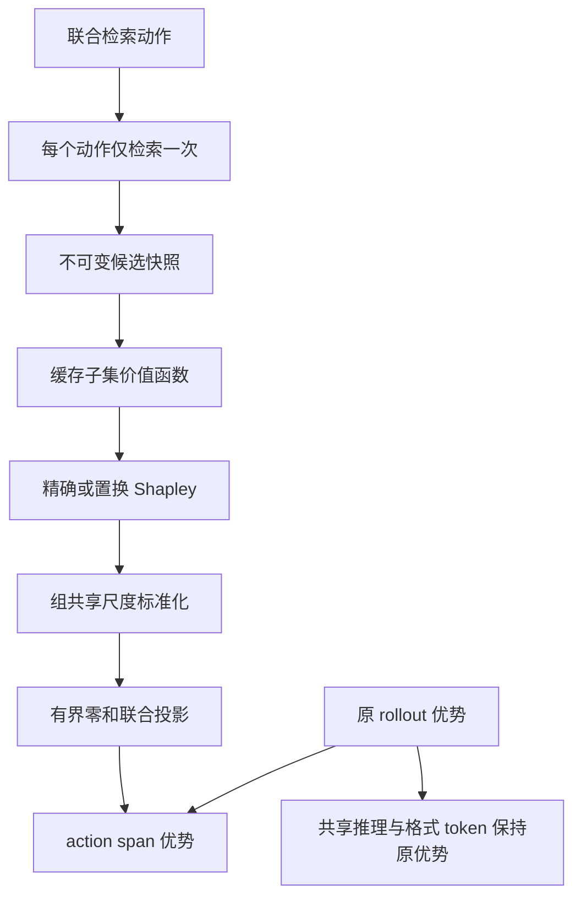
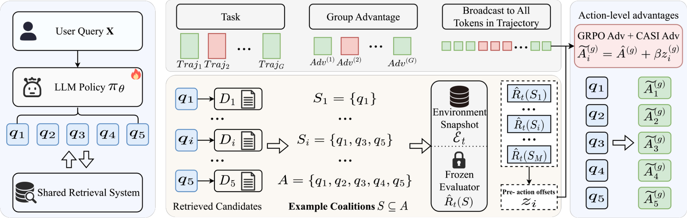

# CASI：冻结检索快照的集合干预与信用分配

## 论文信息

| 项目 | 内容 |
| --- | --- |
| 论文链接 | [arXiv 2610.20293](https://arxiv.org/abs/2610.20293) |
| 公司/机构 | Xiaohongshu |
| 首次公开日期 | 2026-10-14（arXiv v1） |
| 原文开源代码 | 否：未找到原作者公开实现（2026-10-15，官方v1与关联来源核验） |
| Adapter | `casi` |
| 本地复现代码 | [`src/auto_research/reproductions/casi/`](https://github.com/daiwk/auto-research/tree/main/src/auto_research/reproductions/casi/) |
| 实现/评测层级 | `core_mechanism` / L1：CPU 信用分配与优势赋值组件；不含 LLM 策略训练 |

## 原始论文总结

### 背景与主要改动

一次检索请求可能联合产生多个改写动作，线上却只返回整个结果集合的奖励。CASI 不把这个奖励简单均分：每个动作只检索一次，冻结候选快照，再重组子集、评估候选之间的协同与替代关系，以 Shapley 边际贡献分配信用。随后用共享尺度归一化与有界零和投影，将集合信用转为 action/token 优势。

集合奖励广播仍可给出原集合目标的有效 score-function 估计；CASI 的内部优势塑形不能额外宣称保持同一无偏梯度。论文也指出：加性集合无需额外干预；敏感性后端下 CASI 并未优于 Singleton，不应只保留正结果。

### 架构与数据流

下面为本地组件重绘，不是生产系统架构。



<!-- paper-figure:start -->
### 原论文关键图

[](https://arxiv.org/html/2610.20293v1/framework.png)

> **原论文 Figure 1（关键图）**：展示原论文的训练流程与关键优化环节。图片来自[原论文](https://arxiv.org/abs/2610.20293v1)，版权归原作者所有；点击图片可查看来源。
<!-- paper-figure:end -->

### 核心公式

令 $v(\varnothing)=0$，动作数为 $m$，固定快照上的动作信用为

$$
c_i=\sum_{S\subseteq [m]\setminus\{i\}}
\frac{v(S\cup\{i\})-v(S)}{m\binom{m-1}{|S|}}.
$$

五动作精确计算只需评估 31 个非空子集；空集直接为零，不调用外部 evaluator。置换估计复用相同快照并缓存重复前缀。Singleton 与 LOO 分别只读单动作端点、完整集合移除动作端点；当 $m\ge4$ 时，这些端点不能一般性确定 Shapley 信用。

每个 rollout 内先中心化 $d_i^g=c_i^g-\bar c^g$，再用组内全部中心化动作的共同标准差缩放。本地明确使用总体标准差（`ddof=0`），随后求

$$
z^g=\arg\min_{\sum_i z_i=0,\ |z_i|\le\kappa}\|z-u^g\|_2^2,
\qquad A_i^g=A^g+\beta z_i^g.
$$

实现采用 $z_i=\operatorname{clip}(u_i-\lambda,-\kappa,\kappa)$ 的单调根求解，不能用逐维裁剪替代联合投影。它保持 action 算术均值为原 rollout 优势，不保证按 token 长度加权后的均值不变；共享 token 不参与信用重分配。依据[原文 §3](https://arxiv.org/html/2610.20293v1#S3)。

### 论文离线与线上效果

原文报告五次独立策略训练的离线拍卖重放，以及 10% 流量、七天的随机生产 A/B：主指标 advertiser value（Advv）相对生产对照提升 3.51%。这是[原文 §4.5](https://arxiv.org/html/2610.20293v1#S4.SS5)的私有生产结果，不是下面组件的效果。

## 本地复现

> **本地对照口径**：基线为相同冻结集合函数上的 Singleton 和 LOO，实验组为精确/置换 Shapley 与零和优势组件；没有策略训练，相对能力提升不适用。

### 数据、运行与成本

默认使用明确标为受控输入的五动作快照，包含重叠候选、正负价值和候选替代。也可在数据目录提供 `casi-snapshot.json`，字段为 `actions`，每行包含 `key` 与 `candidates`；候选包含 `key`、`rank_score`、`value`。最多八个动作、每动作 1024 个候选、输入不超过 2 MB。

```bash
auto-research reproduce --paper casi --dataset-dir data --device cpu --seeds 42,43,44
```

算法 API 接受独立检索回调和集合 evaluator。默认诊断后端按固定分数对每个子集重新取 top-2，属于显式的 `pr_rerun` 敏感性示例，**不是**论文的私有 `pr_filter` 训练后端；后者须缓存完整集合下游处理结果再过滤，二者不能混称。动作结果不重新生成、不重新检索，共享候选的属性变化会直接拒绝。

### 结果与边界

实测记录见 [CPU 组件指标](metrics/component-cpu-seeds42-44.json)。其中效率恒等式误差、零和误差和共享 token 误差是实现核验值，接近零不表示模型能力接近满分。置换估计误差保留随机性；负边际贡献不会裁成零。三种子只重复算法采样，**不是三次策略训练**。

完整的私有拍卖重放、LLM 五次训练及生产 A/B：**成本过高，不复现（审查 DONE）**。不进入 Evolve 候选晋级，也不把组件成功升级为原 benchmark 复现。

### 代码映射

- `algorithm.py`：冻结快照、子集缓存、精确/置换信用、联合投影、action/token 优势。
- `experiment.py`：预算受限的可重复输入、共同对照和诊断指标。
- `paper.yaml` / `adapter.py`：惰性发现与 CPU 运行合同；本组件不广告 CUDA 路径。

单测覆盖加性退化、端点不可辨识、负贡献、空集零调用、缓存、非独立裁剪、组共享尺度、padding 和 `beta=0` 退回广播。
