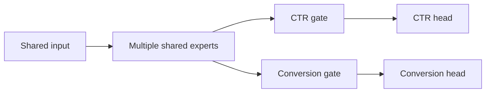
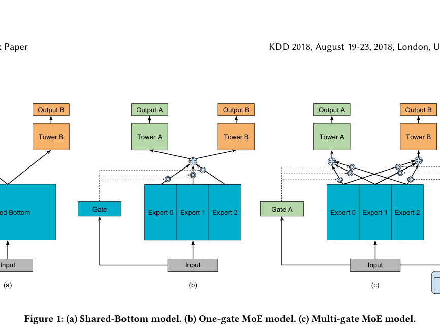

# MMoE: shared experts with an independent gate per task

<!-- source-sha256: f2d1cf4015ce2210470ee7ec24eae9cd6eb3875193cbfc405bdf572b3e6d20b1 -->

[简体中文](README.md)

> **Core mechanism.** Trains shared experts, task-specific gates, and task heads. Private Google business features are not reproduced.

## Paper information

| Field | Details |
|---|---|
| Paper | [KDD 2018 paper](https://research.google/pubs/modeling-task-relationships-in-multi-task-learning-with-multi-gate-mixture-of-experts/) |
| Organization | Google |
| First public release | 2018-08-19 (ACM KDD 2018) |
| Authors' code | The paper did not provide official or author code when checked on 2026-08-09. |
| Adapter / method | `mmoe` |
| Local reproduction code | [`src/auto_research/reproductions/mmoe/`](https://github.com/daiwk/auto-research/tree/main/src/auto_research/reproductions/mmoe/) |

## Original paper

### Motivation and method

Shared-bottom multitask models can transfer negatively when tasks correlate weakly. Fully independent models cannot exploit commonality. MMoE shares experts while learning an independent softmax gate for each task, so tasks combine experts with different weights.

<!-- paper-figure:start -->
### Key figure from the paper

> **Figure 1:** Overview of the paper's method and key components. From the [original paper](https://research.google/pubs/modeling-task-relationships-in-multi-task-learning-with-multi-gate-mixture-of-experts/); copyright remains with the authors.
<!-- paper-figure:end -->

### Core equations

$$
f^k(x)=\sum_i g_i^k(x)f_i(x),\qquad
g^k(x)=\operatorname{softmax}(W_{gk}x).
$$

### Paper results

Synthetic and real recommendation tasks show robustness to different task relationships. Quantitative online lift is not public; this is a classic exception.

## Local reproduction

> **Local comparison:** The baseline is a shared-bottom two-task network, and the treatment uses shared experts with per-task gates. Mean task AUC improves **+1.30%** relative; see `metrics/movielens-100k-seeds42-44.json`.

- Data: click and conversion tasks derived from MovieLens-100K.
- Baseline: shared-bottom MLP with two task heads.
- Method: four shared experts and two independent gates.
- Run: `auto-research reproduce --paper mmoe --dataset-dir data`.

Across three seeds, CTR AUC moves `0.55934→0.56882` and conversion AUC `0.55503→0.56009`.
