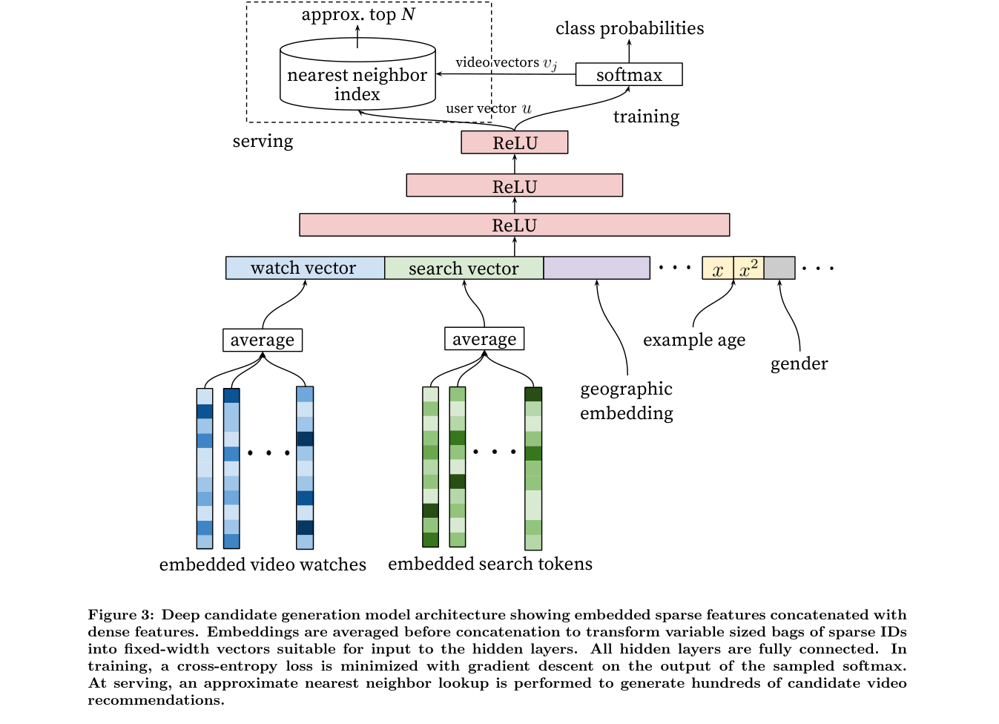

# YouTube DNN: A deep user tower for candidate generation

<!-- source-sha256: 6fdbc162f51c3c282c0b19893ca9138b7b299fb5c34e21b118524d0311332dc2 -->

[简体中文](README.md)

> Trains history pooling, nonlinear user tower and item embeddings, not private logs or production sampled softmax.

## Paper information

| Field | Details |
|---|---|
| Paper | [Paper or original source](https://research.google/pubs/deep-neural-networks-for-youtube-recommendations/) |
| Institution | Google / YouTube. |
| First public release | 2016-09-15 |
| Author code | No official author code linked by the paper as checked on 2026-08-09. |
| Local adapter or method key | `youtube-dnn` |
| Local reproduction code | [`src/auto_research/reproductions/youtube_dnn/`](https://github.com/daiwk/auto-research/tree/main/src/auto_research/reproductions/youtube_dnn/) |

## Paper method and evidence

Separate fast candidate generation from fine ranking. Aggregate watch-history embeddings and other heterogeneous context with a deep nonlinear user tower. Predict the next video as large-scale multiclass classification and retrieve by nearest neighbor at serving.

<!-- paper-figure:start -->
### Original paper figure

The original figure shows candidate generation and ranking. From the [original paper](https://research.google/pubs/deep-neural-networks-for-youtube-recommendations/); copyright remains with the authors.
<!-- paper-figure:end -->

### Core equation

$$
P(v=i\mid U)=\frac{\exp(v_i^\top u)}{\sum_j\exp(v_j^\top u)}.
$$

### Reported results

The paper describes online architecture and offline comparisons but no quantified online lift meeting this repository's inclusion threshold. User-approved classic exception.

## Local reproduction

Complete MovieLens-100K, same item embeddings, negative samples, budget and full catalog. History mean-pooling two-tower vs nonlinear tower: three-seed NDCG@10 **0.02854→0.02666 (-6.61%)**. Retain the negative result. [Metrics](metrics/movielens-100k-seeds42-44.json). Run `auto-research reproduce --paper youtube-dnn --dataset-dir data`.
