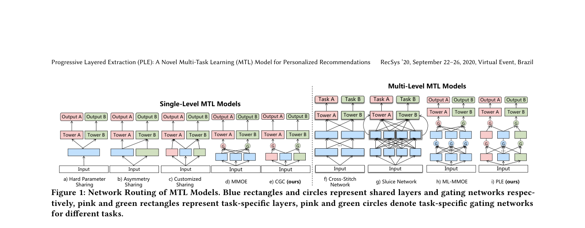

# PLE: Progressive extraction of shared and task-specific information

<!-- source-sha256: eab8131455b798e7c5e22ee907a207da513bc1535b061ea939f47874b8cc4af0 -->

[简体中文](README.md)

> Actual shared/task-specific experts, CGC gates and separate heads; not Tencent Video scale.

## Paper information

| Field | Details |
|---|---|
| Paper | [RecSys 2020 paper](https://doi.org/10.1145/3383313.3412236) |
| Institution | Tencent. |
| First public release | 2020-09-22 (ACM RecSys 2020) |
| Author code | No official author code linked by the paper as checked on 2026-08-09. |
| Local adapter or method key | `ple` |
| Local reproduction code | [`src/auto_research/reproductions/ple/`](https://github.com/daiwk/auto-research/tree/main/src/auto_research/reproductions/ple/) |

## Paper method and evidence

MMoE shares all experts across tasks, which can entangle common and conflicting signals. PLE splits shared and task-specific groups; layered CGC gates progressively extract both kinds of information and reduce seesaw effects.

<!-- paper-figure:start -->
### Original paper figure

The original figure shows progressive extraction. From the [original paper](https://doi.org/10.1145/3383313.3412236); copyright remains with the authors.
<!-- paper-figure:end -->

### Core equation

$$
f^k(x)=\sum_{i\in E_k\cup E_s}g_i^k(x)f_i(x).
$$

### Reported results

The paper reports outperforming MMoE on public and Tencent Video tasks and describes deployment. Included as a user-approved classic exception.

## Local reproduction

MovieLens-100K two-task entire-space protocol. Compare matched MMoE with two task-specific groups plus shared experts; each task gates only its own group and the shared group. Three-seed mean task AUC **+1.34%**; CTR **0.56882→0.57982**, conversion **0.56009→0.56418**. [Metrics](metrics/movielens-100k-seeds42-44.json). Run `auto-research reproduce --paper ple --dataset-dir data`.
