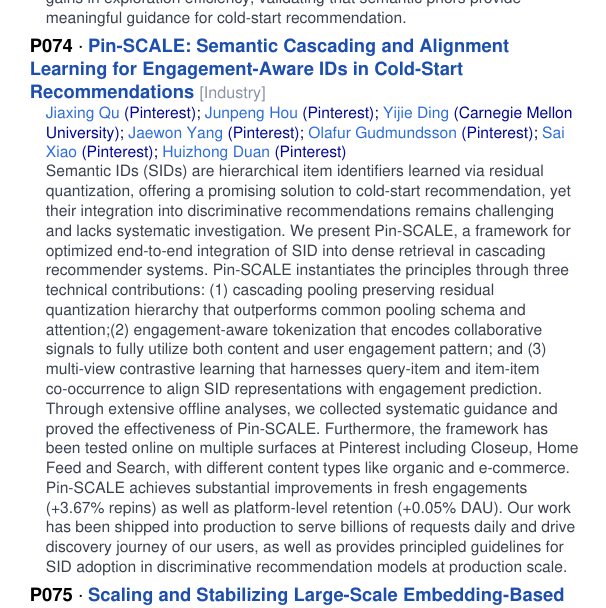

# Pin-SCALE: Cascading, alignment, and deployment of engagement-aware semantic IDs

<!-- source-sha256: 65bd178b5e9c3ed3ca3300296bca7e1cc6dca59b048ca25d20fcadba090079c5 -->

[简体中文](README.md)

> Core engagement-aware residual codebooks and cascade similarity.

## Paper information

| Field | Details |
|---|---|
| Paper | [Paper or original source](https://sigir2026.org/SIGIR2026_program.pdf) |
| Institution | Pinterest. |
| First public release | 2026-07-19 |
| Author code | No official author code linked by the paper as checked on 2026-08-09. |
| Local adapter or method key | `pin-scale` |
| Local reproduction code | [`src/auto_research/reproductions/pin_scale/`](https://github.com/daiwk/auto-research/tree/main/src/auto_research/reproductions/pin_scale/) |

## Paper method and evidence

Keep residual SID hierarchy via cascading pooling, encode engagement into tokenization, and use query–item and item–item contrastive views to align IDs with engagement prediction for dense retrieval.


<!-- paper-figure:start -->
### Original paper figure

[](https://sigir2026.org/SIGIR2026_program.pdf#page=96)

Figure shows SID hierarchy and alignment. From the [original paper](https://sigir2026.org/SIGIR2026_program.pdf); copyright remains with the authors.
<!-- paper-figure:end -->

### Core equation

$$
c_\ell=\arg\min_j w_i\lVert r_\ell-e_{\ell,j}\rVert_2^2,\qquad
\mathcal L=\mathcal L_{\mathrm{rank}}+
\lambda_q\mathcal L_{q,i}+\lambda_i\mathcal L_{i,i}.
$$

### Reported results

Deployed on Pinterest Closeup, Home Feed and Search: fresh Repin +3.67%, DAU +0.05%, billions of daily requests.

## Local reproduction

```bash
auto-research reproduce --paper pin-scale --dataset-dir data --seed 42
```

Unweighted semantic/content ranker vs engagement-weighted three-level SID: NDCG@10 **0.03540→0.04022 (+13.61%)**, fresh Hit@10 **+50.00%** on a very small denominator. [Metrics](metrics/movielens-seed42.json). The SIGIR program is the verified primary source, not an arXiv record. Public popularity/transitions proxy Pinterest engagement.
