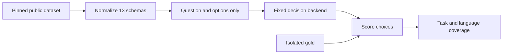
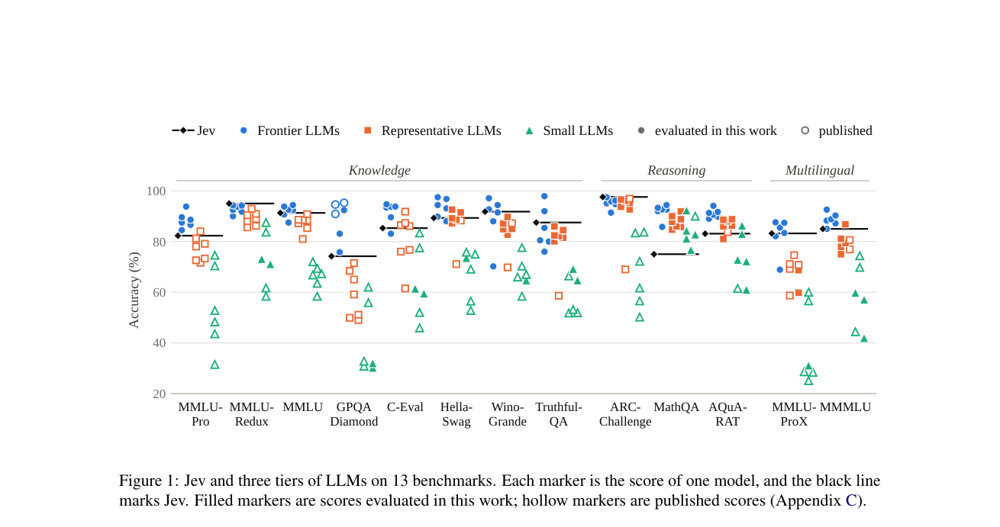

# Jev capability evaluation: What finite-choice benchmarks do and do not establish

<!-- source-sha256: 9484343eb3f24d2ff8c29ecdb8396472ae1bdf62060678922467f9d94eb10033 -->

[简体中文](README.md)

> Finite-choice evaluation protocol with one real public-checkpoint run, not a reproduction of the paper's closed model.

## Paper information

| Field | Details |
|---|---|
| Paper | [arXiv 2610.11978](https://arxiv.org/abs/2610.11978) |
| Institution | Dalian Maritime University; Xing Li and Qingcheng Chang are co-first authors. |
| First public release | 2026-10-08 (arXiv v1) |
| Author code | No author code found as of 2026-10-10; TypeSafe Jev weights are not public. |
| Local adapter or method key | `jev-capability`, evaluation entry point, not a training algorithm. |
| Local reproduction code | `src/auto_research/system_one/capability_bench.py`, `capability_data.py`; runner `scripts/run_jev_capability.py`. |

## Paper method and evidence

Evaluate knowledge, reasoning, and multilingual ability by sending only the question and options once. Math is weaker than knowledge in the paper. Keep vendor-reported and author-measured scores separate because prompting protocols differ; this is not a new architecture or objective.

<!-- paper-figure:start -->
### Original paper figure

Figure 1: separate measured and reported evidence, not a unified ranking. From the [original paper](https://arxiv.org/abs/2610.11978); copyright remains with the authors.
<!-- paper-figure:end -->

### Core equation

Accuracy is correct selections divided by questions, with Wilson 95% intervals. Illegal choices are wrong, not retried. Multilingual reporting keeps language-macro and sample-weighted accuracy separate.

### Reported results

The original Figure 1 compares closed Jev and three tiers of LLMs over 13 benchmarks; solid points are measured by the authors, hollow points are public reports under potentially different protocols. It is not the open NanoJev result.

## Local reproduction

Supports MMLU-Pro, MMLU-Redux, MMLU, GPQA Diamond, C-Eval, HellaSwag, WinoGrande, TruthfulQA MC1, ARC-Challenge, MathQA, AQuA-RAT, MMLU-ProX, and MMMLU. `capability_data.DATASETS` lists official sources. Require complete 40-character revisions; execute no remote dataset Python. Record config, language, original split, normalized SHA-256, counts, and exclusions. Shuffle GPQA options deterministically rather than keeping correct choice at A. Apply explicit Redux correction indices and reject ambiguity or labels that cannot be mapped; this local cleanup may differ from the paper. Do not guess unlabelled C-Eval test answers; a labeled validation run remains `source_split=validation`. Require explicit languages and never call an English subset full 29/14-language coverage. Explanations, CoT, and gold are excluded from requests.

~~~bash
pip install -e '.[system-one-gpu]'
PYTHONPATH=src python scripts/run_jev_capability.py prepare \
  --benchmark arc-challenge --config ARC-Challenge --language en \
  --revision 210d026faf9955653af8916fad021475a3f00453 \
  --output data/system-one-capability/arc.jsonl
~~~

~~~bash
PYTHONPATH=src python scripts/run_jev_capability.py evaluate \
  --backend nanojev --checkpoint-dir checkpoints/nanojev --device cuda:0 \
  --data data/system-one-capability/arc.jsonl \
  --output runs/jev-capability/report.json
~~~

Pass multiple JSONL inputs with --data; each needs a generated .source.json. Use official config/language names. GPQA authentication failure is an error, not a proxy substitution. Closed Jev calls the live service only with explicit TYPESAFE_API_KEY and --backend typesafe; secrets are excluded. Fixed-temperature repeats do not count as independent seeds; no test tuning.

Tests cover all 13 schemas, option ordering, label isolation, hashes, and reported versus measured evidence. On 2026-10-10 a real A100 ran NanoJev once on all 1,172 official ARC-Challenge test items: 327 correct, 27.90%, Wilson 95% CI 25.41%–30.54%. No test training, tuning, or retries. [Sanitized GPU receipt](../../gpu-validations/jev-capability-a100-20261010.json) records revisions. This is not the paper's 97.6% closed Jev result. The other 12 tasks are unmeasured and listed under coverage.missing. No training or trainable Evolve operator.

Sources: [full text](https://arxiv.org/html/2610.11978v1), [official ARC data](https://huggingface.co/datasets/allenai/ai2_arc), [Redux corrections](https://huggingface.co/datasets/edinburgh-dawg/mmlu-redux-2.0), [TruthfulQA MC1](https://huggingface.co/datasets/truthfulqa/truthful_qa).
