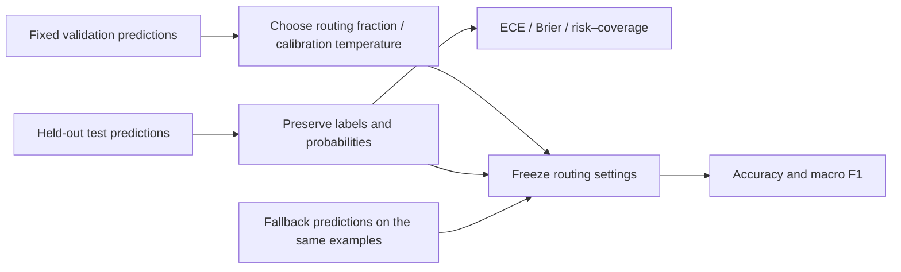
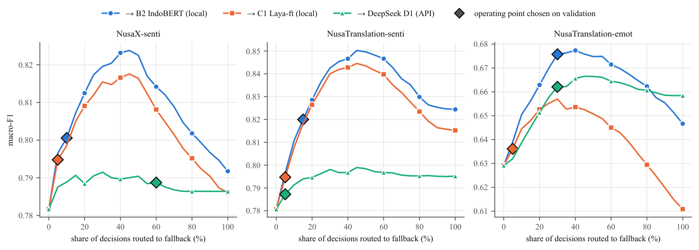

# JEV Cross-Lingual Transfer, Calibration, and Confidence Cascades

<!-- source-sha256: 3a550deb82128ff8f3339ffc10f50a730a3aef8a7167331ad5e905c9706f8360 -->

[简体中文](README.md)

## Paper information

| Field | Value |
| --- | --- |
| Paper | [arXiv 2610.14112v1](https://arxiv.org/abs/2610.14112v1) |
| First author's affiliation | Universitas Budi Luhur, Jakarta, Indonesia (Romi Fadli; verified on the first page of the PDF) |
| First public date | 2026-10-09 (arXiv v1) |
| Authors' open-source code | [Code, preregistration, and all predictions](https://github.com/tnromy/evaluating-system-one-models-for-indonesian-regional-languages/tree/a8499c2b71815ca512563dbb7fdc5c51dc783f6a), pinned to `a8499c2b71815ca512563dbb7fdc5c51dc783f6a` |
| Local adapter | `jev-regional-transfer` (rescoring published predictions, not training) |
| Local code | `src/auto_research/system_one/regional_transfer.py`; entry point: `scripts/run_jev_regional_transfer.py` |

## Original paper

### Background and contribution

Well-calibrated probabilities do not guarantee a useful ranking of a model's own errors. The study examines accuracy, calibration, error ranking, translation, and labeling requirements in 12 NusaX languages and 7 parallel NusaTranslation languages. English, Indonesian, and regional-language versions share sentence IDs, so cross-language comparisons cluster by sentence instead of treating translations as independent observations.

A low-cost decision model answers every example; a local classifier or LLM handles a low-confidence subset. The authors use validation macro F1 to pick the smallest routing fraction, then freeze it for test evaluation rather than choosing the best test point. The paper does not propose a new architecture.



<!-- paper-figure:start -->
### Key figure from the paper

[](https://github.com/tnromy/evaluating-system-one-models-for-indonesian-regional-languages/blob/a8499c2b71815ca512563dbb7fdc5c51dc783f6a/results/figures/fig4_cascade_h3b.pdf)

The authors' Figure 4: the x-axis is the fraction sent to the fallback, and diamonds are selected on validation. This is the paper result, not the local single-seed Javanese recalculation. The figure is from the pinned public repository, CC BY-SA 4.0, attributed to Romi Fadli et al.

From the [original paper](https://arxiv.org/pdf/2610.14112v1); copyright belongs to the authors.
<!-- paper-figure:end -->

### Core equations

$$
\mathrm{ECE}=\sum_b \frac{|B_b|}{N}|\mathrm{acc}(B_b)-\mathrm{conf}(B_b)|,
\quad \mathrm{Brier}=\frac1N\sum_i\sum_k(p_{ik}-\mathbf1[y_i=k])^2.
$$

$$
\mathrm{AURC}=\frac1N\sum_{k=1}^N\mathrm{risk}(k),\qquad
r^*=\min\{r:F_1(\mathrm{cascade}_r;V)\ge\max(F_1(P;V),F_1(F;V))\}.
$$

Routing fractions are selected on the 0%, 5%, …, 100% grid. If none meets the criterion, choose the best validation point, preferring lower cost on ties. Temperature scaling is a local extension: $p'_k\propto p_k^{1/T}$, with $T$ selected only by validation NLL. Exact zero probabilities do not acquire mass; NLL uses a machine-precision floor to remain finite, and extreme NLL is not evidence of ordinary calibration behavior.

### Paper results

Mean ECE in regional languages did not necessarily worsen, but the ability to rank errors degraded. The original local cascades typically improved the cost–quality trade-off by routing only a small share of low-confidence samples. No production A/B test was reported. The original study involved 1,270 trainings and 24.3 T4 GPU hours; **we do not retrain all learning curves or call commercial APIs**.

## Local reproduction

The evaluator rescores published predictions, computes ECE with 15 equal-width right-closed bins, Brier score, NLL, the authors' stable-sort AURC, and an additional confidence tie-grouped AURC. It also selects the cascade fraction by validation macro F1. The two AURC variants are named separately because their tie rules differ. The published labels can disagree with the argmax of rounded probabilities. Label-based accuracy retains those labels; probability-argmax accuracy and disagreement counts are reported separately. Calibration and risk–coverage follow the authors' probability-argmax convention.

The loader strictly validates probabilities, labels, splits, and duplicate `(dataset, language, item_id)` keys. The fallback must cover every identical example and agree on gold labels; it does not silently take an intersection. Overlap between validation and test keys is rejected. Gold answers are used only for offline scoring and are not sent to a model inference entry point.

### Prepare and run

```bash
pip install -e . 'pyarrow>=20,<24'
PYTHONPATH=src python scripts/prepare_jev_regional_predictions.py \
  --output data/jev-regional-predictions
PYTHONPATH=src python scripts/run_jev_regional_transfer.py \
  --validation data/jev-regional-predictions/validation.parquet \
  --test data/jev-regional-predictions/test.parquet \
  --output runs/jev-regional/all-languages.json
PYTHONPATH=src python scripts/run_jev_regional_transfer.py \
  --validation data/jev-regional-predictions/validation.parquet \
  --test data/jev-regional-predictions/test.parquet \
  --fallback-validation data/jev-regional-predictions/fallback-valid.parquet \
  --fallback-test data/jev-regional-predictions/fallback-test.parquet \
  --language jav --output runs/jev-regional/javanese-cascade.json
```

The preparation script downloads only 4 pinned public Parquet files totaling 140,584 bytes and verifies the Git blob SHA1 of each. A corrupt cache fails rather than being silently overwritten. Upstream code is MIT; predictions and results are CC BY-SA 4.0. **Jev outputs are for benchmarking only and cannot be used to train or distill any model.** This entry point is not a trainable Evolve operator.

### Verified results and limitations

On 2026-10-14, the CPU evaluator recalculated the pinned repository's NusaX **A1 native Choice, English condition** over 12 languages, 1,200 validation items, and 4,800 test items. The macro average of reported-label accuracy was 79.9792%. Seven test labels disagreed with the probability argmax and were recorded separately. On Javanese (100 validation / 400 test), base accuracy was 89%. Validation selected 10% rank routing; with published IndoBERT seed 0 predictions as fallback, test accuracy was 91% and macro F1 was 0.89905. This is not the original Noul all-language, three-seed comparison.

See the [CPU recalculation receipt](metrics/public-predictions-cpu.json) for results and source hashes. This run did not recalculate the other NusaTranslation tasks, translation arms, label learning curves, mixed-effects models, full multi-seed evaluation, or API cost analysis. Temperature selection and absolute-threshold routing are additional explorations; settings are frozen on validation and never selected on test. This does not claim renewed reproduction of commercial-model capabilities or a stable training gain.

Sources: [paper](https://arxiv.org/pdf/2610.14112v1), [pinned evaluation code](https://github.com/tnromy/evaluating-system-one-models-for-indonesian-regional-languages/blob/a8499c2b71815ca512563dbb7fdc5c51dc783f6a/src/jevexp/eval.py), and [authors' cascade implementation](https://github.com/tnromy/evaluating-system-one-models-for-indonesian-regional-languages/blob/a8499c2b71815ca512563dbb7fdc5c51dc783f6a/analysis/run_cascade.py).
