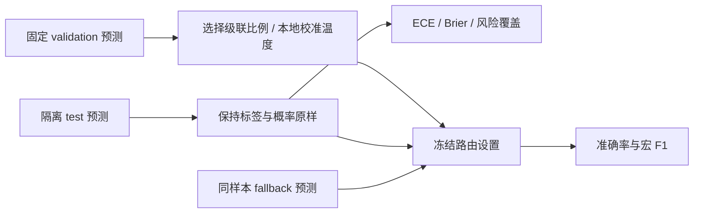
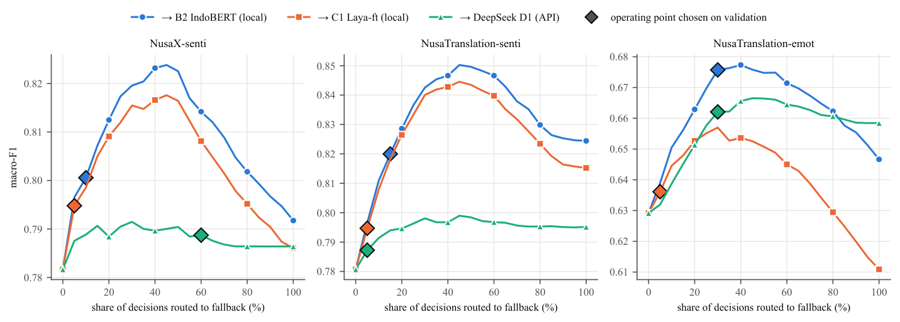

# JEV 跨语言迁移、校准与置信度级联

## 论文信息

| 字段 | 内容 |
| --- | --- |
| 论文链接 | [arXiv 2610.14112v1](https://arxiv.org/abs/2610.14112v1) |
| 一作机构 / 公司 / 学校 | Universitas Budi Luhur，印度尼西亚雅加达（Romi Fadli；原 PDF 首页核对） |
| 首次公开日期 | 2026-10-09（arXiv v1） |
| 原作者开源代码 | [代码、预注册与全部预测](https://github.com/tnromy/evaluating-system-one-models-for-indonesian-regional-languages/tree/a8499c2b71815ca512563dbb7fdc5c51dc783f6a)，固定 commit `a8499c2b71815ca512563dbb7fdc5c51dc783f6a` |
| 本地 Adapter | `jev-regional-transfer`（公开预测复算入口，不是训练 adapter） |
| 本地复现代码 | `src/auto_research/system_one/regional_transfer.py`；入口 `scripts/run_jev_regional_transfer.py` |

## 原始论文总结

### 背景与主要改动

“输出概率校准良好”不等于“能可靠排序自己的错误”。本文在 NusaX 的 12 种语言和 NusaTranslation 的 7 种平行语言上，分别研究准确率、校准、错误排序、翻译和所需人工标签量。英语/印尼语和区域语言共享句子 ID，因此跨语言比较需要以句子为聚类单位，而不是把语言版本当独立样本。

方法是先让低成本决策模型回答所有样本，再把低置信度的一部分交给本地分类器或 LLM。原作者以验证集宏 F1 选择最小路由比例，再冻结该比例评测测试集；不是在测试结果中挑最优点。本文不提出新的模型架构。



<!-- paper-figure:start -->
### 原论文关键图

[](https://github.com/tnromy/evaluating-system-one-models-for-indonesian-regional-languages/blob/a8499c2b71815ca512563dbb7fdc5c51dc783f6a/results/figures/fig4_cascade_h3b.pdf)

原作者 Figure 4：横轴是交给 fallback 的比例，菱形点由 validation 选定。这是论文结果，不是本地爪哇语单 seed 重算；图像来自固定公开仓库，CC BY-SA 4.0，署名 Romi Fadli 等。

图片来自[原论文](https://arxiv.org/pdf/2610.14112v1)，版权归原作者所有。
<!-- paper-figure:end -->

### 核心公式

$$
\mathrm{ECE}=\sum_b \frac{|B_b|}{N}|\mathrm{acc}(B_b)-\mathrm{conf}(B_b)|,
\quad \mathrm{Brier}=\frac1N\sum_i\sum_k(p_{ik}-\mathbf1[y_i=k])^2.
$$

$$
\mathrm{AURC}=\frac1N\sum_{k=1}^N\mathrm{risk}(k),\qquad
r^*=\min\{r:F_1(\mathrm{cascade}_r;V)\ge\max(F_1(P;V),F_1(F;V))\}.
$$

路由比例在 0%、5%、…、100% 网格选取；无达标点时取验证集最佳点并优先较低成本。概率校准是本地扩展：$p'_k\propto p_k^{1/T}$，温度只按验证 NLL 选择。精确零概率不凭空补质量；NLL 为数值有限使用机器精度下界，极端 NLL 不能误读为正常校准表现。

### 论文离线与线上效果

论文观察到区域语言的平均 ECE 未必恶化，但错误排序能力变差；原作者局部级联通常只路由少量低置信度样本即可改善成本/质量。本文没有生产线上 A/B。原研究涉及 1,270 次训练、24.3 T4 GPU 小时；按成本规则，本轮**不重训全部学习曲线，不调用商业 API**。

## 本地复现

本地提供公开预测复算、15 等宽右闭区间 ECE、Brier、NLL、作者稳定排序 AURC、额外的置信度 tie-grouped AURC，以及按验证集宏 F1 选比例的级联。两个 AURC 的 tie 规则不同，因此名称分开。固定预测标签可能与公开四舍五入概率的 argmax 不一致；保留标签计算准确率，另报概率 argmax 准确率与不一致数量，校准/风险覆盖按作者概率 argmax 口径。

读取时严格检查概率、标签、split、重复 `(dataset, language, item_id)`。fallback 必须覆盖每一个相同样本且 gold 一致，不静默取交集。验证与测试键相交即拒绝。标准答案仅进入离线评分；没有发送到模型的推理入口。

### 一键准备和运行

```bash
pip install -e . 'pyarrow>=20,<24'
PYTHONPATH=src python scripts/prepare_jev_regional_predictions.py \
  --output data/jev-regional-predictions
PYTHONPATH=src python scripts/run_jev_regional_transfer.py \
  --validation data/jev-regional-predictions/validation.parquet \
  --test data/jev-regional-predictions/test.parquet \
  --output runs/jev-regional/all-languages.json
PYTHONPATH=src python scripts/run_jev_regional_transfer.py \
  --validation data/jev-regional-predictions/validation.parquet \
  --test data/jev-regional-predictions/test.parquet \
  --fallback-validation data/jev-regional-predictions/fallback-valid.parquet \
  --fallback-test data/jev-regional-predictions/fallback-test.parquet \
  --language jav --output runs/jev-regional/javanese-cascade.json
```

准备脚本只下载 4 个固定公开 parquet，合计 140,584 字节，逐个核对 Git blob SHA1；缓存错误即失败，不静默覆盖。作者代码 MIT；预测和结果 CC BY-SA 4.0。**Jev 输出仅允许 benchmarking，禁止用来训练或蒸馏任何模型。**本入口不作为 evolve 的可训练 operator。

### 已验证结果与边界

2026-10-14 在 CPU 上实际重算固定仓库的 NusaX **A1 native Choice 英文条件**：12 语言、1,200 validation、4,800 test，报告标签准确率宏平均 79.9792%。7 个 test 标签与概率 argmax 不一致，已单独保留记录。爪哇语 100 validation / 400 test，基础准确率 89%；验证选出的 10% rank 路由，结合作者已发布 IndoBERT seed 0 预测，test 准确率 91%、宏 F1 0.89905。不能把它写成论文原来的 Noul 全语言三 seed 对照。

结果及源哈希见 [CPU 复算记录](metrics/public-predictions-cpu.json)。其他 NusaTranslation 任务、翻译臂、标签学习曲线、混合效应模型、完整多 seed 和 API 成本分析未在本轮重算。温度选择与绝对阈值级联是额外探索；所有设置在验证集冻结，测试不用于选点。本地不声称再次复现了商业模型的能力或获得稳定训练提升。

来源：[原论文](https://arxiv.org/pdf/2610.14112v1)、[固定评测代码](https://github.com/tnromy/evaluating-system-one-models-for-indonesian-regional-languages/blob/a8499c2b71815ca512563dbb7fdc5c51dc783f6a/src/jevexp/eval.py)、[原作者级联](https://github.com/tnromy/evaluating-system-one-models-for-indonesian-regional-languages/blob/a8499c2b71815ca512563dbb7fdc5c51dc783f6a/analysis/run_cascade.py)。
