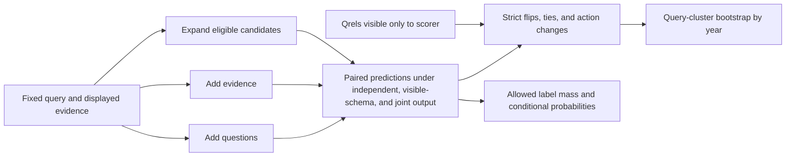
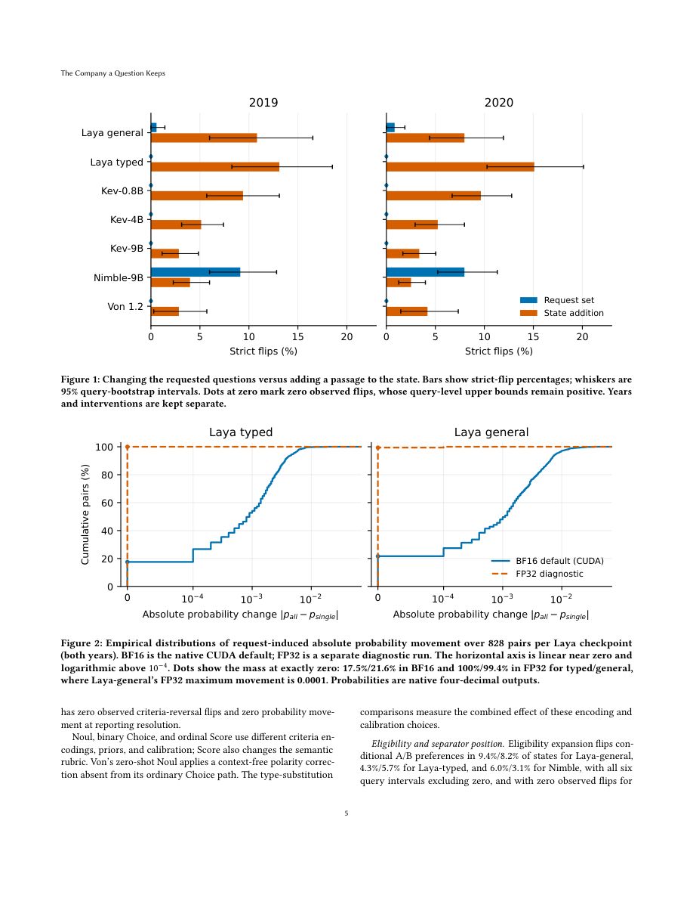

# JEV: Retrieval request independence audit

<!-- source-sha256: 2e0b5a5da56302a2cb739b52774349cc6e701522bff69078772d9b193a45540a -->

[简体中文](README.md)

## Paper information

| Field | Details |
|---|---|
| Paper | [arXiv 2610.14631v1](https://arxiv.org/abs/2610.14631v1) |
| Institution | First author Jianbo Chen, Tsinghua University, verified on the first page. |
| First public release | 2026-10-10 (arXiv v1) |
| Author code | No public download for the paper artifact was found as of 2026-10-14. The paper describes saved fixtures, predictions, and analysis code; the evaluated Laya/Kev/Nimble/Von repositories are not this artifact. |
| Local adapter | `jev-request-audit` (paired-prediction protocol, not a model or training adapter). |
| Local reproduction code | `src/auto_research/system_one/request_audit.py`; entry point `scripts/run_jev_request_audit.py`. |

## Paper method and evidence

Valid structured output does not imply question independence. The paper separates three interventions: add request questions while holding evidence and target propositions fixed; add evidence while holding the target and eligible candidates fixed; or expand the candidate set while holding all displayed evidence fixed. This distinguishes schema dependence from genuine context changes and candidate renormalization.

The paper uses 92 queries from TREC DL2019/2020 to construct 276 three-passage states, balancing scenarios with zero, one, or two positives. This is not a production distribution. Inputs exclude qrels, original document IDs, and scenario names. The independent compiler supplies only common evidence and the current question, not other questions, routing keys, or gold labels.



<!-- paper-figure:start -->
### Original paper figure

[](https://arxiv.org/pdf/2610.14631v1#page=5)

Figures 1–2 on page 5 of the [original paper](https://arxiv.org/pdf/2610.14631v1) distinguish question-set changes from added evidence and illustrate why small BF16/FP32 probability differences need separate diagnosis. Unmodified capture, attributed to Jianbo Chen under CC BY-NC-ND 4.0. Figure values are not local measurements.
<!-- paper-figure:end -->

### Core equations

$$
\widetilde p_l=\frac{e^{z_l}}{\sum_{k\in L}e^{z_k}},\qquad
M_L=\frac{\sum_{k\in L}e^{z_k}}{\sum_{v\in V}e^{z_v}}.
$$

Preserve both conditional probability and allowed-label mass over the full vocabulary. This prevents legal normalized outputs from hiding weak support. A binary strict flip is:

$$
\mathbf1[(p-0.5)(p'-0.5)<0].
$$

Pairs with either value exactly 0.5 count as ties, not strict flips. Under candidate expansion compare $p_A/(p_A+p_B)$, not the naturally diluted $p_A$ when C is added. The action is the highest-scoring option strictly above threshold, with fixed label order breaking ties and abstention when none qualifies.

### Reported results

For Nimble-9B, request expansion produced 9.1%/8.0% strict flips and 21.4%/18.9% action changes in 2019/2020. Flips disappeared when other schema fields were removed. For Laya, small BF16 probability movements largely disappeared in FP32 and are not evidence of semantic dependence. No production A/B was reported.

## Local reproduction

Implemented: distinct intervention constructors, a gold-free independent compiler, stable label-mass and conditional-probability calculations, A/B preference preservation, strict flips and ties, threshold actions, and binary/action accuracy differences.

`audit_paired_predictions` expects one before/after pair per row with `year`, `query_id`, `scenario`, `before`, `after`, and scorer-only `positive_labels`. Target sets must match. Duplicates, missing targets, or incomplete scenarios are errors, not reasons to silently reweight. Aggregate within query/scenario, then weight scenarios and queries equally. Bootstrap queries separately by year, default 5,000 resamples and seed 20260928. Zero observed events are accompanied by the query-level 95% upper bound $1-0.05^{1/n}$, not a guarantee of zero risk.

```bash
PYTHONPATH=src python scripts/run_jev_request_audit.py \
  --predictions runs/jev-audit/paired-predictions.jsonl \
  --threshold 0.5 --resamples 5000 \
  --output runs/jev-audit/report.json
```

Input comes from audited model requests. The script does not download TREC, load models, or produce the paper's 59,892 predictions. It records input hashes, but the collector must attest to checkpoint and request provenance; a hash cannot prove gold isolation.

[Protocol validation](metrics/protocol-validation.json) covers stable independent request bytes, visible evidence changes, unchanged evidence under candidate expansion, low allowed-label mass, 0.5 ties, action changes without a strict flip, year separation, query resampling, and rejection of incomplete scenarios. No seven-checkpoint rerun or local reanalysis of released real predictions was performed. The original suite uses seven decision checkpoints, four LLM controls, and tens of thousands of intervened predictions; no verifiable public artifact was found to permit a cheap rerun. Full model evaluation remains deferred. The protocol may be used by future backends but is not GPU validation or evidence of Evolve improvement. See [paper Sections 3–4](https://arxiv.org/html/2610.14631v1).
