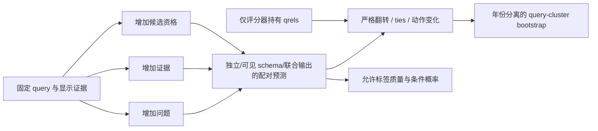
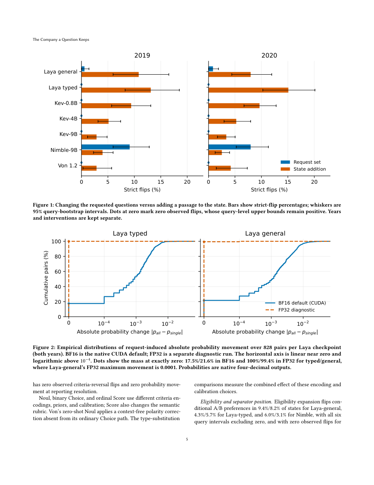

# JEV 检索请求独立性审计

## 论文信息

| 字段 | 内容 |
| --- | --- |
| 论文链接 | [arXiv 2610.14631v1](https://arxiv.org/abs/2610.14631v1) |
| 一作机构 / 公司 / 学校 | 清华大学（Jianbo Chen，原文首页核验） |
| 首次公开日期 | 2026-10-10（arXiv v1） |
| 原作者开源代码 | 截至 2026-10-14，未找到本论文 artifact 的公开下载地址；原文只描述保存的 fixtures、预测和分析代码。被测 Laya/Kev/Nimble/Von 仓库不是本论文 artifact |
| 本地 Adapter | `jev-request-audit`（配对预测协议，不是模型或训练 adapter） |
| 本地复现代码 | `src/auto_research/system_one/request_audit.py`；入口 `scripts/run_jev_request_audit.py` |

## 原始论文总结

### 背景与主要改动

合法结构化输出不能保证问题彼此独立。论文分离三种干预：增加请求问题时保持证据和目标命题不变；增加证据时保持原目标、候选资格不变；增加可选候选时保持全部显示证据不变。这样可以区分问题 schema 依赖、真实上下文改变和候选归一化效应。

论文对 TREC DL2019/2020 的 92 个 query 构造 276 个三段落状态，按 0/1/2 个正例平衡场景；它不是生产分布。输入不包含 qrels、原始文档 ID 或场景名。问题独立编译器只将共享证据和当前问题送入模型，不序列化其他问题、路由键或 gold。



<!-- paper-figure:start -->
### 原论文关键图

[](https://arxiv.org/pdf/2610.14631v1#page=5)

原论文第 5 页 Figure 1–2：问题集合变化和证据新增不能混为一谈；BF16 与 FP32 的微小概率差异也需要单独诊断。截图未改动原内容，署名 Jianbo Chen，原文 CC BY-NC-ND 4.0；图中成绩不是本地实测。

图片来自[原论文](https://arxiv.org/pdf/2610.14631v1)，版权归原作者所有。
<!-- paper-figure:end -->

### 核心公式

$$
\widetilde p_l=\frac{e^{z_l}}{\sum_{k\in L}e^{z_k}},\qquad
M_L=\frac{\sum_{k\in L}e^{z_k}}{\sum_{v\in V}e^{z_v}}.
$$

允许标签归一化概率与允许标签在全词表中的质量分别保留，不能把低输出支持隐藏在合法概率里。二元严格翻转为

$$
\mathbf1[(p-0.5)(p'-0.5)<0].
$$

任一值恰为 0.5 的 pair 另记 tie，绝不算 strict flip。候选扩展比较 $p_A/(p_A+p_B)$，而不是直接比较因为加入 C 后自然下降的 $p_A$。动作策略固定为选超过阈值的最高分项、同分按标签顺序；无项超过阈值则拒答。

### 论文离线与线上效果

原文 Nimble-9B 的请求扩展 strict flip 为 9.1% / 8.0%，动作变化为 21.4% / 18.9%（2019 / 2020）；删除其他 schema 字段后翻转消失。Laya 的 BF16 小概率移动在 FP32 检查中基本消失，不能称语义独立性失败。本文没有生产线上 A/B。

## 本地复现

已实现三种不混淆通道的干预构造器、gold-free 独立编译器、数值稳定的标签质量/条件概率计算、保留 A/B 偏好、严格翻转和 tie、阈值动作、二元正确率与动作正确率差。

`audit_paired_predictions` 输入一行一对状态，至少包含 `year`、`query_id`、`scenario`、`before`、`after` 和评分器专属 `positive_labels`。前后目标集合必须相同；重复状态、缺目标和不完整场景覆盖直接报错，不静默重权。先在 query/scenario 内聚合，再场景等权、query 等权；bootstrap 抽 query，年份完全分离，默认 5,000 次、seed 20260928。零事件 CI 不伪装成“保证为零”，改记零观察和 query-level 95% 上界 $1-0.05^{1/n}$。

```bash
PYTHONPATH=src python scripts/run_jev_request_audit.py \
  --predictions runs/jev-audit/paired-predictions.jsonl \
  --threshold 0.5 --resamples 5000 \
  --output runs/jev-audit/report.json
```

这是用户提供配对预测的分析入口；该文件必须来自经过审计的模型请求。脚本不自行下载 TREC、不加载模型、不声称生成了论文的 59,892 个预测。输入哈希会保存，但 checkpoint 和请求来源需由采集端提供，文件哈希本身不能证明 gold 隔离。

### 已验证结果与边界

本轮只验证协议与公式，单元测试覆盖独立问题字节不变、证据变化可见、候选变化不改证据、低输出标签质量、0.5 ties、没有 strict flip 的动作交换、年份分离、query 重采样、遗漏场景拒绝。见 [协议验证记录](metrics/protocol-validation.json)。**没有重跑七个 checkpoint，没有公开真实 artifact 的本地重分析成绩，不作为 evolve 改善证据。**

完整原实验涉及七个 decision checkpoint、四个 LLM 控制模型和数万次多干预预测；原作者 artifact 未公开可验证，本轮没有廉价复算入口。按成本规则保留为“完整模型评测暂缓”，不启动下载或多臂推理。协议代码可以供现有后端后续使用，但不能替代真实 GPU 验证。

来源：[原文方法 3–4 节](https://arxiv.org/html/2610.14631v1)。
