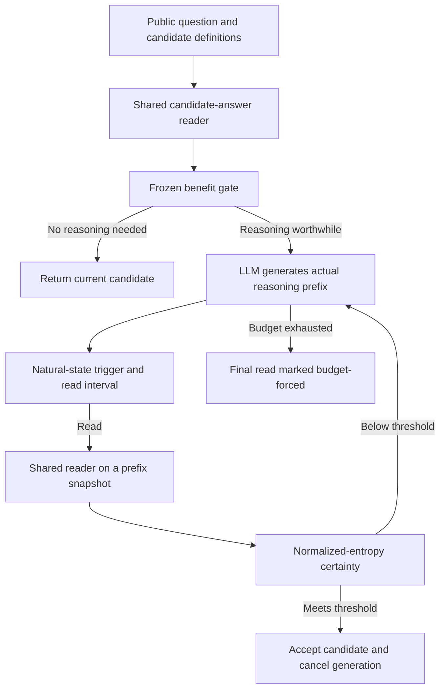
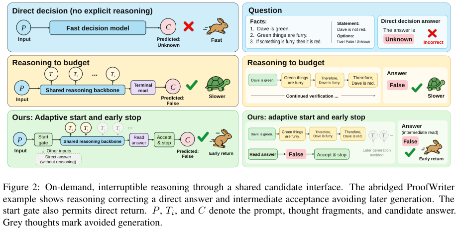

# Selective Reasoning: When to Start Reasoning, Read Candidate Answers, and Stop

<!-- source-sha256: 20c8743f26e83c2507091f8b09077a70fd3e41c6e3693892836627e3010e6d6b -->

[简体中文](README.md) · English

> The local work is a **CPU statistical check of pinned author measurements and a controller interface that does not read gold answers**, not a reproduction of online Qwen3.5-4B capabilities. The public release contains no raw token traces or feature caches; recomputation does not verify exact-prefix relationships. The full online multi-policy experiment exceeds the cost budget and was not reproduced (review complete).

## Paper information

| Field | Details |
| --- | --- |
| Paper | [arXiv 2610.19644](https://arxiv.org/abs/2610.19644) |
| Affiliation | University of Electronic Science and Technology of China |
| First public release | 2026-10-14 (arXiv v1, 06:13:42 UTC) |
| Authors' open-source code | Yes: [author repository](https://github.com/binzheng-joey/selective-reasoning), pinned [v1.0 release](https://github.com/binzheng-joey/selective-reasoning/releases/tag/v1.0), commit `26795854fe148e7a4caa37ef6cc051431b8b8790` |
| Adapter | No paper-capability adapter; standalone local interface key `selective-reasoning` |
| Local implementation | [`src/auto_research/system_one/selective_reasoning.py`](https://github.com/daiwk/auto-research/blob/main/src/auto_research/system_one/selective_reasoning.py), runner `scripts/run_selective_reasoning.py` |

Bin Zheng and Zheng Chen are co-first authors. The affiliation grouping records the same university for both, not two individual entries.

## Original paper summary

### Background and main changes

A typed decision model returns a choice from explicit candidates, which suits JEV/System One decisions. Direct readout is not always sufficient for multi-step reasoning, while always generating long reasoning wastes compute. The paper fits a shared candidate-answer reader on frozen Qwen3.5-4B. Both empty and intermediate reasoning prefixes can yield a candidate distribution.

The controller separates three decisions: a benefit gate decides whether to begin reasoning; a trigger from the natural generation state decides when to request explicit answer readout; a normalized-entropy threshold decides whether to accept a candidate and cancel further generation. The original online system also has concurrent generation and reading, request cancellation, exact prefix restoration, and cost accounting. It is not a script that stops early based on answer correctness.



<!-- paper-figure:start -->
### Key figure from the paper

[](https://arxiv.org/pdf/2610.19644v1#page=3)

> **Figure 2, PDF page 3:** Direct decisions, fixed-budget reasoning, and adaptive start/early stop. The figure comes from the [original paper](https://arxiv.org/pdf/2610.19644v1#page=3), © the original authors. Example answers in the figure explain the method; they are not supplied to the local controller under test.
<!-- paper-figure:end -->

### Core equations

The shared readout maps the hidden state for the current answer query to a candidate distribution:

$$
p_t=\operatorname{softmax}(W_{1:K}\tilde h_t),\qquad a_t=\arg\max_jp_t(j).
$$

The paper uses $W\in\mathbb R^{4\times2560}$, or 10,240 parameters. Larger candidate sets use the corresponding answer-token logits. Readout certainty is

$$
q_t=1-\frac{H(p_t)}{\log K},\qquad H(p_t)=-\sum_j p_t(j)\log p_t(j).
$$

Normalization gives the threshold consistent meaning across candidate counts. Local `entropy_certainty()` implements this equation exactly. `LinearGate` uses frozen means, standard deviations, and logistic weights; it does not fit evaluation inputs. `SelectiveController.start / request_read / accept_read` distinguish startup, requesting a read, and acceptance. A budget-exhausted return must set `budget_forced=true` and must not be called a successful entropy-threshold stop.

### Reported offline and online results

The authors' main evaluation compares reasoning and reading policies on the same 768 questions from ProofWriter, LogiQA2, and ARC-Challenge. Direct readout scores 70.96% and the main controller 84.38%. The controller gains about 7.29 percentage points over fixed 512-token readout. Relative to 1024-token readout, pipeline time falls about 46.30% and accuracy is about 1.17 percentage points lower.

These are fixed measurements from the paper or authors, not a local model run or an industrial online A/B test. No industrial online A/B test was reported. Keep series separate: repeated timing48 averages three runs on each of 48 questions. Repetitions do not add accuracy samples, and accuracy from one series cannot be compared with cost from another.

## Local reproduction

> **Local comparison protocol:** Recompute the public author `records.csv` with same-question/same-group pairing and a bootstrap stratified by dataset and ProofWriter subtype. Check means, differences, ratios, and pointwise intervals. `expected.json` is only for final checks, not for computation or the controller. This path does not produce a local capability score.

### Setup and execution

Only the base Python/NumPy environment is needed, with no CUDA, LLM weights, paid API, or benchmark text. The two pinned public release packages total 3,059,419 bytes. Check exact sizes and SHA256 before extracting only six reviewed CPU files. Do not execute archived scheduling, GPU, or model scripts.

```bash
PYTHONPATH=src python scripts/run_selective_reasoning.py fetch \
  --release-dir .cache/selective-reasoning-v1.0

PYTHONPATH=src python scripts/run_selective_reasoning.py replay \
  --release-dir .cache/selective-reasoning-v1.0 \
  --output runs/selective-reasoning/replay-v1
```

`replay` runs the **unmodified author's `recompute.py --check`** in an isolated Python subprocess, with a default 180-second limit. The output directory must be new; failures remain recorded. Each of the six files has its own content hash. A mismatched ZIP, extra or missing measurements, duplicates, invalid accounting, or numeric mismatches fail validation.

### Measured verification results

All release series were verified on 2026-10-16. See the [stable verification record](validation/official-statistics-cpu.json). These are recomputed author measurements stored in acceptance records, not local model dashboard scores:

| Check | Actual result |
| --- | ---: |
| Independent series | 9 |
| Public author measurement rows | 29,808 |
| Bootstrap draws | 10,000 |
| Fixed bootstrap seed | 20261010 |
| Fixed numeric checks passed | 16,888 /16,888 |
| Local LLM inference calls | 0 |
| Local capability accuracy | Not applicable / null |

For example, `primary13` recomputes 545 /768 for direct, 648 /768 for the main controller, and 657 /768 for fixed 1024. This **recomputes author measurements**. It is not evidence that a local agent or new model reached 84.375% accuracy. All results remain `diagnostic_only=true / promotion_eligible=false`.

### Controller interface and data isolation

`PublicDecision.from_mapping()` accepts only `question / candidates / reasoning_prefix` and rejects extra fields such as `gold / answer / correct / reward / plan`. `LinearGate` takes frozen coefficients, standardization parameters, and public numeric features. Callers fit and select parameters on independent train/dev data. The controller loads no measurement CSV, expected target, or benchmark answer.

The interface can connect to a real backend, but this round integrates no trained shared reader, original concurrent vLLM reading and cancellation, hidden-state trigger, or prefix cache. Artificial probabilities are suitable only for interface unit tests, **not full method or online capability implementation**. No Evolve operator is registered and reference statistics are not promotion rewards.

### Code mapping

| Interface | Actual role |
| --- | --- |
| `fetch_release / extract_release` | Pinned small release packages, size/hash checks, allowlisted extraction |
| `validate_replay_inputs` | Original numeric measurement schema and file identity checks |
| `replay_official` | Original CPU statistics script, time limit, and verification-result import |
| `entropy_certainty / LinearGate` | Normalized entropy and logistic calculation with frozen standardization |
| `PublicDecision / SelectiveController` | Gold-isolated start, read, and stop interfaces |

## Reproduction limits and cost conclusion

The public packages omit question text, gold categories, model inference tokens, and raw feature caches. Statistical recomputation is not independent validation of model predictions or exact-prefix auditing. The local work does not fabricate missing inputs.

The full online study uses Qwen3.5-4B, 768 questions, multiple policies, and long token budgets. The released native-8192 condition averages approximately 38.2 seconds of pipeline time per question. At 768 questions, this condition alone is estimated at about eight device-hours, excluding other policies and development. This is an estimate from paper measurements, not local timing. **The full online experiments exceed the cost budget and were not reproduced (review complete)**. No automatic model download or long rollout.
