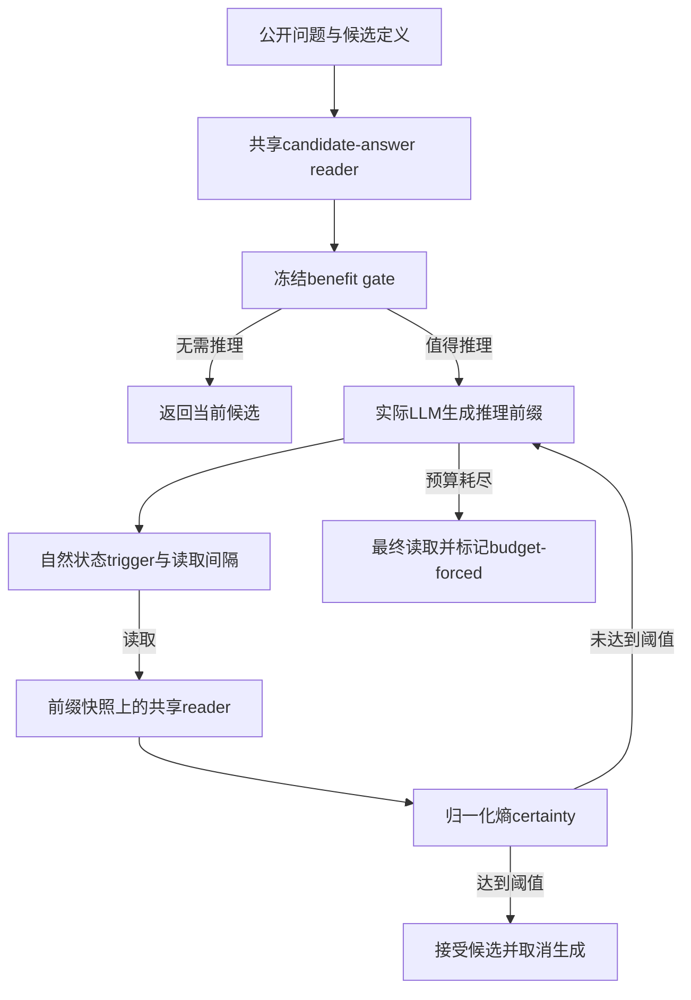
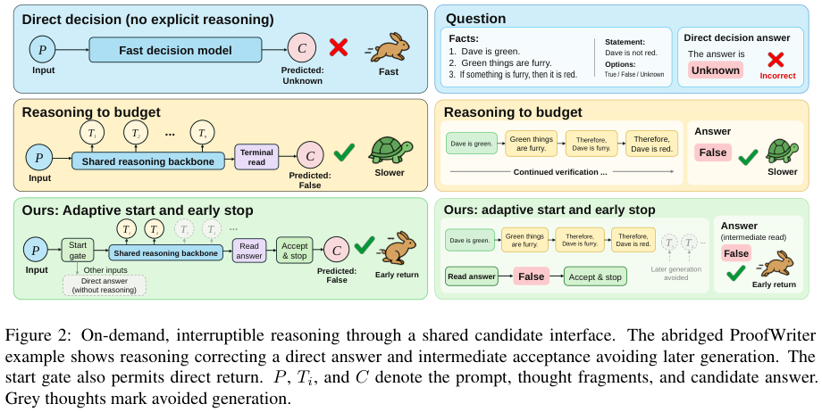

# Selective Reasoning：什么时候开始推理、读取候选答案和停止

> 本地完成的是**固定原作者测量的 CPU 统计复核与不读取 gold 的控制器接口**，不是 Qwen3.5-4B 在线能力复现。公开包不含原始 token trace / feature cache，不能据复算通过声称核实了 exact-prefix 关系。完整在线多策略实验为**成本过高，不复现（审查 DONE）**。

## 论文信息

| 项目 | 内容 |
| --- | --- |
| 论文链接 | [arXiv 2610.19644](https://arxiv.org/abs/2610.19644) |
| 公司/机构 | 电子科技大学（University of Electronic Science and Technology of China） |
| 首次公开日期 | 2026-10-14（arXiv v1，06:13:42 UTC） |
| 原文开源代码 | 是：[原作者仓库](https://github.com/binzheng-joey/selective-reasoning)，固定 [v1.0 release](https://github.com/binzheng-joey/selective-reasoning/releases/tag/v1.0)，commit `26795854fe148e7a4caa37ef6cc051431b8b8790` |
| Adapter | 不注册论文能力 adapter；本地独立接口键为 `selective-reasoning` |
| 本地复现代码 | [`src/auto_research/system_one/selective_reasoning.py`](https://github.com/daiwk/auto-research/blob/main/src/auto_research/system_one/selective_reasoning.py)，入口 `scripts/run_selective_reasoning.py` |

两位作者 Bin Zheng / Zheng Chen 为共同一作，机构聚合按同一电子科大归类，不拆成两个个人条目。

## 原始论文总结

### 背景与主要改动

Typed decision model 从明确候选中返回选择，适合 JEV / System One 式判断，但直接读出不一定足以完成多步推理。始终生成很长的推理又浪费算力。本论文在冻结 Qwen3.5-4B 上拟合共享 candidate-answer reader，让空推理前缀和中间推理前缀都能返回候选分布。

控制器将三个问题分开：benefit gate 决定是否启动推理；从自然生成状态出发的 trigger 决定何时发起显式答案读取；归一化熵阈值决定是否接受当前候选并取消后续生成。原始在线系统还有并发生成 / 读取、请求中断、精确前缀恢复和成本核算，不是一个仅根据答案正确性提前返回的脚本。



<!-- paper-figure:start -->
### 原论文关键图

[](https://arxiv.org/pdf/2610.19644v1#page=3)

> **原论文 Figure 2，PDF 第 3 页**：对比直接判断、固定预算推理与自适应启动 / 提前停止。图片来自[原论文](https://arxiv.org/pdf/2610.19644v1#page=3)，版权归原作者所有；图中示例答案只用于论文说明，不传给本地被测控制器。
<!-- paper-figure:end -->

### 核心公式

共享读出头将当前答案查询的 hidden state 映射成候选分布：

$$
p_t=\operatorname{softmax}(W_{1:K}\tilde h_t),\qquad a_t=\arg\max_jp_t(j).
$$

原文 $W\in\mathbb R^{4\times2560}$，共10,240参数；更大候选集合使用对应答案 token logits。读取 certainty 使用

$$
q_t=1-\frac{H(p_t)}{\log K},\qquad H(p_t)=-\sum_j p_t(j)\log p_t(j).
$$

归一化使不同候选数下的阈值语义一致。本地 `entropy_certainty()` 精确实现此式；`LinearGate` 用冻结均值 / 标准差和 logistic 权重计算门控，不在评测输入上拟合。`SelectiveController.start / request_read / accept_read` 区分启动、触发读取与接受；预算耗尽返回必须标 `budget_forced=true`，不能说成熵阈值成功停止。

### 论文离线与线上效果

原作者 main evaluation 对同一768题（ProofWriter / LogiQA2 / ARC-Challenge）比较多种推理与读取策略。直接读取正确率为70.96%，主控制器84.38%；相对固定512-token读取提高约7.29个百分点，相对1024-token读取的pipeline time下降约46.30%、准确率低约1.17个百分点。

这是论文 / 作者固定测量上的结果，不是本地新跑的模型结果，也不是工业线上 A/B。原文未报告工业线上 A/B。不同 series 必须各自成组：重复 timing48 是48题内三次运行的均值，不能把重复次数当成额外准确率样本，不能把某系列accuracy和另一系列成本拼起来比较。

## 本地复现

> **本地对照口径**：重算原作者公开 `records.csv`，以同题 / 同组配对、dataset / ProofWriter subtype 分层的 bootstrap 复核均值、差值、比值及pointwise区间。`expected.json` 只用于最后检查，不参与计算，也不传给控制器。该入口不产生本地模型能力分数。

### 安装与执行

只需要项目基础环境的 Python / NumPy；无需 CUDA、LLM 权重、付费 API 或 benchmark 正文。两个固定公开发布包共3,059,419字节，先核对精确大小与SHA256，仅提取六个经过核阅的CPU文件；不执行压缩包中的历史调度 / GPU / 模型脚本。

```bash
PYTHONPATH=src python scripts/run_selective_reasoning.py fetch \
  --release-dir .cache/selective-reasoning-v1.0

PYTHONPATH=src python scripts/run_selective_reasoning.py replay \
  --release-dir .cache/selective-reasoning-v1.0 \
  --output runs/selective-reasoning/replay-v1
```

`replay` 在隔离Python子进程中执行**未修改的原作者 `recompute.py --check`**，默认180秒上限，新输出目录不得覆盖；失败会保留失败记录。六个文件有独立内容 hash；zip不符、额外 / 缺失measurement、重复测量、非法会计口径或数值不符均失败。

### 实际复核结果

2026-10-16 已实际完成全部发布系列，结果摘录见[稳定复核记录](validation/official-statistics-cpu.json)。这是作者测量复算，存于验收记录而不是本地模型成绩看板：

| 复核项 | 实际结果 |
| --- | ---: |
| 独立series数 | 9 |
| 原作者公开测量行 | 29,808 |
| Bootstrap draws | 10,000 |
| 固定bootstrap seed | 20261010 |
| 通过的固定数值检查 | 16,888 /16,888 |
| 本地LLM推理次数 | 0 |
| 本地能力准确率 | 不适用 / null |

例如从作者原始测量重新算出的 `primary13`：direct为545 /768，主控制器为648 /768，固定1024为657 /768；这是**作者测量复算**，不能在公开看板里当成本机Agent或新模型取得84.375%准确率。所有结果保持 `diagnostic_only=true / promotion_eligible=false`。

### 控制器接口与数据隔离

`PublicDecision.from_mapping()` 只接受 `question / candidates / reasoning_prefix`，拒绝 `gold / answer / correct / reward / plan` 等额外字段。`LinearGate` 接受冻结系数、标准化参数与公开数值特征；调用方应在独立 train/dev 上拟合和选择参数。控制器不加载测量CSV、expected目标或 benchmark 答案。

该接口可以接真实模型backend，但本轮没有接入 trained shared reader、原始vLLM的并发读取与取消、原始hidden-state trigger或prefix缓存。传入人工概率只可用于接口单测，**不算完整方法或在线能力实现**。不注册Evolve算子，也不把参考统计作为晋级奖励。

### 代码映射

| 接口 | 实际职责 |
| --- | --- |
| `fetch_release / extract_release` | 固定小发布包、大小/hash、白名单提取 |
| `validate_replay_inputs` | 原测量数值schema与文件身份检查 |
| `replay_official` | 原CPU统计脚本、时间限制、复核结果导入 |
| `entropy_certainty / LinearGate` | 归一化熵与冻结标准化logistic计算 |
| `PublicDecision / SelectiveController` | gold隔离的启动 / 读取 / 停止接口 |

## 复现边界与成本结论

公开包不包含问题正文、gold答案类别、模型推理token、原始feature caches；因此统计复算不等于独立验证模型预测或exact-prefix审计。本地不补造这些缺失输入。

完整在线研究使用Qwen3.5-4B、768题、多策略与长token预算。仅作者发布的native-8192平均pipeline time约38.2秒 /题，按768题估算该条件已有约8小时设备时间，未计其余策略与开发；这是依据论文测量的估算，非本机实测。故完整在线实验明确**成本过高，不复现（审查 DONE）**，不会再自动下载模型或启动长rollout。
