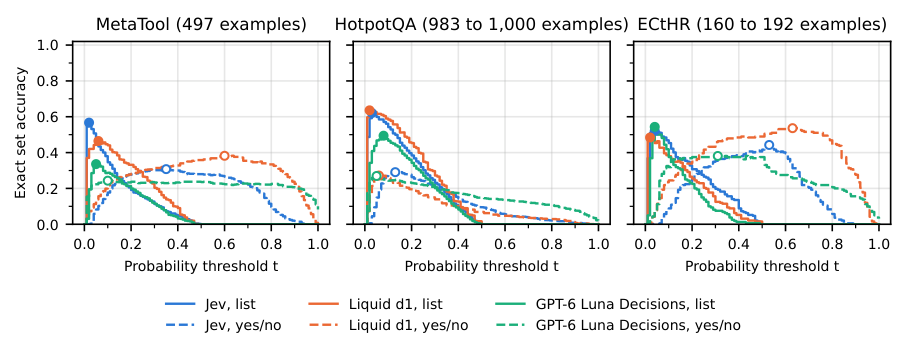

# Jev multi-correct choices: Auditing probability allocation and exact sets

<!-- source-sha256: 9c94d851227fa9e7abc7c1bbdd210fae04ea58cd492f116d7be14859f19dc4d1 -->

[简体中文](README.md)

> **L1 external prediction/scoring protocol; diagnostic only.** No model or API calls.

## Paper information

| Field | Details |
| --- | --- |
| Paper | [When Multiple Choices Are Correct: Asymmetric Probability Allocation in Jev and Other Decision Models](https://arxiv.org/abs/2610.29217v1) |
| Affiliations | First author Rushab Munot: Independent Researcher |
| First public release | 2026-10-21 05:18:35 UTC |
| Author code | [Rushab1/gr-jev](https://github.com/Rushab1/gr-jev), MIT, tag `arxiv-v1` at `7b161f96cd0ff1842845fc66f981d1471cc18151`. Saved model responses were not released. |
| Local key | `jev-multicorrect`; no adapter |
| Local code | `src/auto_research/system_one/multicorrect.py` |
| Local evidence | [Local mechanism metrics](metrics/component-cpu-seeds42-44.json) |

## What the paper changes

A list may put every correct item above distractors yet assign one correct item less than uniform mass. Top-1 or rank metrics can miss incomplete sets. Distinguish normalized categorical shares from independently queried binary correctness probabilities; the former are not calibrated binary confidence. The paper studies Jev, Luna and Gemini.

### Original paper figure



Original figure from the reviewed paper, reused without redrawing. See [figure provenance](assets/provenance.json).

### Core equations

$$
\Delta_i=100\left(\max_{j\in G_i}p_{ij}-\min_{j\in G_i}p_{ij}\right).
$$

Threshold with greater-than-or-equal, report exact-set accuracy and pooled micro P/R/F1, below-uniform correct options under strict ranking, max probability in no-correct lists and abstentions. Abstention fails even for empty truth. Author curves reuse one dataset retrospectively; local threshold tuning searches 0–1 in 0.01 steps on validation, tie to smallest, freezes on test and rejects overlapping IDs. Binary ECE uses ten equal-width (low,high] bins with zero in first; excluding first renormalizes the remainder. Explicit two-decimal option; no implicit rounding/renormalization. Empty prediction precision is locally zero rather than author's occasional NaN.

### Results reported by the authors

The authors see asymmetric mass even with five identical correct copies, and simple thresholds do not fix complete recovery/calibration. These are paid-model observations, not local capability measurements.

## Local reproduction and limits

`PublicChoiceList` exposes ID, question and options; `collect_public_predictions` rejects evaluator rows carrying the correct set. Join predictions and labels only at scoring; interface checks do not sandbox a malicious closure. Eight CPU contracts cover ranking/set difference, below-uniform counts, threshold freeze, disjoint IDs, abstention, unlabeled callback, copy-gap reference and excluded-bin normalization. Three seeds are fixtures, not capability or Evolve evidence.

```bash
PYTHONPATH=src python -c 'from auto_research.system_one.multicorrect import diagnostic; print(diagnostic(42))'
python -m pytest tests/test_jev_multicorrect.py
```

### Full experiment: not reproduced

The full three-model large-list paid API study was not reproduced. No substitute response data, API calls, automatic retry or claim of comparable model performance.

### Additional references

[`multicorrect.py`](https://github.com/daiwk/auto-research/blob/main/src/auto_research/system_one/multicorrect.py)
