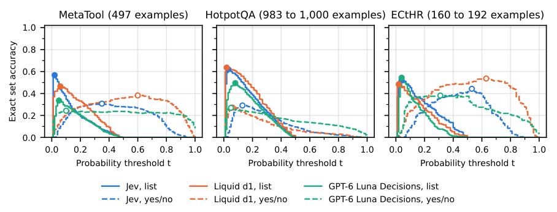
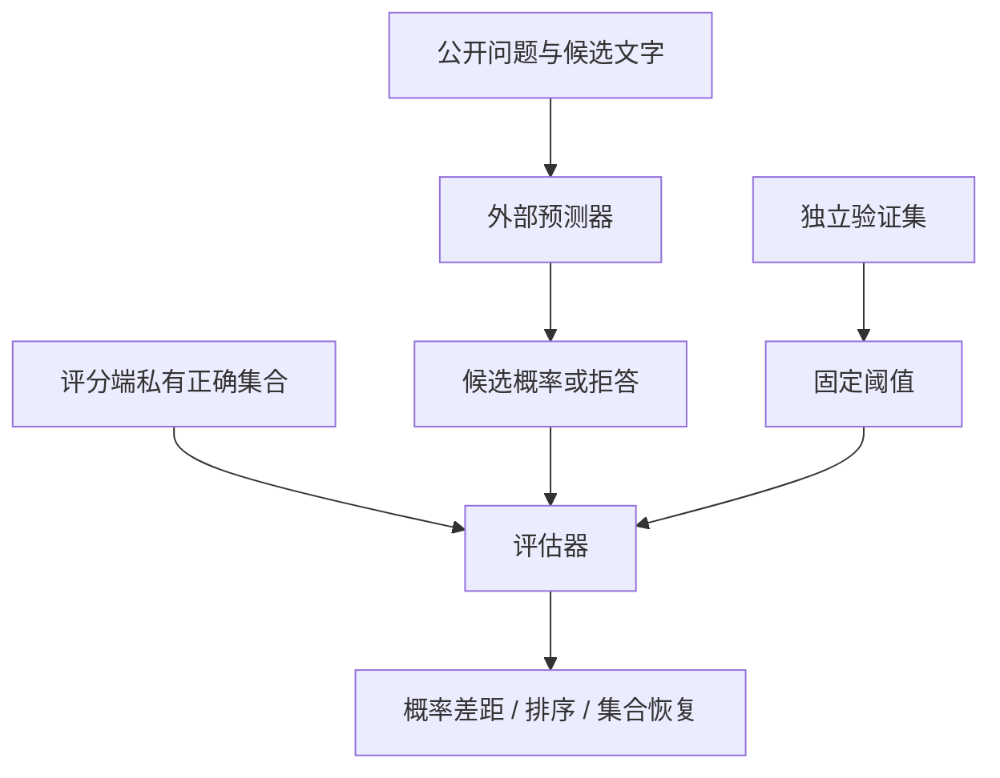

# JEV 多正确选项概率分配审计

## 论文信息

| 字段 | 内容 |
| --- | --- |
| 论文 | [When Multiple Choices Are Correct: Asymmetric Probability Allocation in Jev and Other Decision Models](https://arxiv.org/abs/2610.29217v1) |
| 公司 / 机构 | 一作 Rushab Munot，Independent Researcher |
| 首次公开日期 | 2026-10-21 05:18:35 UTC（arXiv v1；10月22日公告） |
| 原作者开源代码 | [Rushab1/gr-jev](https://github.com/Rushab1/gr-jev)，MIT；论文固定标签 `arxiv-v1` 对应 commit `7b161f96cd0ff1842845fc66f981d1471cc18151`。原始模型响应未随代码公开。 |
| 本地 Adapter / 组件键 | `jev-multicorrect`，仅外部预测评分协议，未注册能力 adapter |
| 本地代码位置 | [src/auto_research/system_one/multicorrect.py](https://github.com/daiwk/auto-research/blob/main/src/auto_research/system_one/multicorrect.py) |
| 实现与完整实验边界 | L1 机制/评分契约；不调用模型或付费 API。完整三模型、大规模候选列表实验：成本过高，不复现（审查 DONE）。 |

## 原始论文总结

### 背景与主要改动

当一个列表有多个正确选项时，模型可能把大部分概率分给其中一个正确项，另一个正确项虽高于所有干扰项，概率仍低于均匀基线。单选 top-1 或“正确项都排在干扰项之前”因此会掩盖完整集合恢复的失败。论文同时分析 JEV、Luna 和 Gemini，避免把所有现象都归因于某一种架构。

特别要区分两种输出：一个候选列表内总和约为1的类别份额，以及对每个选项独立询问“是否正确”得到的二元概率。前者不能直接当作后者的校准置信度。

## 原文重要截图



来自作者固定版本 `paper/figures/exact_set.pdf`，保留原图三个面板；不是本地实验结果。来源与哈希见 [provenance.json](assets/provenance.json)。

## 方法与本地协议



本地 `PublicChoiceList` 只有请求ID、问题和候选文字；`collect_public_predictions` 拒绝传入带正确集合的 `EvaluatorRow`。概率与标签只在预测完成后的评分端汇合。身份检查只是契约，不承诺能防御恶意回调读取外部闭包。

对正确集合 $G_i$ 和候选份额 $p_{ij}$，多正确项差距为：

$$
\Delta_i=100\left(\max_{j\in G_i}p_{ij}-\min_{j\in G_i}p_{ij}\right).
$$

阈值选择集合为 $\hat G_i(t)=\{j:p_{ij}\ge t\}$，同时报告 exact-set accuracy、池化 micro precision/recall/F1、严格排序条件下低于均匀概率的比例、无正确项列表的最大概率及拒答数。拒答即使遇到空正确集合也算失败，不把缺失预测当成成功。

原文的全量阈值曲线是**同一数据上的回溯诊断**。本地另提供可部署的拆分协议：只在 validation 上按 `0,0.01,…,1` 拟合阈值（并列取最小值），`evaluate_test` 冻结该阈值且拒绝 validation/test 请求ID重叠。不用 test 重选最优阈值。

独立二元输出用10个等宽箱计算 ECE，与作者 `(low,high]`、第一箱包含0的边界一致。排除第一箱时按留下的样本重新归一化。API 的两位小数需显式传 `rounding_decimals=2`；不偷偷重归一化，也不自动四舍五入。空预测集合的 micro precision 约定为0，与作者部分脚本的 NaN 展示约定不同。

## 原文结论与复现边界

原文观察到多个正确项之间的概率不对称，甚至把同一正确文本复制五次也不能保证均匀分配；简单阈值未解决集合恢复和校准问题。这些是**原文付费模型实验的观察**，本地没有重新测得这些能力结论。

本地诊断只检查8项评分/隔离契约：排序与集合恢复的差别、低份额正确项计数、固定验证阈值、数据不重叠、拒答处理、公开回调无标签、五拷贝差距参考值、低概率箱排除的重新归一化。三种子不把固定评分夹具变成正式能力比较，不接入 evolve promotion。

```bash
PYTHONPATH=src python -c 'from auto_research.system_one.multicorrect import diagnostic; print(diagnostic(42))'
python -m pytest tests/test_jev_multicorrect.py
```

统一三种子契约产物：[CPU metrics](metrics/component-cpu-seeds42-44.json)。完整模型/API实验未运行；作者未公开保存的响应，不伪造同等数据替代。
