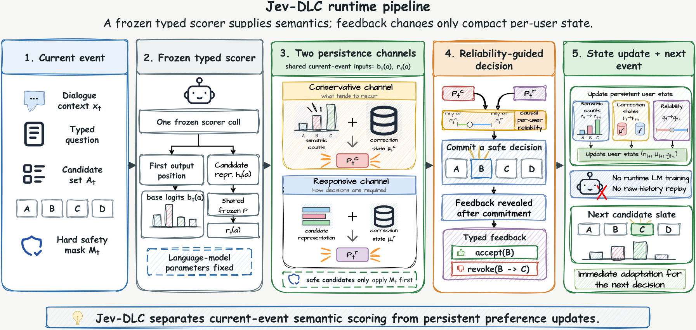

# Jev-DLC: Two-channel continual adaptation from typed feedback

<!-- source-sha256: 4e952074b293d33374f3d5e20ae50c3e443d1a9642a72b343308cadfce8e8d4f -->

[简体中文](README.md)

> Local status: **L1 CPU state-transition component; diagnostic only**. The complete experiment is **not reproduced due to cost (review complete)**. No 27B fine-tuning, cache export, external API calls, full TCPA comparison or automatic retries.

## Paper information

| Field | Details |
| --- | --- |
| Paper | [Jev-DLC: Decision-Level Continual Learning from Typed Feedback](https://arxiv.org/abs/2610.31521v1); [reviewed v1 full text](https://arxiv.org/html/2610.31521v1) |
| Affiliations | First author Yangyang Feng: The Hong Kong University of Science and Technology (Guangzhou). Co-author affiliations include Sun Yat-sen University. |
| First public release | 2026-10-22 16:33:30 UTC, arXiv v1; announced October 23. |
| Author code | No Jev-DLC method repository was found in the paper or its official links. Describing an artifact chain does not establish a public release. OpenJev is a referenced base system, not the method's source. No method revision or license was verified. |
| Local key | `jev-dlc`; standalone CPU component, no adapter or Evolve integration |
| Local code | `src/auto_research/system_one/jev_dlc.py`; `tests/test_oct23_root_components.py` |
| Validation | [Three-seed CPU mechanism metrics](metrics/component-cpu-seeds42-44.json) |

## What the paper changes

Typed decision feedback records an explicit accept event or a revoke event replacing a submitted choice with a new one. Jev-DLC does not feed the full interaction history back into the model. Instead, it maintains two compact channels on top of a frozen scorer: the conservative channel retains semantic counts and a local direction for recurring actions, while the responsive channel stores the current correction direction. Feedback can affect only later requests. A decision must be committed before its feedback is revealed.

### Original paper figure

[](https://arxiv.org/html/2610.31521v1#S4.F2)

Original Figure 2, with scientific content unchanged. See [figure provenance and checksum](assets/provenance.json). Keeping the runtime separate from the evaluator is a requirement of the method.

### Two channels, PA-I updates and reliability

Shared projection and unit normalization map external frozen representations to $r(a)$. For action $a$, with frozen base score $b(a)$, the conservative channel uses a smoothed prior over the action's semantic class $c(a)$:

$$
q(a)=\lambda_c\log\frac{n(c(a))+\alpha}{N+\alpha K},\qquad
s^c(a)=b(a)+q(a)+(\mu^c)^\top\lambda_p r(a),\qquad
s^r(a)=b(a)+(\mu^r)^\top r(a).
$$

Both channels use a passive-aggressive (PA-I) update from the preferred/rejected pair associated with a committed decision:

$$
\ell=[1-\beta-\mu^\top d]_+,\qquad
\tau=\min(1,\ell/\|d\|^2),\qquad
\mu'=\mu+\tau d.
$$

Do not update the vector when $d=0$. An accept event uses the highest-probability remaining safe candidate as the contrast; a revoke event uses the explicitly withdrawn committed choice. The defaults are $\alpha=0.5$ and $\lambda_c=\lambda_p=2$. The channel probabilities are mixed geometrically. After feedback is revealed, reliability is updated using the channels' **pre-update** predictions, their 0/1 loss, a learning rate of 0.25 and fixed share of 0.1. The initial log weights are $(2,0)$, not equal.

### Results reported by the authors

On TCPA-Repeat the paper reports user-macro accuracy of 44.83%, 2.43 percentage points above Recent-4, and 56.07% for users with at least two prior feedback events. PPlug leads overall on the Open track, where items change. The paper's 324-byte state measurement depends on its data types and semantic vocabulary; it is not a memory guarantee for the local Python object. A CPU update time is also not the end-to-end latency of the 27B model. None of these capability results was measured locally.

## Local reproduction and limits

`predict` does not accept gold labels or targets. `feedback` only accepts the instance's current committed `Decision`, rejecting fabricated, replayed and stale updates. Adaptation cannot override a hard safety mask. The contract also binds the semantic vocabulary, projection and model revisions, monotonically increasing event IDs and reset isolation. Only the public scorer cache for the pending decision is kept; it is released after feedback, without retaining interaction text.

```bash
PYTHONPATH=src python -c 'from auto_research.system_one.jev_dlc import diagnostic; print(diagnostic(42))'
PYTHONPATH=src python -m pytest tests/test_oct23_root_components.py
```

The three-seed diagnostics check PA-I against an independent minimization reference, both channels and geometric mixing, feedback ordering, hard masks, revisions and reset. They use supplied random logits and representations, not a loaded Jev model or generated answers. A perfect contract pass rate is not model accuracy, and synthetic feedback does not establish a capability improvement. The CPU-only path does not require a CUDA receipt.

### Full experiment: not reproduced

The complete study requires a Qwen3.8-27B LoRA scorer trained for 300 steps, a $32\times5120$ projection fitted on training users, target-isolated caches and evaluation across all tracks. These are outside the local budget and were not launched. The component remains `diagnostic_only=true`, `promotion_eligible=false` and `evolve_integrated=false`.
