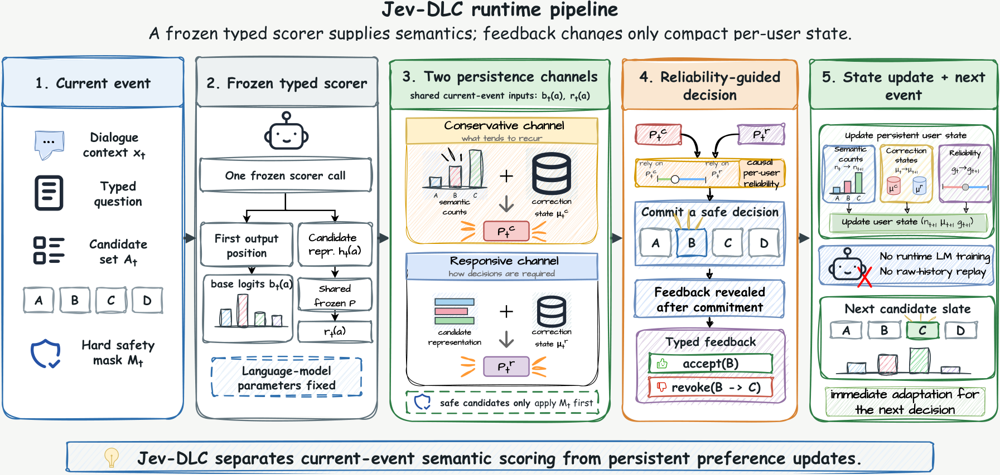

# Jev-DLC：类型反馈上的双通道持续适配

## 论文信息

| 字段 | 内容 |
| --- | --- |
| 论文链接 | [arXiv 2610.31521 v1](https://arxiv.org/abs/2610.31521v1)；[固定全文](https://arxiv.org/html/2610.31521v1) |
| 原文标题 | Jev-DLC: Decision-Level Continual Learning from Typed Feedback |
| 公司 / 机构 / 学校 | 一作 Yangyang Feng：香港科技大学（广州）；共同作者含 Sun Yat-sen University。按一作机构聚合 |
| 首次公开日期 | 2026-10-22 16:33:30 UTC（arXiv v1），10月23日公告 |
| 原作者代码 | **未在原文及官方链接找到 Jev-DLC 方法代码仓库**；论文描述 artifact chain 不等于代码已经公开。所引 OpenJev 基座不能写成该方法代码。无可核固定代码 revision/license |
| 本地 adapter / 稳定键 | `jev-dlc`；`adapter: null`，CPU `component_only` / L1 状态转移组件 |
| 本地复现代码目录 | `src/auto_research/system_one/jev_dlc.py`；测试 `tests/test_oct23_root_components.py` |
| 完整实验 | **成本过高，不复现（审查 DONE）**；不启动27B SFT、缓存导出、外部 API 与完整TCPA对照，不自动重试 |

## 原始论文总结

### 背景与主要改动

类型化决策能给出明确 accept 或 revoke(旧选择→新选择)。Jev-DLC 不把完整历史重新塞进模型，而是在冻结 scorer 上维护两个紧凑通道：保守通道记住重复动作的语义计数与局部方向；响应通道只存当前修正方向。反馈只能影响**之后**的请求，不能先看当前正确答案再报成功。

<!-- paper-figure:start -->
### 原论文关键图

[](https://arxiv.org/html/2610.31521v1#S4.F2)

直接保留论文原始 Figure2，[来源及哈希](assets/provenance.json)，未修改科学内容。运行时与评测器的边界是该方法的一部分，不只是画图说明。
<!-- paper-figure:end -->

### 双通道、PA-I与可靠性

外部冻结表示经共享投影后单位归一化为 $r(a)$。保守通道的语义先验是：

$$
q(a)=\lambda_c\log\frac{n(c(a))+\alpha}{N+\alpha K},\quad
s^c(a)=b(a)+q(a)+(\mu^c)^\top\lambda_p r(a),\quad s^r(a)=b(a)+(\mu^r)^\top r(a).
$$

两个通道均按已提交决策对应的 preferred/rejected pair 做 PA-I：

$$
\ell=[1-\beta-\mu^\top d]_+,\quad\tau=\min(1,\ell/\|d\|^2),\quad\mu' = \mu+\tau d.
$$

$d=0$ 时不更新向量。accept 使用最高概率的其余安全候选为对照；revoke 使用明确撤回的已提交选择。默认 $\alpha=.5,\lambda_c=\lambda_p=2$。通道以几何概率混合；反馈揭示后，用**更新之前**通道预测的0/1损失、学习率.25及fixed share .1更新可靠性。初始log weights为(2,0)，不是等权。

本地 `predict` 不接收gold/target；`feedback`只接受本实例当前已提交的Decision，拒绝伪造/重放/过期更新。硬安全掩码不能被状态覆盖；固定语义词表、投影/模型revision、单调事件编号和reset隔离纳入契约。只保留当前待反馈的公开scorer缓存，提交反馈后释放，不保留交互文本历史。

### 原文结果（非本地能力）

TCPA-Repeat 用户macro准确率44.83%，较Recent-4高2.43个百分点；有至少两次历史反馈时为56.07%。原文同时指出更换item的Open轨道整体由PPlug占优。其324 bytes是原实验数据类型/语义词表下的状态统计，不是本地Python对象的内存占用承诺。CPU更新耗时也不能当作27B完整模型端到端时延。

## 本地复现与边界

```bash
PYTHONPATH=src python -c 'from auto_research.system_one.jev_dlc import diagnostic; print(diagnostic(42))'
PYTHONPATH=src python -m pytest tests/test_oct23_root_components.py
```

[三种子指标](metrics/component-cpu-seeds42-44.json)仅验证独立PA-I最小化参考、双通道/几何混合、反馈时序、硬掩码、revision和reset；外部给定随机logits/表示，不加载JEV、不生成任务答案。没有把1.0契约通过率标为模型准确率，也不根据合成反馈宣称能力提升。纯CPU路径无需CUDA回执。

完整方案需Qwen3.8-27B LoRA scorer（300步）、训练用户上拟合32×5120投影、目标隔离缓存与全轨道评测；本轮不启动这些高成本实验。`diagnostic_only=true`、`promotion_eligible=false`、`evolve_integrated=false`。
