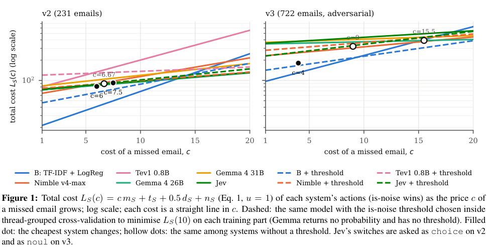

<!-- source-sha256: 073c22bdb82f313fe1a37a54330b4131e14ae0f5285d26b41d4ab53715ef867e -->

# Typed Inbox: freeze the measurement protocol before deciding to train

[简体中文](README.md)

> **component_only / L0 protocol interface.** No inbox classifier, Jev or generative model is implemented. No real mailbox is read. The full private-inbox and multi-model campaign is not reproduced due to cost (review DONE).

## Paper information

| Field | Content |
| --- | --- |
| Paper | [Measure Before You Train](https://arxiv.org/abs/2610.32955v4); reviewed [fixed v4](https://arxiv.org/html/2610.32955v4) |
| First-author affiliation | Federico Lucca, independent researcher, Trento, Italy |
| Original publication | **2026-10-23 17:49:43 UTC**, v1; reviewed v4 updated 2026-11-12 07:31:11 UTC, not a November first release |
| Author code | [federicolucca/foyer-measure](https://github.com/federicolucca/foyer-measure/tree/902725e8439545451f6824c6916eb60ae2b7248b), MIT; the paper's v2.3 tag resolves to this commit. Private messages and labels are not public |
| Local adapter / key | `typed-inbox-protocol`; `adapter=null`, not integrated into Evolve |
| Local code | `src/auto_research/foundation_models/typed_inbox_protocol.py` |

## Original paper

### Background and main changes

Field accuracy in a personal multilingual inbox need not produce safe actions. The paper compares typed decision models, TF-IDF plus logistic regression, and generative LLMs. Tasks, labels and costs must be frozen before deciding whether training is worthwhile. Historical keyword/model fields are not gold labels; relationship is often a contact property, not something to infer anew for every email.

The protocol stores exactly the visible sender, subject, body truncated to 1,500 characters, date and channel, with secrets redacted before storage. Normalize subject plus sender key to group threads; random email splits leak context. An earlier ID-hash split leaked 11 threads and four near duplicates. The main experiment uses thread-grouped, class-stratified five-fold CV. V2 contains 231 messages in 207 threads; v3's 722 messages in 698 threads form an adversarial stress set, not the natural inbox distribution.

### Architecture and workflow


<!-- paper-figure:start -->
### Original paper figure



Fixed-v4 PDF p.7, Figure 1, including its caption. Dashed cutoffs are selected inside CV training portions, not after seeing test outcomes. These are author results, not local results. [Original figure](https://arxiv.org/pdf/2610.32955v4#page=7); copyright belongs to the authors. [Crop and hashes](assets/provenance.json).

Image from the [original paper](https://arxiv.org/html/2610.32955v4); copyright belongs to the original authors.
<!-- paper-figure:end -->

### Core equations

The paper combines missed messages, tasks, conflict flags and other actions:

$$
L_S(c)=c\,m_S+t_S+0.5d_S+n_S.
$$

The missed-action price $c$ matters beyond individual-switch accuracy. The paper also compares noise-wins, action-wins and conflict-flag policies. Locally, **only a binary action-threshold interface** is implemented:

$$
\theta^*=\arg\min_\theta\frac1{|V|}\sum_{i\in V}
 [c_{FN}y_i\mathbf1(s_i<\theta)+c_{FP}(1-y_i)\mathbf1(s_i\ge\theta)].
$$

This is not the full action-composition cost, a trained classifier, contact-graph propagation, or class-stratified sampling. Only an explicit validation split can fit a cutoff. Prediction never receives test labels.

### Author results

The simple supervised baseline is competitive, and the cheapest system changes with missed-email cost. Classification, action cost and latency are different quantities. The paper describes routing 129 messages in one user's production inbox during 2026-10-22–27; this is observational, not randomized production A/B. No private-inbox accuracy or production actions were reproduced locally.

## Local implementation

### Data protocol and code mapping

`freeze_email` replaces **explicit caller-supplied** sensitive strings before storing the 1,500-character body and SHA256. It does not discover unknown passwords or PII and is not a general redactor. Immutable `FrozenEmail` accepts no gold field. `grouped_folds` hash-orders whole threads without labels: it isolates threads but **does not reproduce the paper's class-stratified five-fold split**. Duplicate email IDs are rejected.

`fit_action_threshold` enumerates validation score cutoffs with separate false-negative/false-positive costs. Ties favor the higher cutoff; an upper cutoff permits no actions. `ActionThreshold.predict` accepts only a score, not a label. Scores and costs must be finite; booleans are not numeric scores.

```bash
PYTHONPATH=src python -c 'from auto_research.foundation_models.typed_inbox_protocol import diagnostic; print(diagnostic(42))'
PYTHONPATH=src python -m pytest tests/test_nov18_agent_protocols.py -q
```

### Diagnostics and limits

[CPU protocol metrics](metrics/component-cpu-seeds42-44.json) cover three-seed synthetic thread isolation, redaction before storage, body limits, test-fit rejection and cost behavior—not inbox accuracy. Negative controls include replies/forwards, duplicate IDs, cutoff boundaries, all-negative labels and NaN. As in the [Jev capability benchmark](../2610.11978-jev-capability/README.md), gold belongs only to the outer scorer; unlike that benchmark, no decision backend is called here.

### High-cost full experiment

The full comparison requires private personal email, independent annotations, a contact graph and multiple local/hosted models with grouped CV. A single A100/A30 or Mac cannot replace private resources or the hosted API matrix. **Full experiment not reproduced due to cost (review DONE).** No mailbox login, weights, trial training or automatic retry. This CPU-only interface needs no GPU receipt and remains `promotion_eligible=false`, `evolve_integrated=false`.
