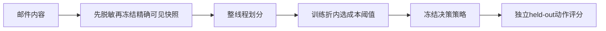
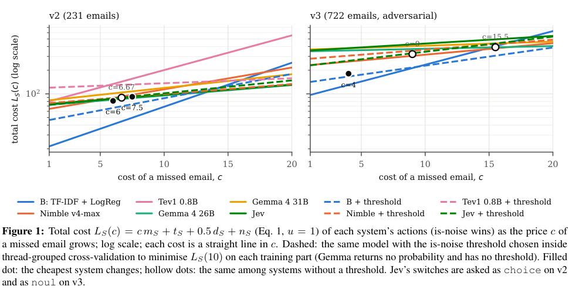

# Typed Inbox：先冻结测量协议，再决定是否需要训练

[English](README-en.md)

> **component_only／L0协议接口。** 本地没有邮件分类器、Jev或生成模型，不读取真实邮箱；完整私有邮箱与多模型实验高成本不复现（审查 DONE）。

## 论文信息

| 字段 | 内容 |
| --- | --- |
| 论文链接 | [Measure Before You Train](https://arxiv.org/abs/2610.32955v4)，核对[固定v4正文](https://arxiv.org/html/2610.32955v4) |
| 一作机构 / 公司 / 学校 | Federico Lucca，Independent researcher，Trento, Italy |
| 首次公开日期 | **2026-10-23 17:49:43 UTC**（v1）；所读v4更新于2026-11-12 07:31:11 UTC，不算11月新首发 |
| 原作者代码 | [federicolucca/foyer-measure](https://github.com/federicolucca/foyer-measure/tree/902725e8439545451f6824c6916eb60ae2b7248b)，MIT；原文v2.3 tag解析到该commit。私有邮件、标签不公开 |
| 本地 adapter / key | `typed-inbox-protocol`；`adapter=null`，未接入Evolve |
| 本地复现代码 | `src/auto_research/foundation_models/typed_inbox_protocol.py` |

## 原始论文总结

### 背景与主要改动

在个人多语言收件箱里，字段分类准确率不一定能转化为安全的动作。论文比较类型化决策模型、TF-IDF＋逻辑回归和生成式LLM，强调先冻结任务、标签与成本，再判断训练是否值得。生产系统遗留的关键词／模型字段不能当金标；联系人的relationship也不宜每封邮件重新推断。

协议保存模型实际可见的sender、subject、截断至1500字符的body、日期和channel；敏感值必须先脱敏再存快照。线程按规范化subject＋sender key分组，不能随机按单封邮件切分；原文早期id-hash切分出现11个跨集合线程和4个近重复。主评估采用线程分组、类别分层的5折交叉验证；v2有231封、207线程，v3的722封、698线程是人工增加难例的stress集，不代表自然邮箱分布。

### 架构与流程



<!-- paper-figure:start -->
### 原论文关键图



固定v4 PDF第7页Figure 1，含原始图注；图中虚线阈值在交叉验证训练部分选择，不是测试后调参。图为作者结果，不是本地结果。[原图来源](https://arxiv.org/pdf/2610.32955v4#page=7)，版权归原作者；[裁剪及SHA256](assets/provenance.json)。
<!-- paper-figure:end -->

### 核心公式

原文用漏信、追踪、冲突提示和其他动作数量组成成本：

$$L_S(c)=c\,m_S+t_S+0.5d_S+n_S.$$

其中漏掉需要动作的邮件具有可变价格$c$，不能只看三个开关的单独accuracy。原文还比较noise-wins、action-wins和冲突提示策略。本地**仅实现二元行动阈值接口**：

$$\theta^*=\arg\min_\theta\frac1{|V|}\sum_{i\in V}
 [c_{FN}y_i\mathbf1(s_i<\theta)+c_{FP}(1-y_i)\mathbf1(s_i\ge\theta)].$$

它不等于原文完整动作组合成本，也不包含训练分类器、联系图传播或类别分层采样。阈值只能接收显式validation集合；test标签不进入预测函数。

### 论文离线与线上效果

作者发现简单监督基线有竞争力，且最优模型随漏信价格变化；图中的分类质量、动作成本和推理延迟不能互相替代。原文描述一人生产系统在2026-10-22至27日的129封邮件路由变化，这是单用户观察，不是随机线上A/B。本地没有重跑私有邮件、多模型准确率或生产动作。

## 本地复现

### 数据协议与代码映射

`freeze_email`先替换调用者**显式提供**的敏感字符串，再存1500字符正文与SHA256。它不发现未知密码／PII，不能当通用脱敏器。不可变`FrozenEmail`不接收gold字段。`grouped_folds`按线程哈希排序、整组分折，不读取标签，因此保证线程隔离但**不是原文的类别分层5折**。重复email ID直接拒绝。

`fit_action_threshold`穷举validation分数切点，按独立FN／FP成本选择；同成本时优先较高阈值，最高切点支持全不行动。`ActionThreshold.predict`只接收分数，不接收标签。输入分数、成本必须有限，bool不能伪装数值。

```bash
PYTHONPATH=src python -c 'from auto_research.foundation_models.typed_inbox_protocol import diagnostic; print(diagnostic(42))'
PYTHONPATH=src python -m pytest tests/test_nov18_agent_protocols.py -q
```

### 结果、负控与边界

[CPU协议指标](metrics/component-cpu-seeds42-44.json)记录三seed合成消息的线程隔离、脱敏先于存储、正文上限、test拟合拒绝与成本阈值行为；不是邮箱分类accuracy。负控包含回复／转发同线程、重复ID、阈值边界、全阴性和NaN。与[Jev能力评测](../2610.11978-jev-capability/README.md)相同，gold必须由外层评分器隔离；但这里没有调用任何决策后端。

### 高成本完整实验

完整复现需不可公开的个人邮箱、独立人工标签、联系图，以及多种本地／托管模型和分组交叉验证。单卡A100/A30或Mac不能替代私有数据或托管API矩阵。**高成本完整实验：不复现（审查 DONE）**；不登录邮箱，不下载权重，不启动试训或自动重试。仅CPU接口不需要GPU验收，`promotion_eligible=false`、`evolve_integrated=false`。
