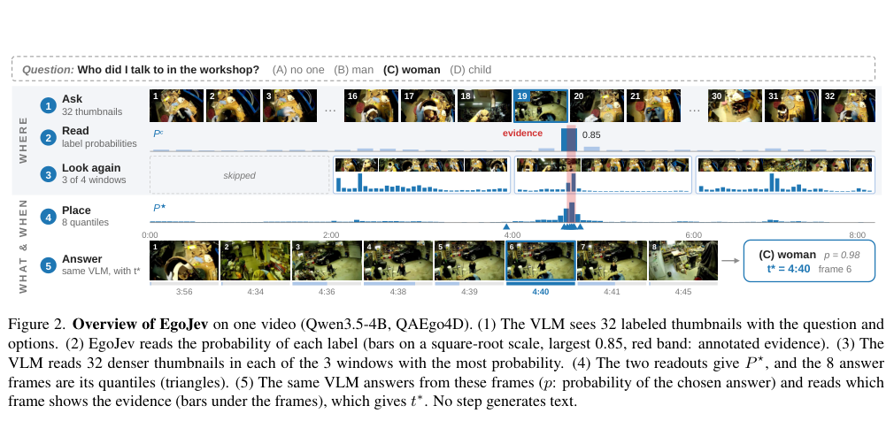

<!-- source-sha256: 37657219b8d52e742e72ac97cc3b9eb9a1e03ef03d2f9c795be8bbd165d67673 -->
# EgoJev: Finding Evidence in Egocentric Video by Reading VLM Decisions

[简体中文](README.md)

> **L1 CPU postprocessing only; no VLM capability evidence**. Full experiments: **high cost, not reproduced (review DONE)**.

## Paper information

| Field | Value |
| --- | --- |
| Paper link | [arXiv:2611.24616v1](https://arxiv.org/abs/2611.24616v1); [fixed PDF](https://arxiv.org/pdf/2611.24616v1) |
| Company / institution / school | Chunggi Lee: Harvard University (fixed-v1 PDF byline) |
| Original publication date | 2026-11-18T15:34:10Z (arXiv v1); announcement2026-11-19 |
| Original source code | No author method source or license verified in fixed v1; dependencies are not a method release. |
| Local adapter / key | `egojev`; `adapter: null`; not Evolve-integrated |
| Local reproduction code directory | `src/auto_research/system_one/egojev_components.py` |

## Original paper summary

### Background and main changes

One frozen VLM compares labeled thumbnails in one prompt. Complete label probabilities replace written timestamps. Coarse mass selects refinement windows; local fine readouts retain their window mass and are geometrically fused with coarse probabilities. Midpoint quantiles of a piecewise-uniform time distribution allocate answer frames.

~~~mermaid
flowchart LR
 C[Explicit coarse probabilities] --> W[Window mass and top k]
 F[Explicit refined probabilities] --> S[Preserve coarse window mass]
 W --> S
 S --> G[Geometric coarse fine fusion]
 G --> Q[Piecewise uniform inverse CDF]
 Q --> T[Answer frame times only]
~~~

<!-- paper-figure:start -->
### Original paper figure

[](https://arxiv.org/pdf/2611.24616v1)

Original PDF crop, no semantic edits; author method, not local evidence. [Page, crop and SHA256](assets/provenance.json). Copyright retained by the original authors.
<!-- paper-figure:end -->

### Core equations

$$
P_s^\star\propto\sqrt{P^c_{j(s)}P_s^f},\qquad t_b=F^{-1}\left(\frac{b-1/2}{B}\right),\quad b=1,\ldots,B.
$$

Normalize each refined local distribution, then multiply by its coarse window mass; unrefined windows spread that mass evenly. A square root is not a plain product. For k0, keep the single-level coarse distribution. Inverse-CDF placement interpolates within bins. Full labels such as17] require all conditional token probabilities, including the closing bracket; that VLM readout is not implemented locally.

### Paper offline and online results

The paper reports QAEgo4D accuracy51.2% uniform versus62.0% EgoJev and26.7s/question averaged over50 cases on an A100 MIG slice. Local postprocessing reads no videos, VLMs or answers and does not reproduce that accuracy. No production A/B is reported.

## Local reproduction

### Data protocol and code mapping

The CPU component consumes explicit candidate probabilities and implements window masses/stable top-k, fine-mass scaling, geometric fusion and piecewise-uniform inverse CDF. There are no gold inputs, VLM/tokenizer calls, visual prefill cache, permutation-label check, video decoding or answering model. Synthetic diagnostic probabilities establish only L1 postprocessing, not VLM capability.

```bash
PYTHONPATH=src python -c 'from auto_research.system_one.egojev_components import diagnostic; print(diagnostic(42))'
PYTHONPATH=src python -m pytest tests/test_nov19_jev_addendum.py -q
```

[Canonical CPU component evidence](metrics/component-cpu-seeds42-44.json); independent frozen-source execution, not a video benchmark.

### Same-topic comparison and boundaries

System One reranking sorts a joint candidate distribution. EgoJev uses it to allocate time budget. Single-token letter readout cannot silently replace multi-token numeric labels, and quantile frames are not simply the top-k frames.

### High-cost full experiment

The full matrix has500QAEgo4D,996MyEgo and500EgoSchema questions, four VLMs and baseline/ablation runs. At the paper’s26.7s/question,500cases alone imply about3.7hours, an estimate rather than a local measurement and not a timing estimate for other tasks. Full experiments are not reproduced; only tiny CPU probability cases run without weights/videos.

**High cost, not reproduced (review DONE)**. No full experiment, large download, automatic retry or implementation queue; no capability promotion.
