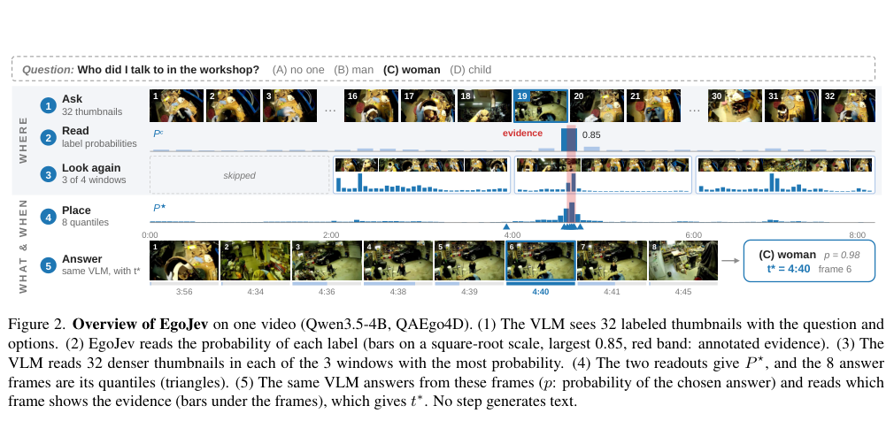

# EgoJev：以决策分布几何融合与分位数分配视频帧

[English](README-en.md)

> **仅L1 CPU后处理；无VLM能力证据**. 完整实验：**成本过高，不复现（审查 DONE）**。

## 论文信息

| 字段 | 内容 |
| --- | --- |
| 论文链接 | [arXiv:2611.24616v1](https://arxiv.org/abs/2611.24616v1); [fixed PDF](https://arxiv.org/pdf/2611.24616v1) |
| 公司 / 机构 / 学校 | Chunggi Lee: Harvard University (fixed-v1 PDF byline) |
| 首次公开日期 | 2026-11-18T15:34:10Z (arXiv v1); announcement2026-11-19 |
| 原作者开源代码 | 固定v1未找到可核验的原作者方法源码/许可证；依赖仓库不算本方法开源。 |
| 本地 adapter / key | `egojev`；`adapter: null`；未接入Evolve |
| 本地复现代码目录 | `src/auto_research/system_one/egojev_components.py` |

## 原始论文总结

### 背景与主要改动

同一冻结VLM把带数字标签的候选缩略图放在一个prompt中，读取完整标签的条件概率而不是生成时间文本。粗分布决定细看窗口，细分布先保留窗口粗概率总量，再与对应粗分布做几何平均。最后在时间的分段均匀分布上取中点分位数，分配有限回答帧。

~~~mermaid
flowchart LR
 C[Explicit coarse probabilities] --> W[Window mass and top k]
 F[Explicit refined probabilities] --> S[Preserve coarse window mass]
 W --> S
 S --> G[Geometric coarse fine fusion]
 G --> Q[Piecewise uniform inverse CDF]
 Q --> T[Answer frame times only]
~~~

<!-- paper-figure:start -->
### 原论文关键图

[](https://arxiv.org/pdf/2611.24616v1)

固定v1原始PDF裁切，未修改科学内容；是作者方法，不是本地证据。[页码、裁切与SHA256](assets/provenance.json)。图片来自[原论文](https://arxiv.org/pdf/2611.24616v1)，版权归原作者所有。
<!-- paper-figure:end -->

### 核心公式

$$
P_s^\star\propto\sqrt{P^c_{j(s)}P_s^f},\qquad t_b=F^{-1}\left(\frac{b-1/2}{B}\right),\quad b=1,\ldots,B.
$$

细读窗口的局部分布归一后乘该窗口的粗概率总量；未细读窗口均摊其窗口质量。平方根不同于普通乘积，后者过度锐化。k=0直接保留单层粗分布。分位数需在bin内插值而不是一律取bin中心。标签如17]可能多token，完整读出需逐条件概率相乘并含终止]，本地不实现这部分。

### 论文离线与线上效果

原文QAEgo4D准确率从uniform51.2%到62.0%，每题26.7秒为A100 MIG切片上的50题平均。本文组件没有读视频、VLM或答案，不能报告上述准确率。未报告生产线上A/B。

## 本地复现

### 数据协议与代码映射

CPU组件仅接受显式给定的候选概率，执行窗口质量/稳定top-k、细层质量缩放、几何融合和分段均匀逆CDF。输入不含gold证据或答案；未实现VLM标签打分、tokenizer、图像预填缓存、label permutation检查、视频解码或回答模型。诊断概率是合成算例，不是VLM能力证据；L1只指后处理机制。

```bash
PYTHONPATH=src python -c 'from auto_research.system_one.egojev_components import diagnostic; print(diagnostic(42))'
PYTHONPATH=src python -m pytest tests/test_nov19_jev_addendum.py -q
```

[规范CPU组件证据](metrics/component-cpu-seeds42-44.json)；独立冻结源码执行，不是视频benchmark。

### 同主题比较与边界

System One多模态重排把一个联合候选分布用于排序；EgoJev将分布用于时间预算分配。前者单token字母读出不能不加检查地替代后者多token数字标签概率，frame quantile也不是单纯top-k帧。

### 高成本完整实验

完整矩阵含500题QAEgo4D、996题MyEgo、500题EgoSchema、四个VLM与多基线/消融。按原文26.7秒/题估算仅500题约3.7小时（不是本机实测；其他任务耗时不同），再含长视频和模型资源。完整实验高成本不复现；本地只跑秒级CPU概率算子，无权重/视频下载。

**成本过高，不复现（审查 DONE）**；不启动完整实验、不下载大资源、不自动重试、不进入自动实现队列，不作能力晋级。
