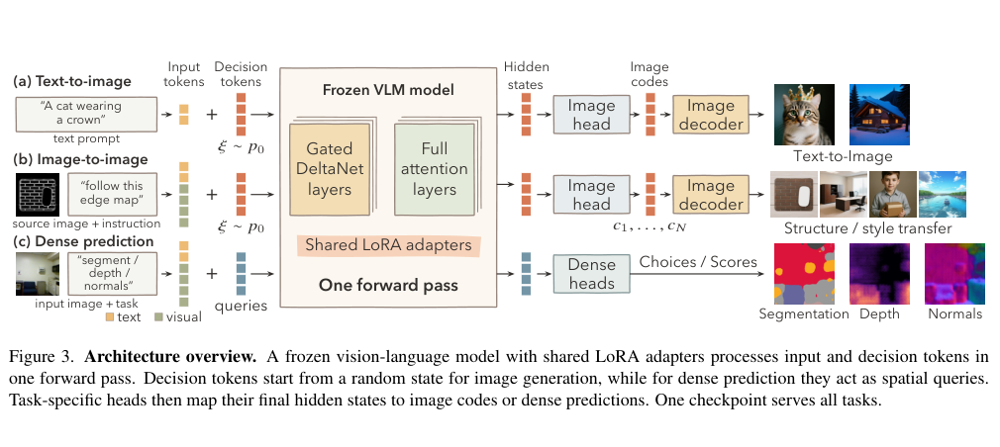

<!-- source-sha256: 2778cec61fd33d1beebf345e8dd0c31972d3e1a202797960b49dfb61221270c3 -->
# Jeveration: System One Models Now Generate

[简体中文](README.md)

> **Review only; no implementation**. Full experiments: **high cost, not reproduced (review DONE)**.

## Paper information

| Field | Value |
| --- | --- |
| Paper link | [arXiv:2611.24738v1](https://arxiv.org/abs/2611.24738v1); [fixed PDF](https://arxiv.org/pdf/2611.24738v1) |
| Company / institution / school | Yuhe Liu: National University of Singapore (fixed-v1 PDF byline) |
| Original publication date | 2026-11-18T16:56:59Z (arXiv v1); announcement2026-11-19 |
| Original source code | No author method source or license verified in fixed v1; dependencies are not a method release. |
| Local adapter / key | `jeveration`; `adapter: null`; not Evolve-integrated |
| Local reproduction code directory | None (not reproduced) |

## Original paper summary

### Background and main changes

Images become a joint Choice over128 discrete codes. A shared random state coordinates positions rather than independently sampling marginal codes. A frozen Qwen3.5-4B with shared LoRA/heads first learns masked image conditionals, then distribution matching and confidence correction teach single-pass decisions. One checkpoint also serves image-to-image and dense tasks.

~~~mermaid
flowchart LR
 Y[Prompt or source image] --> V[Frozen VLM plus shared LoRA]
 X[Shared random state] --> V
 V --> C[Parallel image code Choices]
 C --> D[Image decoder]
 V --> M[Dense task heads]
 T[Masked conditionals and correction training] --> V
~~~

<!-- paper-figure:start -->
### Original paper figure

Original PDF crop, no semantic edits; author method, not local evidence. [Page, crop and SHA256](assets/provenance.json). Copyright retained by the original authors.
<!-- paper-figure:end -->

### Core equations

$$
q_\theta(c\mid y)=\mathbb E_{\xi\sim p_0}\prod_{i=1}^{N}q_{\theta,i}(c_i\mid y,\xi),\qquad \mathcal L_{gen}=\mathcal L_{DM}+\lambda\mathcal L_{corr}.
$$

Choices factorize conditionally on shared xi, but mixing over xi permits dependence. Noise alone is insufficient: direct supervision can ignore it. Training correction re-masks the least-confident half and uses the frozen first-stage model to complete them; inference remains one generation pass.

### Paper offline and online results

The paper reports512px, GenEval0.74 and77.8ms end-to-end on one H200. The122.2x ratio is relative to the listed Janus-Pro-7B, not every method; resolutions and sizes differ. No production A/B or local image-quality/latency measurement is claimed.

## Local reproduction

### Data protocol and code mapping

Review only: no model, head, training, image generation or metrics. Shared random numbers plus a linear fixture would not reproduce the learned joint generator.

### Same-topic comparison and boundaries

LLM2Jev reads a finite candidate decision distribution. Jeveration must also coordinate spatial outputs and learn to use shared randomness. Candidate scoring alone does not establish a coherent joint image distribution.

### High-cost full experiment

Section4.1 and supplementary4 report a frozen4B backbone, about1B trainable parameters,92k+6.7k updates and around four days on four RTX PRO6000 GPUs, plus million-scale images and multitask evaluation. This reported cost exceeds one A100/A30 or Mac short-run budget; no probe/download is attempted.

**High cost, not reproduced (review DONE)**. No full experiment, large download, automatic retry or implementation queue; no capability promotion.
