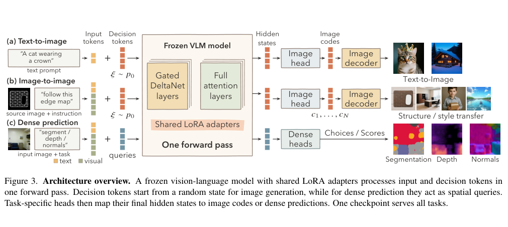

# Jeveration：以共享随机状态协调一次前向图像决策

[English](README-en.md)

> **仅资料收录；无实现**. 完整实验：**成本过高，不复现（审查 DONE）**。

## 论文信息

| 字段 | 内容 |
| --- | --- |
| 论文链接 | [arXiv:2611.24738v1](https://arxiv.org/abs/2611.24738v1); [fixed PDF](https://arxiv.org/pdf/2611.24738v1) |
| 公司 / 机构 / 学校 | Yuhe Liu: National University of Singapore (fixed-v1 PDF byline) |
| 首次公开日期 | 2026-11-18T16:56:59Z (arXiv v1); announcement2026-11-19 |
| 原作者开源代码 | 固定v1未找到可核验的原作者方法源码/许可证；依赖仓库不算本方法开源。 |
| 本地 adapter / key | `jeveration`；`adapter: null`；未接入Evolve |
| 本地复现代码目录 | 无（不复现） |

## 原始论文总结

### 背景与主要改动

把图像表示为128个离散code的联合Choice，所有位置共享随机状态，而不是把各位置的边缘分布独立采样。冻结Qwen3.5-4B配共享LoRA与任务head，先学masked图像分布，再以distribution matching和置信纠正训练单步决策；同一checkpoint还做图到图与dense prediction。

~~~mermaid
flowchart LR
 Y[Prompt or source image] --> V[Frozen VLM plus shared LoRA]
 X[Shared random state] --> V
 V --> C[Parallel image code Choices]
 C --> D[Image decoder]
 V --> M[Dense task heads]
 T[Masked conditionals and correction training] --> V
~~~

<!-- paper-figure:start -->
### 原论文关键图

固定v1原始PDF裁切，未修改科学内容；是作者方法，不是本地证据。[页码、裁切与SHA256](assets/provenance.json)。图片来自[原论文](https://arxiv.org/pdf/2611.24738v1)，版权归原作者所有。
<!-- paper-figure:end -->

### 核心公式

$$
q_\theta(c\mid y)=\mathbb E_{\xi\sim p_0}\prod_{i=1}^{N}q_{\theta,i}(c_i\mid y,\xi),\qquad \mathcal L_{gen}=\mathcal L_{DM}+\lambda\mathcal L_{corr}.
$$

给定共享xi后可并行选择，但对xi求混合后各位置不再必须独立。仅添加随机噪声不够：原文指出直接监督可忽略该状态。纠正target在训练时重mask最低置信的一半位置，由冻结的第一阶段模型补全；推理仍是一次生成前向，不是把训练辅助步骤算成免费。

### 论文离线与线上效果

论文报告512px、GenEval0.74、单H200端到端77.8ms；122.2倍是相对表内较慢的Janus-Pro-7B，不能当成对所有方法的加速。不同分辨率/模型规模也需区分。未报告生产线上A/B；没有本地图像质量或延迟测量。

## 本地复现

### 数据协议与代码映射

仅资料收录，无模型、head、训练、生成或指标文件。不能用几个共享随机数加线性层假装得到论文的联合图像生成。

### 同主题比较与边界

LLM2Jev把候选标签读成有限决策分布；Jeveration还必须协调空间上众多输出，并学会使用共同随机状态。单选候选打分成功，不证明整图联合分布或图像质量。

### 高成本完整实验

原文§4.1和补充§4：冻结4B骨干，约1B可训练参数；92k第一阶段+6.7k第二阶段，四张RTX PRO6000约4天，另有百万级图像和多任务评测。按已有论文测量已明显超单A100/A30/Mac短预算，不试训、不下载。

**成本过高，不复现（审查 DONE）**；不启动完整实验、不下载大资源、不自动重试、不进入自动实现队列，不作能力晋级。
