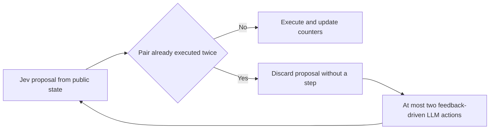
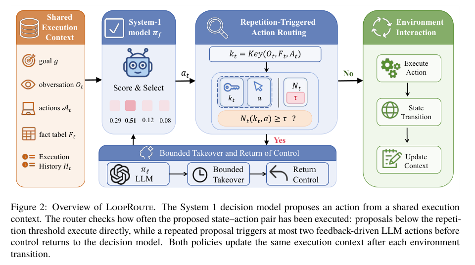

# Stop Going in Circles:Loop-Triggered Routing for System 1 Decision Agents

<!-- source-sha256: 71d5f3b07101ae50b5466a1eac27949e003191f2dbc403ffed869143292428f5 -->

[简体中文](README.md)

> **component_only / l1_mechanism; not model or agent capability replication.** Full experiments are too costly and not reproduced (review DONE). No Evolve promotion evidence.

## Paper information

| Field | Value |
| --- | --- |
| Paper link | [Stop Going in Circles:Loop-Triggered Routing for System 1 Decision Agents](https://arxiv.org/abs/2611.25363v1); [fixed v1 PDF](https://arxiv.org/pdf/2611.25363v1) |
| First-author institution / company / school | Zeming Yu, Sichuan University |
| Original publication date | **2026-11-19 02:01:59 UTC**; November20 announcement/review is not first publication |
| Original author code | No paper-specific public method source verified in fixed v1 and reviewed sources; cited dependencies are not a release. |
| Local Adapter / key | `looproute`; `adapter=null`, not integrated with Evolve |
| Local reproduction code | `src/auto_research/system_one/looproute.py` |

## Original paper summary

### Background and main changes

Fast System One action selection does not guarantee long-task completion. LoopRoute normally gives control to frozen Jev. After the same action has executed twice under the same public state, it intercepts the next proposal and lets an LLM take at most two feedback-driven actions. Control then returns without a separate recovery test; later loops can trigger another takeover.

Keys exclude growing history and step counters. ALFWorld uses confirmed facts and sorted admissible actions; MapReader uses the action response, room description and inventory; TextWorld uses room, inventory and the candidate-ID/command map. ALFWorld counts only decision-policy executions and clears on new information or takeover completion. The other adapters count both policies and retain counts throughout the episode. Intercepted proposals consume no environment step and update no count.

### Architecture and flow



### Original paper figure



Fixed v1 PDF page4, Figure 2 with original caption. Only whitespace and unrelated body text are cropped; scientific content is unchanged. Copyright belongs to the original authors. [Source](https://arxiv.org/pdf/2611.25363v1#page=4) · [Provenance](assets/provenance.json). Not local evidence.

### Core equations

$$
r_t=\mathbf1[N_t(k_t,\hat a_t)\ge2],\qquad a_t=\begin{cases}\pi_\ell(x_t),&b_t>0\ \mathrm{or}\ r_t=1,\\\pi_f(x_t),&\mathrm{otherwise},\end{cases}\qquad B=2.
$$

### Reported offline and online results

On134 ALFWorld,100 MapReader and100 Cooking tasks across seven LLMs, the reported mean gains over standalone Jev are21.0%,60.1% and30.1%; these are not improvements over full LLM control. Full LLM control can remain more accurate: GPT-6-Astra solves100/100 Cooking tasks versus83/100 routed. Timing sums API request durations rather than end-to-end wall-clock. Some splits informed earlier exploration, so the paper does not claim untouched development-free tests. No production A/B is reported.

## Local reproduction

### Data protocol and code mapping

The local kernel executes public-state keys, separate pending decisions and actual executions, third-proposal interception, exact two-action takeovers and benchmark-specific counters. It takes declared public fields, not gold/reward/success labels. A trusted external ALFWorld adapter supplies new_information; semantic fact verification is not implemented. There is no Jev/LLM backend, benchmark environment or API request. Controlled traces validate routing rules, not task success.

```bash
PYTHONPATH=src python -c 'from auto_research.system_one.looproute import diagnostic; print(diagnostic(42))'
PYTHONPATH=src python -m pytest tests/test_nov20_agent_components.py -q
```

After the shared source freeze, the batch runner writes [three-seed CPU diagnostics](metrics/component-cpu-seeds42-44.json). Synthetic control values are not task success rates.

### Results, negative controls and limits

Controls distinguish the same action in different states, proposals and executions. Routing again before recording a transition fails, preventing retries from counting as execution. Tests cover ALFWorld excluding LLM actions and clearing at handoff, versus both-policy persistent counters elsewhere. Termination immediately ends takeover; public-key schemas reject added history/step/gold fields.

Reviewed same-topic comparison: [foundation-models:selective-reasoning](../2610.19644-selective-reasoning/README-en.md). Selective Reasoning uses shared readout, a benefit gate and answer-distribution certainty to start, read and stop reasoning. LoopRoute uses recurrence of executed public state/action pairs to hand control briefly to another policy. High certainty is not environment progress, and absence of recurrence is not action correctness.

### High-cost full experiments

The full matrix spans334 tasks, seven frontier LLMs, full/routed comparisons, six additional decision models and ablations with real Jev/API services and long environment rollouts. One GPU cannot substitute those services or charges. Full experiments are not run; only seconds-scale CPU routing controls execute without models or paid APIs. **Too costly; not reproduced (review DONE).** This is terminal, not an automatic retry or full-implementation queue. Passing the cheap slice does not establish the paper's full results.
