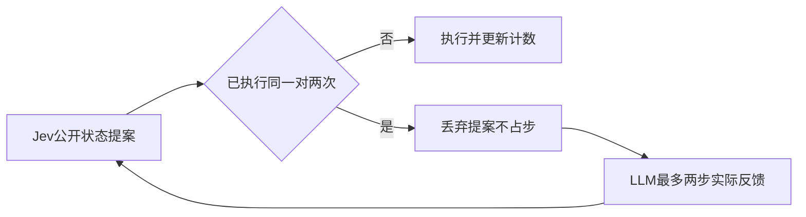
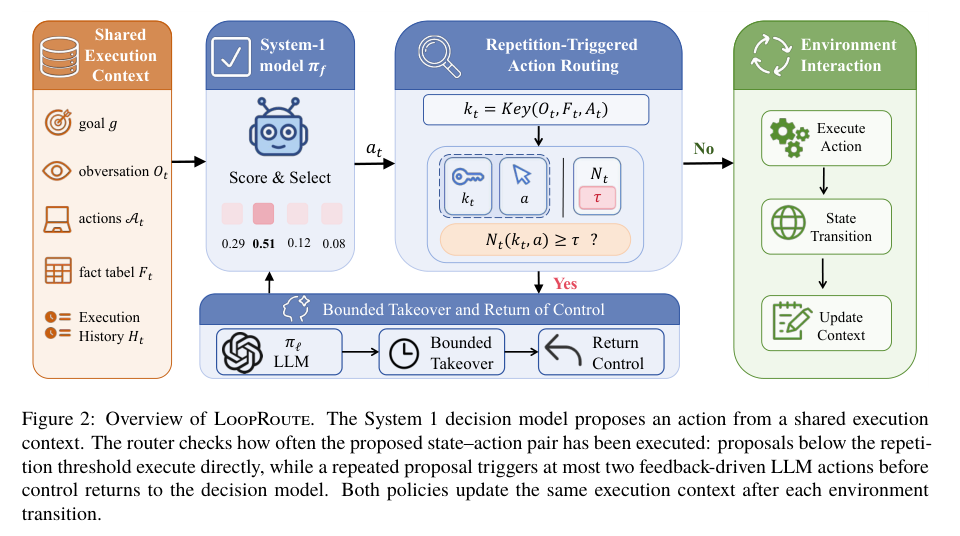

# LoopRoute：在重复执行前拦截，让LLM只接管两步

[English](README-en.md)

> **component_only / l1_mechanism；不是模型或Agent能力复现。** 完整实验成本过高，不复现（审查 DONE）；不作为Evolve晋级证据。

## 论文信息

| 字段 | 内容 |
| --- | --- |
| 论文链接 | [Stop Going in Circles:Loop-Triggered Routing for System 1 Decision Agents](https://arxiv.org/abs/2611.25363v1)；[固定v1 PDF](https://arxiv.org/pdf/2611.25363v1) |
| 一作机构 / 公司 / 学校 | Zeming Yu，Sichuan University |
| 首次公开日期 | **2026-11-19 02:01:59 UTC**；11月20日公告/审查不等于首发 |
| 原作者代码 | 固定v1及本轮核对来源未发现可核验的论文专用公开方法源码；不把引用依赖算开源。 |
| 本地 Adapter / key | `looproute`；`adapter=null`，未接入Evolve |
| 本地复现代码 | `src/auto_research/system_one/looproute.py` |

## 原始论文总结

### 背景与主要改动

System One决策模型能快速选动作，但局部选择正确不保证长任务完成。LoopRoute默认把控制权交给冻结Jev；只有同一公开状态下的同一动作已经执行两次，才拦截第三次提案，让LLM按实际环境反馈接管最多两步，然后无额外恢复测试地交回Jev。后续再次卡住可再次接管。

状态key不含不断增长的history或step。ALFWorld用已确认事实和排序后的可行动作；MapReader用当前动作回应、房间描述和inventory；TextWorld用房间、inventory和候选ID到命令映射。ALFWorld只累计决策模型执行，新事实或接管结束会清空；另外两者累计两种policy的执行并保持到episode结束。被拦截提案既不占环境步，也不更新计数。

### 架构与流程



<!-- paper-figure:start -->
### 原论文关键图



固定v1 PDF第4页Figure 2及原图注；仅裁留白和无关正文，未改科学内容。图片来自[原论文](https://arxiv.org/pdf/2611.25363v1#page=4)，版权归原作者所有；不是本地结果。[资产来源](assets/provenance.json)。
<!-- paper-figure:end -->

### 核心公式

$$
r_t=\mathbf1[N_t(k_t,\hat a_t)\ge2],\qquad a_t=\begin{cases}\pi_\ell(x_t),&b_t>0\ \mathrm{or}\ r_t=1,\\\pi_f(x_t),&\mathrm{otherwise},\end{cases}\qquad B=2.
$$

### 论文离线与线上效果

原文在ALFWorld134题、MapReader100题、Cooking100题及7个LLM上报告相对独立Jev的平均成功率增益21.0%、60.1%、30.1%；这里不是与全LLM策略相比。全LLM仍可能更准：GPT-6-Astra Cooking为100/100，路由为83/100。时间统计是累计API请求时间，不是端到端wall-clock；部分split参与早期探索，原文承认不是完全未触碰的开发外测试。未报告生产A/B。

## 本地复现

### 数据协议与代码映射

本地执行公开状态key、pending decision/实际执行分离、第三次提案拦截、准确两步接管及各benchmark计数规则。只接受显式公开字段，不接收gold、奖励或成功标签；new_information由可信外部ALFWorld适配器提供，本地不假装语义核实事实。没有Jev/LLM backend、benchmark环境或实际API请求；控制轨迹只证明路由规则，不证明任务成功率。

```bash
PYTHONPATH=src python -c 'from auto_research.system_one.looproute import diagnostic; print(diagnostic(42))'
PYTHONPATH=src python -m pytest tests/test_nov20_agent_components.py -q
```

本轮统一冻结源码后由批次runner生成[三种子CPU诊断](metrics/component-cpu-seeds42-44.json)；合成控制值不是任务成功率。

### 结果、负控与边界

负控区分相同动作但不同状态、未执行提案和真实执行；拒绝未提交transition就再次route，防止重试被当执行。测试ALFWorld不计LLM动作、接管结束清空，以及MapReader/TextWorld计两种动作且不清空。终止立即结束接管；共享key拒绝history/step/gold附加字段。

同主题实读对照：[foundation-models:selective-reasoning](../2610.19644-selective-reasoning/README.md)。Selective Reasoning依据共享读出、benefit gate和答案分布确定性，决定何时生成/读取/停止推理；LoopRoute依据真实环境状态-动作复现，决定是否把控制权短暂交给另一policy。前者的高certainty不代表环境已进展，后者的未重复也不保证动作正确。

### 高成本完整实验

完整矩阵包含334任务、7个前沿LLM、全控制/路由比较、六个额外决策模型与多组消融，需真实Jev/API和多环境长rollout。单卡不能等价替代这些服务及调用费用，因此完整实验高成本不跑；只执行秒级CPU路由核，不下载模型，不调用付费API。 **成本过高，不复现（审查 DONE）**。此终态不自动重试、不进入完整实现队列，不阻塞其他交付；低成本组件通过不证明完整论文效果。
